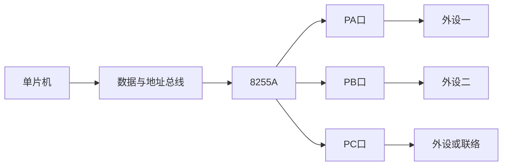

# 可编程并行接口芯片扩展（8255A等）

## 为什么需要 8255A

MCS-51 的 P0～P3 口数量有限，P0、P2 还常承担地址/数据总线，P3 有第二功能。需要同时连接键盘、显示器、打印机、开关量等外设时，可用 **8255A 可编程并行接口芯片**扩展 I/O。它提供 **PA、PB、PC 三个 8 位并行口**，通过软件设置工作方式，比用锁存器、缓冲器搭接口更灵活。

## 内部结构与寻址

8255A 与 CPU 相连的主要信号有：$D_0\sim D_7$、$\overline{RD}$、$\overline{WR}$、$\overline{CS}$、$A_1,A_0$ 和 RESET。单片机常把 $A_1,A_0$ 接地址线，用 $\overline{CS}$ 参加片选译码。

| $A_1A_0$ | 选中对象 | 典型用途 |
|---|---|---|
| 00 | PA 口 | 输入/输出数据 |
| 01 | PB 口 | 输入/输出数据 |
| 10 | PC 口 | 数据或联络信号 |
| 11 | 控制口 | 写控制字，不能当数据口 |

> [!IMPORTANT]
> 8255A 的“控制口”只用于写方式控制字或 PC 置位/复位控制字；==读写 PA、PB、PC 必须访问各自端口地址==。



## 三种工作方式

| 方式 | 可用端口 | 特点 |
|---|---|---|
| 方式 0：基本输入/输出 | PA、PB、PC | 无固定联络信号，最常用 |
| 方式 1：选通输入/输出 | PA、PB | PC 的部分线自动作选通、应答等联络信号 |
| 方式 2：双向选通 | 仅 PA | PA 双向传送，PC 提供联络信号 |

方式控制字写入控制口，最高位 $D_7=1$。其中 PA 与 PC 高 4 位为一组，PB 与 PC 低 4 位为一组。若只需把 PC 某一位单独置 1 或清 0，则写 **PC 置位/复位控制字**，此时 $D_7=0$，$D_3D_2D_1$ 选择位号，$D_0$ 决定置位或复位。

> [!WARNING]
> 两种控制字都写入同一个控制口，靠 $D_7$ 区分：$D_7=1$ 是方式设置，$D_7=0$ 是 PC 位操作。==PC 位操作不会改变其他 PC 引脚==，也不要把它当成整个 PC 口输出数据。

## 初始化与访问步骤

先根据外设方向确定各口输入/输出，再形成方式控制字，最后访问数据口：

```c
#define PA   XBYTE[0x7FFC]
#define PB   XBYTE[0x7FFD]
#define PC   XBYTE[0x7FFE]
#define CTRL XBYTE[0x7FFF]

CTRL = 0x90;      /* PA方式0输入，PB、PC方式0输出 */
x = PA;           /* 读PA */
PB = y;           /* 写PB */
CTRL = 0x0F;      /* PC7置1：D7=0，位号111，D0=1 */
```

这里采用线选法，假设未参与译码的高位地址使片选有效，且 $A_1,A_0$ 分别接地址总线的 $A_1,A_0$，所以四个地址依次相差 1。若接线或译码不同，地址必须重新计算。

## 一个完整的控制字例子

要求：PA 工作于方式 0、输入；PB 工作于方式 0、输出；PC 高 4 位输出，PC 低 4 位输入。

方式控制字各位为：

| 位 | $D_7$ | $D_6D_5$ | $D_4$ | $D_3$ | $D_2$ | $D_1$ | $D_0$ |
|---|---|---|---|---|---|---|---|
| 含义 | 方式标志 | PA 方式 0 | PA 输入 | PC 高输出 | PB 方式 0 | PB 输出 | PC 低输入 |
| 取值 | 1 | 00 | 1 | 0 | 0 | 0 | 1 |

因此控制字为 $10010001B=91H$，初始化写 `CTRL = 0x91;`。

> [!TIP]
> 解题按“端口地址 → 工作方式 → 输入输出方向 → 控制字”顺序写。特别注意：==输入/输出方向由控制字决定，不是由外设名称决定==；方式 1、2 中 PC 的联络线也不能再随意当普通 I/O 使用。

## 与相近扩展方法的区别

| 方法 | 优点 | 局限 |
|---|---|---|
| 锁存器/三态缓冲器扩展 | 电路简单、成本低 | 功能固定，方向和联络不灵活 |
| 8255A 并行扩展 | 三个口、方式可编程、支持联络 | 占地址空间，需正确初始化 |
| 串口扩展 I/O | 节省引脚、连线少 | 速度及时序方式不同，不属于并行接口 |

8255A 是**并行接口芯片**，不要与 8251 串行接口、8155（并行口加定时器/存储器）混淆；考试若给具体接线图，应以图中片选和地址线连接为准。
