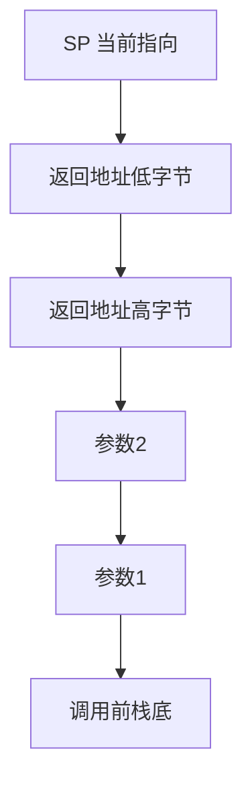

# 子程序设计与参数传递

## 子程序设计与参数传递

调用子程序时，CPU 通过 `LCALL` / `ACALL` 把返回地址压入堆栈，再跳转到子程序入口；执行到 `RET` 时从堆栈弹出返回地址。这条机制解决了“怎么去、怎么回”的问题，但另一个问题随之而来：**数据怎么在调用者和子程序之间流动？**

假设要写一个“求单字节无符号数平方”的子程序。调用者手上有自变量 $x$，子程序算完要交出 $x^2$。如果双方没有约定好数据的“交接方式”，子程序要么拿不到输入，要么算完结果没人知道放在哪。这种调用者与子程序之间的数据交接，就是**参数传递**。

MCS-51 汇编语言中主要有三种参数传递方法：**寄存器传递、固定存储单元传递、堆栈传递**。

### 寄存器传递

把参数放在工作寄存器（`R0`～`R7`）、累加器 `A` 或数据指针 `DPTR` 中。这是最常用的方式，速度快、代码简洁。

```asm
; 子程序 SQUARE：求 A 中无符号数的平方
; 入口：A = x（x ≤ 15，保证结果 ≤ 255）
; 出口：B = 结果高字节，A = 结果低字节
SQUARE:
    MOV  B, A
    MUL  AB        ; BA = A × B
    RET

; 调用：
    MOV  A, #12
    LCALL SQUARE   ; 结果：B=00H，A=90H（144）
```

> [!IMPORTANT]
> 寄存器传递的核心约定是：==哪几个寄存器放什么参数、哪个寄存器放返回值，必须在子程序注释里写清楚==。调用者不按约定放置，结果必然错误。

### 固定存储单元传递

在内部 RAM（如 `30H`～`7FH`）中划定固定单元存放输入参数和输出结果。适合参数较多、寄存器不够用的场合。

```asm
; 子程序 ADD2：计算 (31H)(30H) + (33H)(32H)，结果存 (35H)(34H)
; 入口：30H=加数1低字节，31H=加数1高字节
;       32H=加数2低字节，33H=加数2高字节
; 出口：34H=结果低字节，35H=结果高字节
ADD2:
    MOV  A, 30H
    ADD  A, 32H
    MOV  34H, A      ; 低字节相加
    MOV  A, 31H
    ADDC A, 33H
    MOV  35H, A      ; 高字节带进位相加
    RET
```

> [!WARNING]
> 固定存储单元传递的隐患在于“固定”二字：==子程序和调用者之外的代码也可能误用这些单元==，一旦发生冲突（例如中断服务程序也用到 `30H`），数据会被悄悄破坏。较复杂的程序会划出一块“参数区”并统一管理。

### 堆栈传递

调用前先把参数压入堆栈，子程序从堆栈中取出。**MCS-51 的难点在于：调用时返回地址也压在堆栈里**，子程序不能直接用 `POP` 取参数，否则会把返回地址弹出来丢掉。

正确做法：用堆栈指针 `SP` 加偏移量间接访问。设调用前压入了 2 个参数字节，执行 `LCALL` 时又压入 2 字节返回地址，此时堆栈布局如下：



子程序中要做的是：先保存当前 `SP`，再按偏移量取参数。假设参数为 1 字节，返回地址为 2 字节，则参数位于 `SP - 2` 处（`LCALL` 后 `SP` 指向返回地址高字节的上一格）。

```asm
; 子程序 GETPARAM：从堆栈中取 1 字节参数，结果加 1 后仍放回堆栈原位置
; 入口：堆栈中距栈顶偏移 -2 处为参数
GETPARAM:
    MOV  R0, SP      ; R0 = 当前 SP
    DEC  R0
    DEC  R0          ; R0 指向参数所在单元
    MOV  A, @R0      ; 取出参数
    INC  A
    MOV  @R0, A      ; 放回原位置
    RET
```

> [!CAUTION]
> 堆栈传递最容易出错的地方是偏移量算错。==偏移量 = 返回地址长度（LCALL 为 2）+ 参数在栈中的相对位置==。少减一个字节就会把返回地址当成数据改掉，程序跑飞。课后务必自己画一次堆栈图核实。

### 三种方式对比

| 方式 | 适用场景 | 优点 | 缺点 |
|---|---|---|---|
| 寄存器传递 | 参数少（≤3 个） | 速度最快，代码最短 | 寄存器数量有限 |
| 固定单元传递 | 参数较多 | 直观易读 | 占用 RAM，易冲突 |
| 堆栈传递 | 递归、可重入、参数动态变化 | 无固定单元占用，支持重入 | 偏移量易算错，代码繁琐 |

> [!NOTE]
> C51 编译器在函数调用时混合使用寄存器（`R7`～`R0` 传前几个参数）和固定存储单元，并结合堆栈管理局部变量。理解汇编层的三种方式，有助于理解 C 代码编译后的行为以及为何有的函数调用开销较大。

### 一个算对了的例子

写子程序 `MAX2`：从 `R0` 和 `R1` 中取两个无符号数，将较大者放入 `A`。

```asm
MAX2:
    MOV  A, R0
    CJNE A, 01H, NEXT   ; 注意：01H 是 R1 的地址（工作寄存器区 0）
NEXT:
    JNC  DONE           ; 若 R0 ≥ R1，A 已是较大值
    MOV  A, R1          ; 否则 R1 更大
DONE:
    RET
```

调用：

```asm
    MOV  R0, #35
    MOV  R1, #78
    LCALL MAX2          ; 结果 A = 78（4EH）
```

检查：`CJNE A, 01H, NEXT` 比较 `A`（35）与 `R1`（78），不等则跳转，且 35 < 78 使进位标志 `C = 1`；`JNC DONE` 不跳，执行 `MOV A, R1`，最终 `A = 78`。正确。

> [!TIP]
> 比较两个无符号数大小时，`CJNE` 配合 `JNC`（或 `JC`）是经典写法。==CJNE 会影响进位标志 C：当目的操作数 < 源操作数时 C = 1==，这是判断大小的关键依据。
