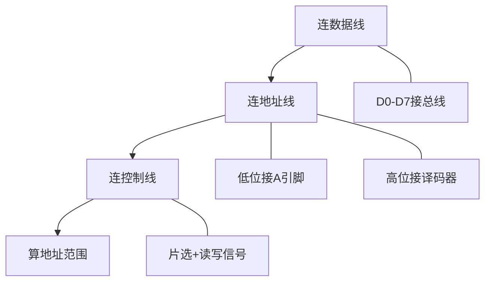

# 程序存储器与数据存储器扩展

当单片机内部资源不够用时怎么办？比如 8051 内部只有 4KB ROM 和 128B RAM，如果程序代码或运行数据超出这个范围，就必须向外部“借”空间——这就是**程序存储器与数据存储器扩展**。

## 为什么要区分两类扩展

> [!IMPORTANT]
> 8051 采用==哈佛结构==，程序存储器（ROM）与数据存储器（RAM）地址空间相互独立，各 64KB。

这意味着 `0000H` 既可以是 ROM 地址，也可以是 RAM 地址。CPU 靠不同的控制信号来区分访问对象：读 ROM 用 $\overline{PSEN}$，读写 RAM 用 $\overline{RD}$ / $\overline{WR}$。

| 对比项 | 程序存储器（ROM）扩展 | 数据存储器（RAM）扩展 |
| :--- | :--- | :--- |
| **典型芯片** | 2764、27128 | 6264、62128 |
| **读控制信号** | $\overline{PSEN}$ | $\overline{RD}$ |
| **写控制信号** | 无（只读） | $\overline{WR}$ |
| **访问指令** | `MOVC` | `MOVX` |

## 怎么做：三步完成扩展

想一想：要让 CPU 正确访问外部芯片，需要解决哪三个问题？——连数据线传信息、连地址线定单元、连控制线发命令。

1. **数据线连接**：芯片的 $D_0 \sim D_7$ 直接挂到系统数据总线（P0 口经锁存器后提供）。
2. **地址线连接**：
   - **低位地址线**：芯片地址引脚 $A_i$ 的个数决定容量。若芯片有 $n$ 根地址线，则容量为 $2^n$ 字节。这些引脚接 P0 口（经 74LS373 锁存的低 8 位）。
   - **高位地址线**：P2 口提供高 8 位地址。剩余的高位用于产生==片选信号 $\overline{CS}$==，常用 74LS138 译码器实现。
3. **控制线连接**：ROM 的 $\overline{OE}$ 接 $\overline{PSEN}$；RAM 的 $\overline{OE}$ 接 $\overline{RD}$，$\overline{WE}$ 接 $\overline{WR}$。

## 算对了的例子

**题目**：用一片 8KB 的 6264（RAM）扩展外部数据存储器，其 $\overline{CS_1}$ 接 74LS138 的 $\overline{Y_2}$ 输出端。已知 138 的输入 C、B、A 分别接 P2.7、P2.6、P2.5，求该 RAM 的地址范围。

**解题步骤**：

1. **确定片内地址位数**：6264 容量 8KB = $2^{13}$B，需 13 根地址线 $A_{12} \sim A_0$。
   - $A_7 \sim A_0$ 由 P0 口提供；
   - $A_{12} \sim A_8$ 由 P2.4 ~ P2.0 提供。
2. **确定片选条件**：选中 $\overline{Y_2}$，即 138 输入 CBA = 010，对应 P2.7 P2.6 P2.5 = 010。
3. **拼出完整地址**：

$$
\underbrace{P2.7\ P2.6\ P2.5}_{0\ 1\ 0}\ \underbrace{P2.4 \sim P2.0}_{片内高位}\ \underbrace{P0.7 \sim P0.0}_{片内低位}
$$

- **起始地址**（片内全 0）：`0100 0000 0000 0000B` = `4000H`
- **结束地址**（片内全 1）：`0101 1111 1111 1111B` = `5FFFH`

> [!TIP]
> 口诀：“**容量定低位，译码定高位，全0是首址，全1是末址**”。

## 常见的坑

> [!WARNING]
> 地址重叠（镜像）：如果高位地址线未全部参与译码（如 P2.7 悬空），会导致多个不同地址指向同一物理单元，引发系统混乱。考试设计题务必让所有高位都参与译码或明确固定电平。

> [!CAUTION]
> 混淆 $\overline{PSEN}$ 与 $\overline{RD}$！用 `MOVX` 指令只能读 RAM，若错把 ROM 的 $\overline{OE}$ 接到 $\overline{RD}$，将永远读不到程序代码。

> [!NOTE]
> P0 口是==分时复用==的：先输出低 8 位地址（需用 74LS373 锁存），再作为数据线传输。而 P2 口在扩展期间始终输出高 8 位地址，无需锁存。
