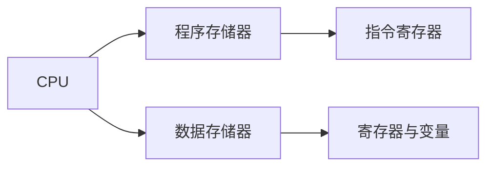
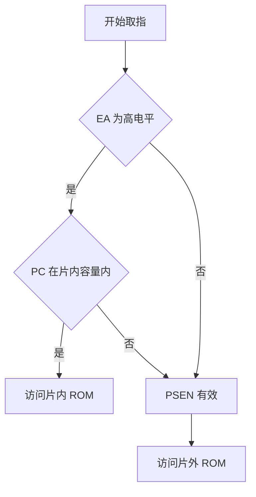

# MCS-51存储器组织（程序存储器与数据存储器）

## 存储器组织与寻址方式

MCS-51 单片机采用 **哈佛结构**：程序存储器和数据存储器彼此独立，拥有各自的地址空间和控制信号。前者用于存放程序、常数及表格，后者用于存放运行过程中的变量、堆栈和数据。

这种结构使取指与数据读写可以采用不同信号，避免二者相互干扰。MCS-51 典型型号具有 **64 KB 程序存储器空间**和 **256 字节数据存储器空间**；无片内程序存储器的型号，程序必须存放在外部 ROM 中。

## 程序存储器

程序存储器用于存放指令、常数和表格，统一按字节编址，地址范围为 $0000H\sim 0FFFFH$，最多 $64\text{ KB}$。CPU 通过程序计数器 PC 保存下一条待取指令的地址，取出的指令代码送入指令寄存器 IR，再由控制器译码执行。

访问片内还是片外 ROM，主要由 $\overline{EA}$ 引脚决定：

| $\overline{EA}$ | 访问方式 |
|---|---|
| 接高电平 | 优先访问片内 ROM；PC 超出其容量时，自动访问片外 ROM |
| 接地 | 始终从片外 ROM 取指 |

访问外部程序存储器时，$\overline{PSEN}$ 产生低电平有效脉冲，作为外部 ROM 的读选通信号；访问片内 ROM 时不需要该信号。

> [!IMPORTANT]
> $\overline{EA}$ 是“外部访问控制”信号，但它接高电平时表示优先使用片内程序存储器；真正访问片外 ROM 时，$\overline{PSEN}$ 才会有效。

## 数据存储器

数据存储器包括内部 RAM 和外部 RAM。内部 RAM 用于存放工作寄存器、位寻址区、用户寄存器区及堆栈；外部 RAM 用于扩展运行数据空间。

外部数据存储器以 16 位寄存器 DPTR 作为地址指针，可访问 $64\text{ KB}$；也可使用 8 位地址指针访问低 $256$ 字节。其控制信号为：

- P3.6：$\overline{WR}$，外部 RAM 写选通信号；
- P3.7：$\overline{RD}$，外部 RAM 读选通信号。

> [!TIP]
> 记忆控制信号：$\overline{PSEN}$ 管 ROM，$\overline{RD}$、$\overline{WR}$ 管 RAM。

## 内部 RAM 的分段

MCS-51 内部 RAM 为 $128$ 字节，地址 $00H\sim 7FH$；MCS-52 为 $256$ 字节，地址 $00H\sim FFH$。其中 $00H\sim 1FH$ 的 32 字节安排给四组工作寄存器，每组 8 个字节，由 PSW 中的 RS1、RS0 选择当前组。

| 地址范围 | 功能 |
|---|---|
| $00H\sim 1FH$ | 四组工作寄存器区 |
| $20H\sim 2FH$ | 位寻址区，共 128 位 |
| $30H\sim 7FH$ | 直接寻址与间接寻址的数据区 |
| $80H\sim FFH$ | MCS-52 扩展区 |

位寻址区中的每个位也有独立地址。位地址采用 $00H\sim 7FH$ 编码，与字节地址 $20H\sim 2FH$ 并不表示同一套地址。例如，字节 $20H$ 的最低位对应位地址 $00H$。

> [!WARNING]
> “位地址 $20H$”与“字节地址 $20H$”属于不同地址空间，不能混用。

## 一个算对的例子

假设某扩展型单片机只有 $2\text{ KB}$ 片内 ROM，地址为 $0000H\sim 07FFH$，且 $\overline{EA}$ 接高电平：

- 当 $PC=0100H$ 时，地址未超过片内容量，CPU 从片内 ROM 取指；
- 当 $PC=0800H$ 时，CPU 自动访问片外 ROM；
- 当 $PC=FFFFH$ 时，同样访问片外 ROM，因为程序地址空间上限为 $0FFFFH$。

对应关系为：

$$
0000H\sim 07FFH \rightarrow \text{片内 ROM},\qquad
0800H\sim 0FFFFH \rightarrow \text{片外 ROM}
$$

若要把程序装入外部 ROM，应将 $\overline{EA}$ 接地，CPU 才会从 $0000H$ 开始始终访问片外 ROM。
