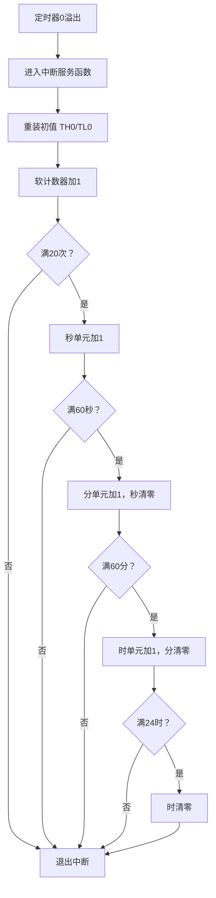

# 定时器0中断服务程序（系统核心时钟程序）
在“市电定时开关”这个实例里，系统需要一个**最小计时单位**。单片机本身没有“时钟芯片”时，怎么知道时间过了多久？答案是：靠内部定时器配合中断，由软件累计出一个时钟。

### 为什么需要它

MCS-51 的定时器是硬件计数器，每隔固定时间（由初值和机器周期决定）溢出一次，触发中断。CPU 在中断服务程序里“数数”——每进一次中断就给某个变量加 1，加到指定值就表示过了 1 秒、1 分钟、1 小时。这就是一个==软件实现的系统时钟==，为定时开关的“何时开、何时关”提供时间基准。

> [!IMPORTANT]
> 定时器/计数器本身只负责产生**等间隔中断**，真正的时间累计（秒、分、时）是中断服务程序里用软件计数器完成的。

### 定时时间怎么算

设系统晶振频率 $f_{osc}=12\,\text{MHz}$，则机器周期：

$$
T_{cy}=\frac{12}{f_{osc}}=1\,\mu s
$$

若使用方式 1（16 位定时器），最大计数值 $2^{16}=65536$，最长定时约 $65.536\,\text{ms}$。要得到 50 ms 的定时中断，计算初值：

$$
\text{初值}=2^{16}-\frac{50\,\text{ms}}{1\,\mu s}=65536-50000=15536=3CB0H
$$

即 $TH0=3CH$，$TL0=0B0H$。每 50 ms 中断一次，**连续 20 次**就是 1 秒。

### 中断服务程序的结构



对应的代码骨架（C51）：

```c
unsigned char count50ms = 0;
unsigned char sec = 0, min = 0, hour = 0;

void Timer0_ISR(void) interrupt 1
{
    TH0 = 0x3C;        // 重装初值
    TL0 = 0xB0;

    count50ms++;
    if (count50ms >= 20) {
        count50ms = 0;
        sec++;
        if (sec >= 60) {
            sec = 0;
            min++;
            if (min >= 60) {
                min = 0;
                hour++;
                if (hour >= 24) {
                    hour = 0;
                }
            }
        }
    }
}
```

> [!TIP]
> 记忆口诀：**“初值装好别忘重装，50ms 数到 20 就是一秒，秒分时层层进位”**。

### 和查询方式的区别

| 比较项 | 查询方式 | 中断方式 |
|---|---|---|
| CPU 参与 | 反复查询 TF0，占用 CPU | 溢出时自动进入 ISR，不占用主循环 |
| 实时性 | 差，取决于查询间隔 | 好，响应及时 |
| 系统时钟场景 | 几乎不用 | ==标准做法== |

### 常见的坑

> [!WARNING]
> 方式 1（16 位）在溢出后不会自动重装初值，**必须在中断服务程序里手动重装 TH0 和 TL0**。如果忘记重装，每次定时会变成 $65536\,\mu s$，时钟就错了。

> [!CAUTION]
> 进入中断服务程序后，若没有及时重装初值并清零 TF0（方式 1 下硬件自动清 TF0，但软件重装仍必要），定时误差会逐次累积。

### 一个算对了的例子

某系统 $f_{osc}=6\,\text{MHz}$，用定时器 0 方式 1 产生 10 ms 定时中断。求初值，并说明如何得到 1 秒时基。

**解**：
机器周期 $T_{cy}=12/(6\times10^6)=2\,\mu s$。

需要计数的个数：$N=10\,\text{ms}/2\,\mu s=5000$。

初值：

$$
65536-5000=60536=EC78H
$$

所以 $TH0=0ECH$，$TL0=0x78H$。每 10 ms 中断一次，软件计数器计满 $100$ 次即为 1 秒。

> [!NOTE]
> 初值计算的核心是“**定时时长 ÷ 机器周期 = 需要计数的个数**”，再用 $2^{16}$（方式 1）减去这个个数。晶振频率减半时，同样时长需要的计数个数也减半，初值相应变大。
