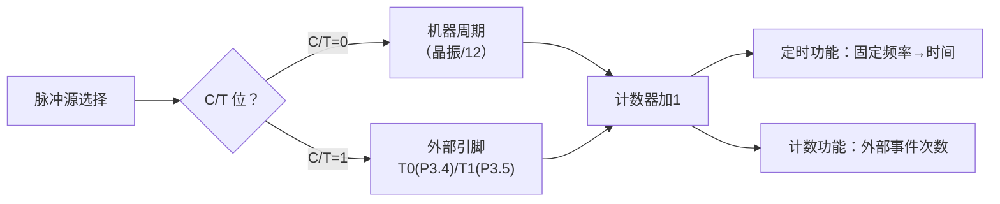

# 定时器/计数器结构与工作原理

## 定时器/计数器的结构与工作原理

定时器/计数器是 MCS-51 单片机中最常用的片上外设之一。你可能会问：它到底是"定时"还是"计数"？

答案是：==本质都是计数，区别仅在于计数对象不同==。



- 当计数对象是**机器周期**（晶振频率的 1/12）时，每个周期时间固定，计数值 × 机器周期 = 定时时长，这就是**定时器**。
- 当计数对象是**外部引脚输入的脉冲**（P3.4 为 T0、P3.5 为 T1）时，统计的是外部事件发生的次数，这就是**计数器**。

> [!IMPORTANT]
> 无论定时还是计数，MCS-51 的 T0/T1 都只能做**加法（递增）计数**，计满溢出后从 0 重新开始。

### 核心 SFR：TMOD 与 TCON

要想让定时器/计数器工作，需要配置两个特殊功能寄存器：

| 寄存器 | 字节地址 | 作用 |
|--------|----------|------|
| TMOD | 89H | 设定工作方式（不可位寻址） |
| TCON | 88H | 控制启停 + 溢出标志（可位寻址） |

**TMOD 的位结构**（高 4 位控制 T1，低 4 位控制 T0）：

| 位 | D7 | D6 | D5 | D4 | D3 | D2 | D1 | D0 |
|---|----|----|----|----|----|----|----|----|
| 名称 | GATE | C/T | M1 | M0 | GATE | C/T | M1 | M0 |

- `C/T`：0 = 定时，1 = 计数
- `M1 M0`：工作方式选择（00→方式0 13位 / 01→方式1 16位 / 10→方式2 8位自动重装 / 11→方式3 双8位仅限T0）
- `GATE`：门控位 —— 0 时只需软件置位 TRx 即可启动；1 时还需对应 `INTx` 引脚为高电平

> [!WARNING]
> TMOD 不能位寻址，只能整体赋值，例如 `MOV TMOD, #01H`。而 TCON 可以位寻址，用 `SETB TR0` 即可单独启动 T0。

**TCON 的高 4 位**：

| 位 | D7 | D6 | D5 | D4 |
|---|----|----|----|----|
| 名称 | TF1 | TR1 | TF0 | TR0 |

- `TRx`：运行控制位（1 = 启动，0 = 停止）
- `TFx`：溢出标志位（计满溢出时硬件置 1，中断响应后硬件自动清 0）

> [!NOTE]
> `TFx` 也可被程序查询。如果不使用中断而是用查询方式，记得手动清 0。

### 四种工作方式速览

| 方式 | M1 M0 | 位数 | 特点 |
|------|-------|------|------|
| 0 | 0 0 | 13位 | THx 高 8 位 + TLx 低 5 位，兼容老产品 |
| 1 | 0 1 | 16位 | THx 8 位 + TLx 8 位，最常用 |
| 2 | 1 0 | 8位 | TLx 计数溢出后 THx 自动重装初值 |
| 3 | 1 1 | 双8位 | 仅 T0 可用，拆成两个独立 8 位计数器 |

> [!TIP]
> 需要精确定时、避免反复软件装初值时，用方式 2（自动重装）；需要长定时时，用方式 1（16 位）。

### 52 系列增强：定时器/计数器 T2

MCS-52 系列额外增加了一个 16 位 T2（TH2 + TL2），配有自己的控制寄存器 T2CON（0C8H，可位寻址）和捕获/重装寄存器 RCAP2H、RCAP2L。

T2 的额外能力：
- **捕获功能**：T2EX（P1.1）负跳变时，当前计数值被自动锁存到 RCAP2H/RCAP2L
- **自动重装**：溢出或 T2EX 负跳变时，RCAP2H/RCAP2L 的 16 位值自动装入计数器
- **波特率发生器**：当 T2CON 中 RCLK 或 TCLK 置位时，T2 为串行口提供时钟
- **可编程方波输出**：T2MOD 中 T2OE 置 1 时，P1.0 可输出 50% 占空比方波

### 算对了的例子

> 已知晶振 12MHz，要求 T0 工作在方式 1 下定时 50ms，计算 TH0 和 TL0 初值。

**解析**：
- 晶振 12MHz → 机器周期 = $12 / 12\text{MHz} = 1\mu\text{s}$
- 方式 1 是 16 位计数器，最大计数值 = $2^{16} = 65536$
- 定时 50ms = 50000μs，需要计 50000 个数
- 初值 = $65536 - 50000 = 15536 = 3CB0\text{H}$
- TH0 = 3CH，TL0 = 0B0H

```asm
MOV  TMOD, #01H   ; T0 方式1（16位定时）
MOV  TH0,  #3CH   ; 装高字节
MOV  TL0,  #0B0H  ; 装低字节
SETB TR0          ; 启动 T0
```

> [!CAUTION]
> 方式 0 里 TLx 只用低 5 位（bit0 ~ bit4），计算初值时注意 THx 和 TLx 的"13 位"不是连续存储，写法容易出错。多数场景直接选方式 1 更省心。
