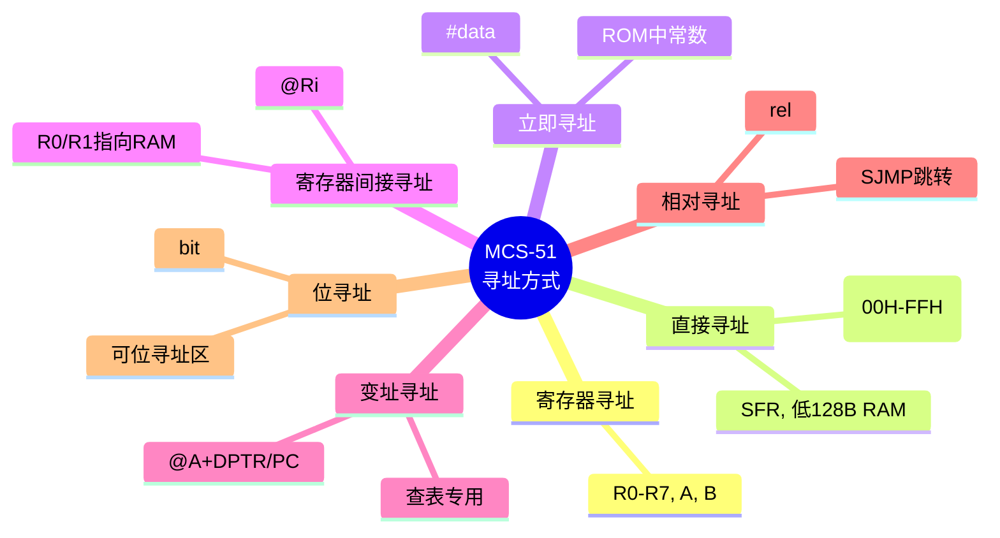

# MCS-51七种寻址方式

## MCS-51 七种寻址方式

寻址方式决定了 CPU 如何找到操作数。在 MCS-51 中，不同的存储空间（片内 RAM、SFR、片外 RAM/ROM）对应不同的“钥匙”。理解这七种方式，是编写高效汇编代码的基础。

> [!IMPORTANT]
> ==核心结论==：寻址方式由指令助记符隐含决定，无需额外标记。关键在于区分**数据在哪里**以及**如何访问**。



### 为什么需要多种寻址？

试想：若所有数据都通过固定地址访问，程序将极其僵化。**寄存器寻址**速度最快，适合频繁运算；**立即寻址**用于加载常数；而**间接寻址**则像指针，能动态访问数据块。

### 七种方式详解与辨析

| 寻址方式 | 指令示例 | 操作数来源 | 适用空间 |
| :--- | :--- | :--- | :--- |
| **寄存器** | `MOV A, R0` | 工作寄存器 R0-R7 | 片内 RAM |
| **直接** | `MOV A, 30H` | 地址 30H 单元的内容 | 片内 RAM, SFR |
| **立即** | `MOV A, #30H` | 指令中的常数 30H | 程序存储器 ROM |
| **间接** | `MOV A, @R0` | R0 内容作地址指向的单元 | 片内 RAM (低128B) |
| **变址** | `MOVC A, @A+DPTR` | PC/DPTR + A 偏移量 | 程序存储器 ROM |
| **相对** | `SJMP rel` | PC + rel | 程序存储器 ROM |
| **位** | `SETB 20H.0` | 可位寻址区的某一位 | 片内 RAM (20H-2FH), SFR |

> [!TIP]
> **记忆口诀**：寄存快，直接准，立即常数存 ROM。间接灵活指 RAM，变址查表不离宗。

### 常见坑与易混点

1.  **`#` 号的有无**：
    *   `MOV A, 30H`：把地址 30H 里的**值**给 A。
    *   `MOV A, #30H`：把常数 **30H** 给 A。
    *   ==漏写 `#` 是最高频错误==，导致逻辑完全错误。

2.  **间接寻址的范围限制**：
    *   `@R0` 和 `@R1` 只能访问片内 RAM 的低 128 字节（00H-7FH）。
    *   若要访问高 128 字节或片外 RAM，需使用 `MOVX` 指令配合 DPTR 或 R0/R1（视具体型号而定，标准 51 仅低 128B 支持 `@Ri` 间接寻址片内）。

3.  **变址寻址的唯一性**：
    *   仅用于 `MOVC` 指令，专门用于**查表**（如 LED 段码、波形数据）。

### 典型例题解析

**题目**：已知内部 RAM 中 `(30H)=55H`，`(55H)=AAH`。执行下列指令后，A 的内容是多少？
```assembly
MOV R0, #30H
MOV A, @R0
```

**解析步骤**：
1.  `MOV R0, #30H`：立即寻址。将常数 $30H$ 送入寄存器 $R0$。此时 $(R0) = 30H$。
2.  `MOV A, @R0`：寄存器间接寻址。以 $R0$ 的内容（$30H$）为地址，去取该地址单元的值。
3.  查询内存：地址 $30H$ 单元的内容是 $55H$。
4.  结果：$(A) = 55H$。

> [!WARNING]
> 若第二步写成 `MOV A, 30H`（直接寻址），结果也是 $55H$，但机制不同：前者是通过 $R0$ 间接指向，后者是直接访问地址。若 $R0$ 值改变，间接寻址的结果会变，而直接寻址不变。
