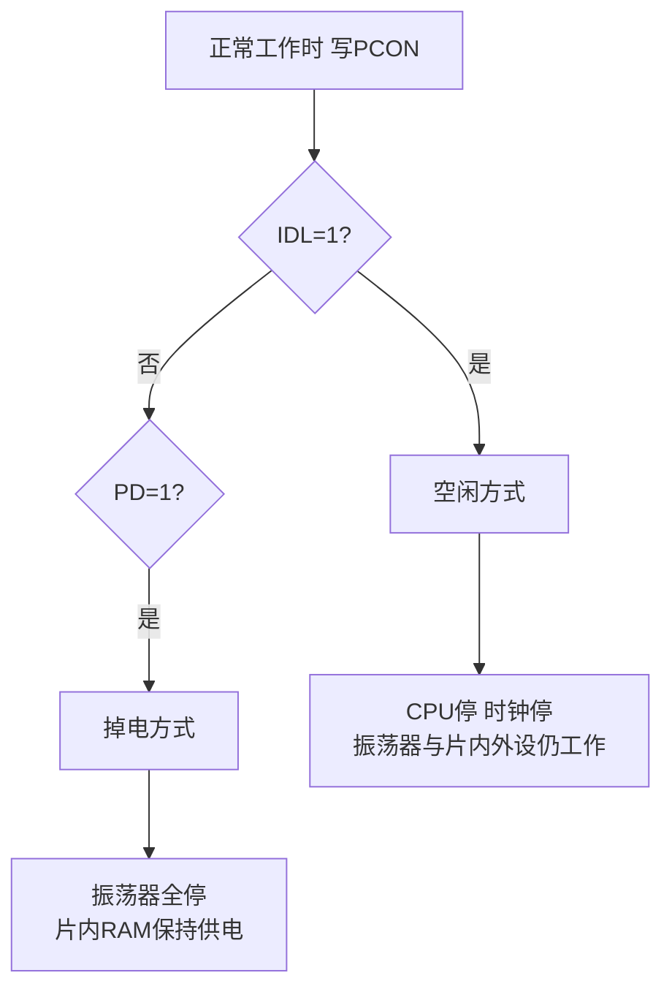

# MCS-51低功耗工作方式

## 低功耗工作方式

MCS-51 单片机设计了两种低功耗工作方式：==空闲方式（Idle）== 和 ==掉电方式（Power Down）==。这两种方式可以在不需要 CPU 持续工作时大幅降低系统功耗，特别适合电池供电的便携设备或需要长期值守的监测节点。

### 为什么需要低功耗方式

在很多嵌入式应用场景中，单片机并不是始终满负荷运行的。比如一个温度巡检仪，可能每隔几秒才采集一次数据，其余时间都在等待。如果 CPU 在此期间仍以正常模式空转，大量电能会白白消耗在无效的时钟驱动上。低功耗方式正是为了解决这个问题：**在空闲时段让 CPU 或整个芯片进入“休眠”，需要工作时再被“唤醒”**。

### 两种方式的本质区别

控制这两种方式的硬件核心是电源控制寄存器 **PCON**（地址 87H），其格式如下：

| D7 | D6 | D5 | D4 | D3 | D2 | D1 | D0 |
|---|---|---|---|---|---|---|---|
| SMOD | – | – | – | GF1 | GF0 | **PD** | **IDL** |

- **IDL (PCON.0)**：置 `1` 进入空闲方式。
- **PD (PCON.1)**：置 `1` 进入掉电方式。

> [!IMPORTANT]
> 若 PCON 中对 IDL 和 PD 两位同时置 `1`，则 **PD 优先**，单片机进入掉电方式。 

---

---

### 空闲方式

执行 `ORL PCON, #01H` 后，CPU 进入空闲状态：==CPU 停止工作，时钟被阻断，但片内振荡器仍在振荡==，时钟信号继续供给中断系统、定时器/计数器及串行口等片内外设。因此 CPU 的现场（PC、SP、PSW、各寄存器及片内 RAM）全部保持原状，引脚电平也维持不变。

**唤醒机制**只有两种：

1. **中断唤醒**：任何被使能的中断发出请求后，硬件自动将 IDL 位清零，CPU 退出空闲方式，先响应中断（若全局中断 EA 已置位），再返回原程序断点继续执行。
2. **复位唤醒**：硬件复位后 IDL 位被清零，但 CPU 从地址 `0000H` 重新开始执行，原程序断点丢失。

> [!TIP]
> 记忆口诀：**空闲不停外设，掉电只留内存**。

---

### 掉电方式

执行 `ORL PCON, #02H` 后，单片机进入掉电方式：==片内振荡器完全停止，整个芯片一切活动都中止，唯有片内 RAM 和特殊功能寄存器的内容被保持==（通常靠后备电池维持 Vcc 引脚电压）。

**唤醒机制**仅限：

- **硬件复位**：复位操作会重新启动振荡器，PCON 中的 PD 位被清零，但片内 RAM 中低于 80H 的单元内容可能因复位操作而改变，需谨慎处理。

> [!WARNING]
> 掉电方式下一切中断均失效，因为没有了时钟源，中断检测电路也无法工作。

---

### 一个算对了的例子

设单片机系统采用 12 MHz 晶振，正常运行时功耗约 50 mA。在空闲方式下，仅 CPU 时钟被阻断，功耗降为约 20 mA。现用于一个每 100 ms 采集一次温度、每次 CPU 实际工作 2 ms 的应用。

**计算**：
- 正常工作：100 ms × 50 mA = 5 mC（电荷量）
- 使用空闲方式：工作 2 ms × 50 mA + 空闲 98 ms × 20 mA = 0.1 + 1.96 = 2.06 mC

节电比例：$(5 - 2.06) / 5 \approx 58.8\%$。若改为掉电方式（通过外部定时器周期性复位唤醒，假定复位与启动耗时 0.5 ms，掉电功耗仅 5 μA 可忽略），则 2.5 ms × 50 mA = 0.125 mC，节电高达 97.5%。

---

### 常见误区

1. **误以为空闲方式下定时器也停了**：空闲方式仅切断 CPU 的时钟，定时器/计数器仍由片内振荡器驱动，可正常计数并在溢出时产生中断唤醒 CPU。
2. **掉电方式下想用中断唤醒**：掉电后振荡器停振，中断系统无法工作，只有硬件复位能唤醒。
3. **复位后误用 RAM 数据**：掉电方式唤醒后，复位操作可能破坏部分 RAM 内容，应在进入掉电前将关键数据保存到高 128B RAM 或外部非易失存储器，并在复位后检查 PD 标志再做恢复。

> [!CAUTION]
> 进入掉电方式前，务必先让所有执行完毕或停止的指令释放总线，并确保 Vcc 在后备电源下不会跌落到最低保持电压（通常 ≥ 2V）以下。
