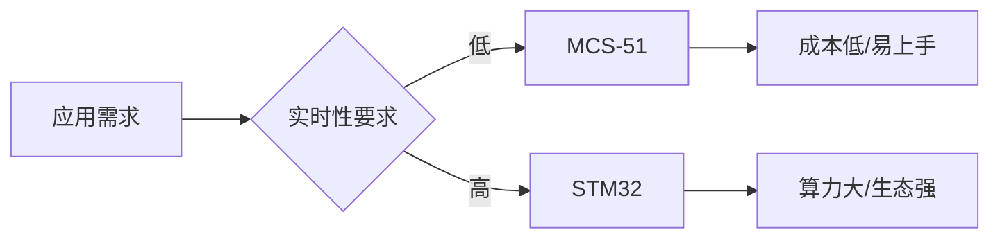

# 常用单片机系列简介（MCS-51、STM32等）

## 什么是常用单片机系列

单片机发展至第四阶段（1983~九十年代中期），Intel 公开了 MCS-51 内核，使其成为 ==8位单片机的工业标准==。与此同时，Motorola 6801、Zilog Z8 等早期架构逐渐退出主流，而以 AVR/PIC 为代表的 RISC 架构开始兴起。当前课程与工程实践中，最核心的两大体系为：

- **MCS-51 系列**：以 Intel 8051 为原型，Atmel、STC、TI 等厂商推出的兼容增强型单片机。
- **STM32 系列**：基于 ARM Cortex-M 内核的 32 位单片机，代表现代嵌入式系统的主流方向。

> [!IMPORTANT]
> MCS-51 是理解单片机体系结构的“语法基础”，STM32 是解决复杂工程的“实战工具”。南邮本课程以 MCS-51 原理为主线，STM32 为系统设计拓展。

## 为什么需要区分不同系列

如果所有单片机都一样，为何还要学习多个系列？因为 ==应用场景决定了架构选择==。MCS-51 采用 CISC 指令集与哈佛总线，外设集成度高但主频低；STM32 采用 RISC 指令集与多级流水线，算力强劲但开发门槛高。选型错误会导致资源浪费或性能瓶颈。

## 怎么做：核心参数对比与选型

掌握两大系列的关键差异，是进行系统设计的前提。下表总结了考试与工程中最高频的对比维度：

| 对比维度 | MCS-51 (增强型52) | STM32 (Cortex-M3/M4) |
| :--- | :--- | :--- |
| 数据总线宽度 | 8 位 | 32 位 |
| 指令集架构 | CISC (复杂指令) | RISC (精简指令) |
| 典型主频 | 12~35 MHz | 72~200+ MHz |
| 存储器结构 | 哈佛 (程序/数据分离) | 哈佛 (带 Cache 加速) |
| 开发生态 | Keil C51 / STC-ISP | Keil MDK / HAL库 / CubeMX |

> [!TIP]
> 记忆口诀：“51 八位经典稳，三二 ARM 性能狠；CISC 指令多而杂，RISC 流水快如风。”

## 和相近概念的区别

课件中提及的 Motorola 6801、Zilog Z8 属于 ==第一代/第二代单片机==，它们未形成开放内核授权模式，生态封闭，现已基本淘汰。而 MCS-51 因 Intel 开源内核，衍生出 Atmel AT89S52、STC89C52 等无数兼容型号；STM32 则基于 ARM 公司 IP 授权，意法半导体在其上集成了丰富外设。==“内核”与“芯片”是两个层次==：ARM 只卖内核设计，ST 公司制造具体芯片；Intel 当年既设计内核也生产芯片。

## 常见的坑

> [!WARNING]
> 混淆“基本型(51)”与“增强型(52)”的资源差异！51 子系列通常指 4KB ROM / 128B RAM / 2 个定时器；52 子系列则为 8KB ROM / 256B RAM / 3 个定时器。考题若问“8052 比 8051 多出什么”，答错即丢分。

> [!CAUTION]
> 不要将 MCS-51 的 SFR 直接寻址经验套用到 STM32。STM32 外设全部通过 ==内存映射寄存器== 访问，必须使用指针或 HAL 库函数，不存在 `MOV P1, #0FFH` 这类指令。

## 算对了的例子：定时器资源辨析

**题目**：某控制系统需同时实现 PWM 输出、串口通信和毫秒级时基中断，选用 MCS-51 系列时，应选基本型还是增强型？说明理由。

**解析**：
1.  PWM 输出需占用 1 个定时器（T0 或 T1）；
2.  串口通信在方式 1/3 下需 T1 作波特率发生器；
3.  毫秒级时基中断还需 1 个独立定时器。
4.  基本型(51)仅有 T0、T1 共 ==2 个定时器==，无法满足 3 项并发需求；
5.  增强型(52)有 T0、T1、T2 共 ==3 个定时器==，可分配 T0→PWM、T1→串口、T2→时基。

**结论**：必须选用 ==增强型(52)== 子系列。此题考查的正是课件中“51 与 52 资源差异”这一核心知识点。
