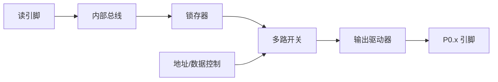
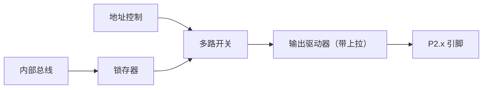

# 并行I/O口结构及工作原理（P0～P3）

## 并行 I/O 口结构及工作原理（P0～P3）

MCS-51 单片机有 **四个 8 位双向并行 I/O 端口**：P0、P1、P2、P3。每个端口在物理上包含一个 8 位锁存器、一个输出驱动器和一个输入缓冲器。但在电路结构上，四个端口**并不完全相同**——这正是初学时最容易混淆的地方。

先想一个问题：单片机引脚既要能当普通输入/输出用，又要能复用为地址线、数据线或外设功能线，**同一个引脚怎么“身兼数职”？** 答案就藏在每个端口内部的“多路开关”和“控制线”里。

---

## P0 口：真正的“双功能”端口

P0 口既可以作普通 I/O 口，也在访问外部存储器时**分时复用为低 8 位地址线和 8 位数据线**。



作普通输出口时，==P0 口是开漏输出==，输出高电平必须**外接上拉电阻**；输出低电平可直接驱动。作地址/数据总线时，内部自动切换控制线，使输出驱动器变为推挽结构，无需外部上拉。

[!WARNING]
> P0 口作普通 I/O 输出“1”时，引脚并不能真正输出高电平，除非外接了上拉电阻。很多实验板上 P0 口接的排阻就是为此而设。

---

## P1 口：最“单纯”的口

P1 口**只有普通 I/O 功能**，内部有固定的上拉电阻，输出高电平时不需要外接上拉。


判断口诀：**P1 是“专职”I/O 口**。

---

## P2 口：高 8 位地址的出口

P2 口有两项功能：

- 作普通 I/O 口；
- 访问外部存储器时输出**高 8 位地址**。

内部结构与 P1 类似，都带内部上拉电阻，但多了一个地址输出控制的多路开关。



[!NOTE]
> P0 与 P2 常配合使用：P2 出高 8 位地址，P0 分时出低 8 位地址与数据，合起来形成 16 位外部地址。

---

## P3 口：第二功能的“大户”

P3 口除了普通 I/O 外，每个引脚都有**第二功能**：

| 引脚 | 第二功能 |
|------|----------|
| P3.0 | RXD（串行输入） |
| P3.1 | TXD（串行输出） |
| P3.2 | INT0（外部中断 0） |
| P3.3 | INT1（外部中断 1） |
| P3.4 | T0（定时器 0 计数输入） |
| P3.5 | T1（定时器 1 计数输入） |
| P3.6 | WR（外部写） |
| P3.7 | RD（外部读） |

P3 口内部也带**内部上拉电阻**。当某位的“第二功能输出”控制端为 1 时，该引脚输出由内部第二功能信号决定。

[!IMPORTANT]
> P0～P3 作输入口使用时，**必须先向锁存器写“1”**，否则引脚会被输出级钳位在低电平，读到的一直是 0。这是因为内部输出级会持续驱动引脚。

---

## 读引脚与读-修改-回写

并行 I/O 口涉及到两种“读”操作：

- **读引脚**：读取引脚外部的实际电平。指令如 `MOV A, P1` 就是读引脚。
- **读锁存器（读-修改-回写）**：先读出锁存器内容，修改后再写回锁存器。指令如 `ANL P1, #0FH`、`CPL P1.0` 都是这类操作。

为什么要区分？因为当端口驱动较大负载时，引脚实际电平可能因负载拉低而与锁存器内容不一致。若此时用“读引脚”去修改端口，就会把被拉低的错误值写回。==读-修改-回写指令操作的是锁存器，避免了这个坑。==

[!TIP]
> 判断方法：只要指令的目的操作数是端口本身（如 `ANL P1, A`、`INC P1`），就是**读-修改-回写**，读的是锁存器。

---

## 驱动能力对比

| 端口 | 输出结构 | 作普通输出时是否需上拉 | 灌电流能力 |
|------|----------|------------------------|------------|
| P0 | 开漏 | 需要 | 较强（约 8 个 LSTTL） |
| P1 | 带上拉 | 不需要 | 约 4 个 LSTTL |
| P2 | 带上拉 | 不需要 | 约 4 个 LSTTL |
| P3 | 带上拉 | 不需要 | 约 4 个 LSTTL |

---

## 一个算对了的例子

**题意**：P1 口接 8 个独立按键（按下为低电平），要求 CPU 判断是否有任意键按下。写出关键初始化与读取代码（伪汇编）。

**解**：

第一步：P1 口作输入前，**必须写 1**。

```asm
MOV   P1, #0FFH      ; P1 锁存器全写 1
MOV   A, P1          ; 读引脚
CJNE  A, #0FFH, KEY  ; 不等于 FFH 说明有键按下
```

这里如果漏掉 `MOV P1, #0FFH`，部分引脚可能被内部输出级拉低，导致读到错误的 0——这是考试和实际设计中最常踩的坑。
