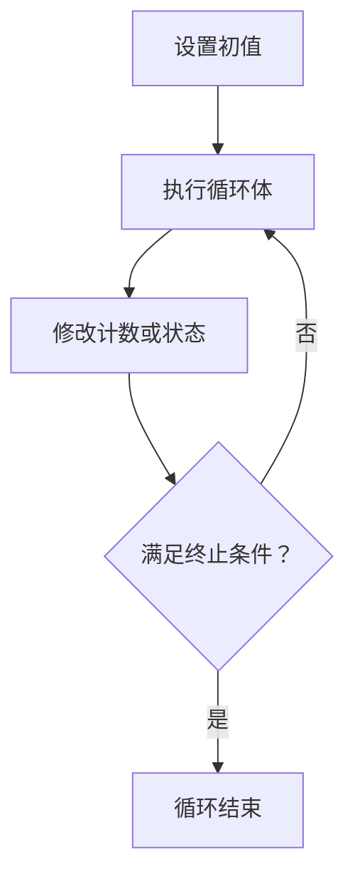

# 循环结构程序设计

## 什么是循环结构程序设计

循环结构程序设计是指：==让一段程序在满足一定条件时反复执行==。它与顺序结构、分支结构的区别在于：顺序结构“从头到尾执行一次”，分支结构“选择其中一条路径”，循环结构则“重复执行某段程序”。

在 MCS-51 汇编语言中，常用的循环控制方式有：

- **计数循环**：执行固定次数；
- **条件循环**：满足或终止某一条件时结束；
- **查表循环**：依次处理表中的数据。

## 为什么需要循环

如果没有循环，处理 $10$ 个数据就必须把相同指令重复写 $10$ 遍；数据量不固定时，甚至无法确定程序长度。

循环可以把“重复做什么”和“什么时候停止”明确分开：



> [!IMPORTANT]  
> 一个完整循环通常包括四部分：==初始化、条件判断、循环体、状态更新==。

## 怎样实现循环

MCS-51 汇编语言通常利用条件转移指令控制循环，例如 `DJNZ`（减 1 后转移）、`SJMP`、`AJMP`、`LJMP` 和 `JC/JNC` 等。

例如：累加 `R0` 寄存器中的 $8$ 次：

```asm
        MOV  A, #00H       ; 累加器清零
        MOV  R7, #08H      ; 循环计数初值
LOOP:   ADD  A, R0        ; 循环体
        DJNZ R7, LOOP     ; R7减1，非零则转移
```

执行过程是：先初始化 `A` 和 `R7`，每次执行 `ADD A, R0` 后让 `R7` 减 1；`R7` 不为零就继续循环，为零则结束。

> [!TIP]  
> 编写循环时先问两个问题：**循环体做什么？哪个量在变化？**  
> 通常应让计数器与数据处理对象分开，便于检查。

## 与相近结构的区别

| 结构 | 作用 | 典型指令或写法 |
|---|---|---|
| 顺序结构 | 按书写顺序执行 | `MOV`、`ADD` |
| 分支结构 | 根据条件选择路径 | `CJNE`、`JZ`、`JNZ` |
| 循环结构 | 重复执行一段程序 | `DJNZ`、条件转移指令组合 |
| 子程序结构 | 多次调用同一功能模块 | `LCALL`、`RET` |

循环和子程序都能“重复”，但目的不同：循环通常重复执行同一段处理逻辑并控制次数；子程序用于抽取可复用功能，调用和返回由 `CALL/RET` 完成。

> [!NOTE]  
> 若程序只是连续处理一组数据，可将处理部分写成子程序，再由循环统一控制处理次数。

## 常见易错点

> [!WARNING]  
> `DJNZ Rn, rel` 使用的是**寄存器 Rn**，不能写成 `DJNZ R, rel`；立即数 `#08H` 与地址 `08H` 也不能混淆。

1. **循环次数少一次**：`MOV R7,#08H` 配合 `DJNZ R7,LOOP` 正好执行 $8$ 次；若判断条件写在循环体之前且写错顺序，可能只执行 $7$ 次。
2. **忘记更新状态**：条件始终成立，会形成死循环。
3. **计数器初值错误**：计数初值为 $N$ 且每次减 $1$ 时，通常循环 $N$ 次；初值为 $0$ 则不能直接按同样方式计数。
4. **破坏关键数据**：循环体若修改了计数器或原始数据，应先保存，必要时使用另一个寄存器。

## 算对了的例子

设要把 `30H～3FH` 共 $16$ 个单元的数据逐个累加到累加器 `A`。可采用如下程序：

```asm
        MOV  R0, #30H      ; 指向首地址
        MOV  R7, #10H      ; 共16个单元
        CLR  A             ; 累加结果清零
LOOP:   ADD  A, @R0       ; 取当前单元并累加
        INC  R0            ; 指向下一单元
        DJNZ R7, LOOP      ; 未处理完则继续
```

`R7` 初值为十六进制 `10H`，即 $16$。每次循环累加一个单元，`R0` 加 $1$；共处理 `30H～3FH`，循环结束后 `A` 中保存这 $16$ 个单元的累加和。
