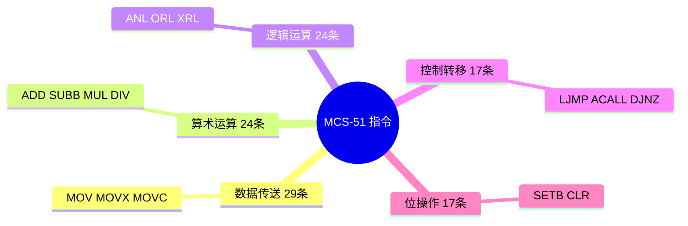

# 指令格式与指令分类

## 指令格式与指令分类

### 是什么

MCS-51 单片机只能识别二进制机器码，但人很难记 `75H 90H 55H` 这样的数字。于是用**助记符**（如 `MOV`）加**操作数**来写程序，这就是汇编语言。汇编器再把它翻译成机器码。

一条典型的指令长这样：

```text
标号:   操作码助记符   操作数1, 操作数2, 操作数3   ; 注释
LOOP:   MOV            A, #30H                     ; 把立即数30H送A
```

| 字段 | 作用 | 能否省略 |
|------|------|----------|
| 标号 | 表示指令地址，供跳转/查表用 | 可以 |
| 操作码 | 做什么（MOV、ADD、SJMP……） | ==不能省== |
| 操作数 | 对谁做（寄存器、内存、立即数） | 视指令而定 |
| 注释 | 给人看的说明 | 可以 |

> [!IMPORTANT]
> ==指令由操作码和操作数两部分组成，操作码决定指令功能，操作数决定操作对象。==

### 为什么需要分类

51 单片机有 ==111 条指令==，按字节数、执行周期、功能三种方式划分。分类的意义在于：看到指令就能快速判断它占多少字节、跑多久、影响哪些标志位。

### 指令分类

按**功能**分为五大类：

| 类别 | 条数 | 典型指令 | 说明 |
|------|------|----------|------|
| 数据传送 | 29 | `MOV`、`MOVX`、`MOVC`、`XCH` | 在寄存器、RAM、ROM 间搬数据 |
| 算术运算 | 24 | `ADD`、`ADDC`、`SUBB`、`MUL`、`DIV` | 加减乘除，影响 PSW 标志位 |
| 逻辑运算 | 24 | `ANL`、`ORL`、`XRL`、`RL`、`CLR` | 与或非、移位、清零 |
| 控制转移 | 17 | `AJMP`、`LJMP`、`SJMP`、`ACALL`、`LCALL`、`RET`、`JZ`、`CJNE`、`DJNZ` | 改变程序执行顺序 |
| 位操作 | 17 | `SETB`、`CLR`、`ANL C,bit`、`MOV C,bit` | 对可位寻址位单独操作 |

按**字节数**分：

| 字节数 | 编码格式 | 举例 |
|--------|----------|------|
| 单字节 | 操作码隐含了操作数 | `INC A`、`CLR C`、`RET` |
| 双字节 | 操作码 + 1 字节操作数 | `MOV A, #data`、`ADD A, #data` |
| 三字节 | 操作码 + 2 字节操作数 | `MOV direct, #data`、`LJMP addr16` |

按**执行周期**分：单周期 64 条、双周期 45 条、四周期 2 条（`MUL`、`DIV`）。



> [!TIP]
> 记字节数的小窍门：==操作数里出现 `#data` 或 `direct` 就要多占字节==。`#data` 占 1 字节，`direct` 占 1 字节，`addr16` 占 2 字节，`addr11` 占 1 字节。

### 一个算对了的例子

**题目**：`MOV 30H, #50H` 是几字节指令？执行时占几个机器周期？

**分析**：
- 操作码 `MOV direct, #data` 占 1 字节
- 第一操作数 `30H`（direct）占 1 字节
- 第二操作数 `#50H`（#data）占 1 字节

合计 **3 字节**。该指令属于数据传送类，是 ==单周期指令==。

> [!WARNING]
> 别把 `#50H` 和 `50H` 搞混：`#50H` 是立即数（常数），`50H` 是片内 RAM 的地址。`MOV A, #50H` 把 50H 这个数送 A；`MOV A, 50H` 把 RAM 50H 单元里的内容送 A。==有无 `#` 号，含义完全不同==。

> [!NOTE]
> 位操作类是 51 指令系统的一大特色，它把布尔处理器独立出来，能对 `P1.0`、`C`、`20H` 中的某一位直接置位、清零、与或非，这是其他很多 8 位机做不到的。
