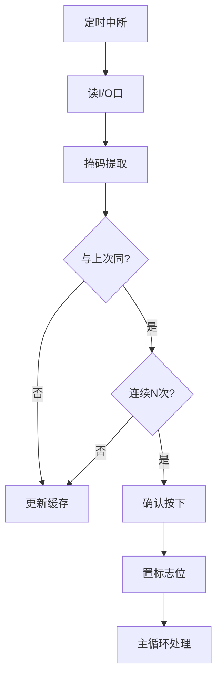

# 按键扫描与按键处理程序

> [!IMPORTANT]
> 按键扫描与处理是单片机系统获取外部输入的核心机制。在市电定时开关中，==外部事件（按键）驱动着系统在各状态之间的转换==，而这一过程通常由定时中断调度完成。

## 为什么不能直接读引脚？

如果主循环里直接 `if (P1_0 == 0)` 就认为按键按下，会遇到什么问题？

机械按键在闭合和断开瞬间，触点会快速弹跳数十毫秒（抖动）。若直接读取，单片机会把一次按下误判为多次触发。因此必须经过**消抖**才能确认有效按键。

## 什么是按键扫描与处理

- **按键扫描**：周期性读取 I/O 口电平，通过软件算法滤除抖动，确认按键是否真正按下或释放。
- **按键处理**：根据扫描结果，修改系统标志位或直接驱动状态机跳转。

课件指出：“外部事件（定时中断调度的按键扫描及状态处理）的发生驱动着系统在各状态之间的转换。”这意味着扫描不应放在主循环死等，而应挂在定时器中断中。



## 怎么做：掩码与状态机

程序设计常定义**按键扫描掩码**来屏蔽无关位。例如 P1 口低 4 位接按键：

```c
#define KEY_MASK 0x0F   // 定义按键扫描掩码
uint8_t key_state = 0;  // 当前稳定状态
uint8_t key_press = 0;  // 按下事件标志
```

在中断服务函数中（假设 $T_0$ 每 $10\text{ms}$ 进一次）：

```c
void Timer0_ISR(void) interrupt 1 {
    uint8_t read_val = ~P1 & KEY_MASK; // 读入并取反，掩码过滤
    static uint8_t cnt = 0;
    
    if (read_val == key_state) {
        cnt = 0; // 电平未变，清零计数
    } else {
        cnt++;
        if (cnt >= 2) { // 连续2次(20ms)不同，确认变化
            key_state = read_val;
            key_press = key_state; // 记录新按下的键
            cnt = 0;
        }
    }
}
```

主循环只负责“消费”标志位：

```c
void main() {
    while (1) {
        if (key_press & 0x01) {      // K1按下
            sys_state = STATE_SET;   // 状态转换
            key_press &= ~0x01;      // 清除标志
        }
    }
}
```

## 算对了的例子

设 P1 口低 4 位接 4 个按键（低电平有效），当前 `P1 = 0xFE`（即 `1111_1110B`），`KEY_MASK = 0x0F`。

1. 取反：`~0xFE = 0x01`
2. 掩码相与：`0x01 & 0x0F = 0x01`
3. 结论：最低位按键（K1）被按下，其余未按下。

若 `P1 = 0xF5`（`1111_0101B`），则 `~0xF5 & 0x0F = 0x0A`（`1010B`），表示 K2、K4 同时按下。

## 相近概念对比

| 方式 | 执行位置 | CPU 占用 | 适用场景 |
| :--- | :--- | :--- | :--- |
| **查询扫描** | 主循环轮询 | 高，阻塞任务 | 简单无实时性要求系统 |
| **中断扫描** | 外部中断触发 | 低，但无法消抖 | 单次紧急按键 |
| **定时中断调度** | 定时器 ISR | ==低且自带消抖== | 市电定时开关等多状态系统 |

> [!WARNING]
> 常见坑：在定时器中断里直接写长延时（如 `delay_ms(20)`）来消抖。这会破坏中断的实时性，导致其他定时任务紊乱。正确做法是用计数器累加中断次数实现软件延时。

> [!CAUTION]
> 高危误区：忘记在中断里清除 `key_press` 标志，或者在主循环处理后不清零，会导致一次按下被反复执行多次状态跳转。务必保证“扫描置位、处理清零”分离。
