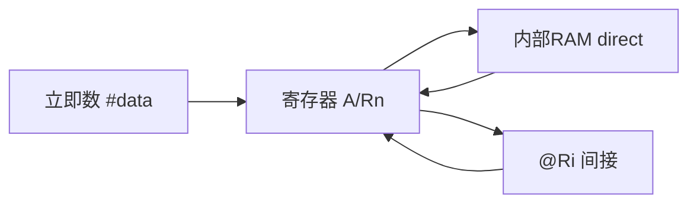

# 数据传送类指令（MOV、MOVX、MOVC、PUSH、POP等）

数据传送类指令是 MCS-51 指令系统中使用频率最高的一组，作用是把数据从一个存储位置搬到另一个存储位置：包括立即数送寄存器、内部 RAM 互传、堆栈进出、外部 RAM 读写、程序存储器查表，以及位的搬运。它不改变操作数本身，只改变"谁的副本被送到哪儿"。

## MOV 指令：内部 RAM 与寄存器之间

通用格式：`MOV 目的操作数, 源操作数`，方向永远是**右→左**。

按源/目的组合可分为几族：

| 形式 | 说明 | 周期 |
|---|---|---|
| `MOV A, Rn` / `MOV A, direct` / `MOV A, @Ri` / `MOV A, #data` | 各种源送 A | 1 |
| `MOV Rn, A` / `MOV direct, A` / `MOV @Ri, A` | A 送各目的 | 1 |
| `MOV Rn, direct` / `MOV direct, Rn` / `MOV direct1, direct2` / `MOV direct, @Ri` / `MOV @Ri, direct` / `MOV direct, #data` / `MOV @Ri, #data` / `MOV Rn, #data` | 通用互传 | 2 |
| `MOV DPTR, #data16` | 16 位立即数送 DPTR | 2 |

想一想：`MOV A, 60H` 和 `MOV C, 60H` 都写 60H，含义一样吗？——==不一样==。前者把==内部 RAM 60H 单元的字节==送 A，后者把==位地址 60H 的一位==送 Cy。位操作区使用位地址（00H～FFH），与字节地址是两个地址空间，必须区分。

寻址形式上，`MOV A, @R0`（机器码 E6H）或 `MOV A, @R1`（E7H）是用 R0/R1 内容作==间接地址==取数，常用于查表、遍历内部 RAM；直接寻址 `MOV A, 60H` 用 60H 作==直接地址==。



## 堆栈：PUSH 与 POP

堆栈按==后进先出==工作，栈顶由 SP 指向。

- `PUSH direct`：先 `SP←SP+1`，再把 direct 内容压入 `(SP)` 指向的单元。
- `POP direct`：先弹出 `(SP)` 内容到 direct，再 `SP←SP-1`。

常用于中断/子程序中保护 A、PSW、Rn 等现场。

## MOVX：外部数据存储器

==MOVX 专门访问外部 RAM==，用 `@Ri`（8 位地址，页寻址）或 `@DPTR`（16 位地址）间接寻址，A 是唯一中转站：

- `MOVX A, @DPTR` / `MOVX @DPTR, A`
- `MOVX A, @Ri` / `MOVX @Ri, A`

`MOV DPTR, #8000H` 后 `MOVX A, @DPTR`，即把外部 RAM 8000H 单元读入 A。

## MOVC：程序存储器查表

MOVC 读取==程序存储器 ROM==中的常数表，用于查表运算：

- `MOVC A, @A+DPTR`：地址 = $(A) + (DPTR)$，查表范围大。
- `MOVC A, @A+PC`：先 $PC \leftarrow PC+1$（跳过指令本身），再取 $((A)+(PC))$ 送到 A，==偏移量受 PC 当前值影响==。

> [!WARNING]
> `MOV` 只搬内部数据，`MOVX` 走外部 RAM（伴随 `RD/WR` 信号），`MOVC` 走 ROM（伴随 `PSEN`），三者**不可互换**；MOVX/MOVC 的目的或源之一必须是 A。

## 位传送

`MOV C, bit` 把位地址 bit 的值送进 Cy；`MOV bit, C` 把 Cy 写入位地址。位地址可用直接位地址（如 `00H`）或 `字节地址.位号`（如 `20H.0`）书写。

## 交换类

| 指令 | 说明 |
|---|---|
| `XCH A, Rn/direct/@Ri` | 字节与 A 整体互换 |
| `XCHD A, @Ri` | 仅==低 4 位==互换，高 4 位不变 |

## 一个算对了的例子

设 `(R0)=60H`、`(60H)=3AH`、`(A)=11H`、`(SP)=30H`：

```
MOV  A, @R0    ; (A)←((R0)) = 3AH，A 变 3AH
PUSH 60H       ; SP←31H，(31H)←3AH
MOV  60H, A    ; (60H)←3AH，内容不变
POP  20H       ; (20H)←(31H)=3AH，SP←30H
XCH  A, 60H    ; A 与 (60H) 互换，均为 3AH
```

> [!TIP]
> 解题时先把每条指令的"源→目"箭头写出来，再逐条更新寄存器/内存的值，==SP 的加减和压栈/弹栈顺序==是最常出错的地方。

> [!NOTE]
> `MOV DPTR, #data16` 是 MCS-51 唯一的 16 位传送指令；R0~R7 分属不同寄存器组，跨组传送前先确认 PSW 的 RS1RS0。
