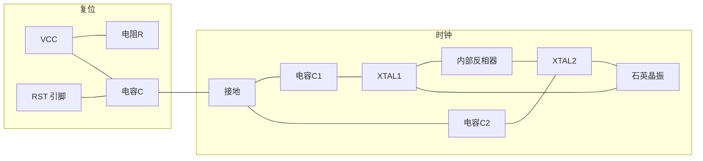

# 时钟电路与复位电路

## 是什么

单片机为什么不像人一样“想动就动”？因为它内部数百万个晶体管必须整齐划一地翻转，这需要一个“节拍器”。

这个节拍器就是**时钟电路**。MCS-51 内部有一个高增益反相放大器，引脚 `XTAL1`（输入）和 `XTAL2`（输出）接上外部的石英晶振和两个微调电容（通常 $C_1 = C_2 = 30\text{pF}$），就构成了==**自激振荡器**==，产生稳定的频率 $f_{osc}$。
这个频率经过内部二分频，才是真正的“系统时钟”。我们把一个振荡周期定义为**拍（P）**，把两个拍（即一个完整的振荡周期）定义为==**状态周期（S）**==，而 CPU 完成一个基本操作（如取指令）需要 6 个状态，即==**机器周期**==。

有了节奏，如果上电时电压混乱导致内部寄存器状态随机怎么办？这就需要**复位电路**。它的核心任务是：在 `RST` 引脚上施加一个满足时间要求的高电平，把 PC 指针强制拉回 `0000H`，让程序从头开始。

## 怎么做（典型电路）

观察上图的上电过程：
1. 电源接通瞬间，电容 C 两端电压不能突变，`RST` 瞬间变为高电平（约等于 $V_{CC}$）。
2. 随着电源通过电阻 R 给电容充电，`RST` 引脚的电压按照指数规律下降，即 $u(t) = V_{CC} \cdot e^{-t/RC}$。
3. 当电压跌落到逻辑低电平的门限（通常取 CMOS 电平的转折区，如 1.5V ~ 3.5V 之间），复位结束，单片机开始跑程序。

> [!IMPORTANT]
> 复位必须满足：高电平持续时间 > 2 个机器周期（即 24 个振荡周期）。这就是我们常说 ==**“2个机器周期”**== 的核心考点。

## 相近概念的区别与算例

很多同学把“复位时间”和“充放电时间”搞混。记住口诀：**算维持高电平的时间，是为了让 CPU 来得及初始化；算下降到低电平的时间，是为了确定程序从哪一刻开始跑。**

**[!WARNING] 常见误区**
1. **混淆晶振频率与机器周期频率**：若晶振为 $12\text{MHz}$，则振荡周期是 $\frac{1}{12}\mu s$，而机器周期是包含 12 个振荡周期，即 $1\mu s$。若题目要求复位高电平持续 > 2 个机器周期，则时间必须 $> 2\mu s$。
2. **忽略施密特触发器**：`RST` 内部有史密特触发器进行波形整形，所以即使电容下降波形较缓，只要跨越了高低电平阈值，也是有效复位。

> [!TIP]
> 解题技巧
> 若出现“求 R、C 参数”的题，核心是利用公式 $u(t) = V_{CC} e^{-t/RC}$。通常令临界值 $u(t) = V_{CC}/2$ 或 $1/3 V_{CC}$，此时 $t \approx 0.7RC$ 或 $1.1RC$。

让我们来看一个算对了的例子（原题改编）：

> **题目**：设 MCS-51 单片机晶振频率 $f_{osc} = 12\text{MHz}$，$V_{CC} = 5\text{V}$，采用上电复位电路，$R = 10\text{k}\Omega$。若要求复位高电平持续时间 $t \ge 2\mu s$，且电容上的电压降到 $0.5\text{V}$ 后方可脱离复位状态。请选择合适的电容 $C$。

**解题步骤**：
1. 算最小要求：2 个机器周期 $= 2 \times 1\mu s = 2\mu s$。
2. 列放电方程：我们需要找到时间 $t$，使得 $u(t) \le 0.5\text{V}$。
   $$ 5 \cdot e^{-t / (10k \cdot C)} = 0.5 $$
3. 化简：$e^{-t / (10k \cdot C)} = 0.1$。
   两边取自然对数：$-t / (10k \cdot C) = \ln(0.1) \approx -2.302$。
   解得 $t = 2.302 \times 10k \times C = 23020 \cdot C$。
4. 因为题目要求 $t \ge 2\mu s$，所以 $23020 \cdot C \ge 2 \times 10^{-6}$。
   解得 $C \ge \frac{2 \times 10^{-6}}{23020} \approx 8.69 \times 10^{-11}\text{F}$。
5. **结论**：选择标准标称值 $C = 10\text{pF}$ 的瓷片电容或稍大的 $C = 10\mu\text{F}$ 电解电容均可满足（视抗干扰需求而定，通常为了可靠复位会选 $10\mu\text{F}$ 配合更长的延时）。

## 常见的坑

[!CAUTION] 高危误区
1. **“晶振两端必须接电容”**：这两个电容叫**负载电容**，并非用于分频，而是利用三点式振荡器的原理，与晶振构成电容三点式振荡网络。如果忘了画这两个电容，或者电容值画成了 $\mu\text{F}$（而不是 $\text{pF}$ 级），仿真必失败。
2. **复位按键抖动**：如果要在复位电路里加手动按键，记得按键两端要并联一个几百欧姆的电阻，或者串联一小段电感，防止按键瞬间引入的尖峰脉冲损坏单片机。
