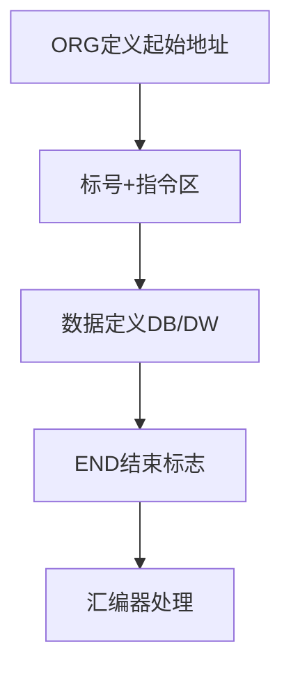

# 汇编语言源程序格式与基本结构

## 汇编源程序的基本结构

如果直接给单片机写一串十六进制机器码，你能保证每条指令的地址、跳转目标都绝对正确吗？显然不能。因此我们需要一种==人类可读、编译器可翻译==的中间形式，这就是汇编语言源程序。它由若干“语句”组成，每条语句对应一条或多条机器指令，是连接算法思维与硬件执行的桥梁。

## 四字段格式规范

MCS-51 汇编源程序的每一行通常包含四个字段，其排列顺序固定：

```
[标号:] [操作码] [操作数] [;注释]
```

| 字段 | 是否必需 | 书写规则与约束 |
| :--- | :--- | :--- |
| 标号 | 否 | 必须以字母或下划线开头，后跟冒号 `:` |
| 操作码 | ==是== | 助记符，如 `MOV`、`AJMP`，不可省略 |
| 操作数 | 否 | 可为寄存器、地址、立即数等，多操作数用逗号分隔 |
| 注释 | 否 | 以分号 `;` 开头，仅用于说明，不参与编译 |

> [!IMPORTANT]
> ==操作码是唯一不可缺少的字段==。缺少操作码的行会被汇编器视为无效语句或纯注释行。

## 伪指令与基本程序框架

除了可执行指令，源程序中还需要==伪指令==来告诉汇编器如何组织代码和数据。它们不生成机器码，仅控制汇编过程。



一个完整的 MCS-51 汇编源程序必须包含以下要素：

-   **`ORG addr`**：指定后续代码或数据的存放起始地址，复位后 PC 默认从 `0000H` 开始，主程序常置于 `0030H` 之后以避开中断向量区。
-   **标号与指令体**：实现具体功能逻辑。
-   **`END`**：==必须作为源程序最后一行==，告知汇编器到此停止翻译，其后内容被忽略。

> [!WARNING]
> `END` 不是可执行指令！若遗漏 `END`，汇编器可能继续解析无效内容导致报错；若在中间误加 `END`，后续合法代码将被截断丢失。

## 常见误区辨析

许多初学者混淆“汇编指令”与“伪指令”。记住：==指令是给 CPU 执行的，伪指令是给汇编器看的==。例如 `MOV A, #30H` 会生成机器码存入 ROM，而 `DATA1 EQU 30H` 仅在汇编阶段做符号替换，ROM 中无任何对应字节。

另一个高频错误是标号命名违规。标号不能使用操作码（如 `MOV:`）、寄存器名（如 `A:`）或数字开头（如 `1LOOP:`），否则汇编器无法区分标识符与关键字。

> [!TIP]
> 检查源程序时，先找 `ORG` 确认入口地址，再找 `END` 确认程序边界，最后逐行核对四字段格式——这三步能排除 80% 的语法类错误。

## 正确示例解析

以下是一个符合规范的完整片段：

```assembly
        ORG     0030H       ; 主程序起始地址
START:  MOV     SP, #60H    ; 初始化堆栈指针
        MOV     A, #0FFH    ; 累加器赋初值
LOOP:   CPL     P1.0        ; P1.0取反
        ACALL   DELAY       ; 调用延时子程序
        SJMP    LOOP        ; 循环执行
        END                 ; 源程序结束
```

该例中：`ORG` 定位到安全区域；`START` 和 `LOOP` 为合法标号；所有操作码拼写正确；`END` 位于末尾。注意 `ACALL` 的目标 `DELAY` 必须在别处定义，否则链接时报未定义符号错误——这正体现了==标号必须先声明后引用==的原则。
