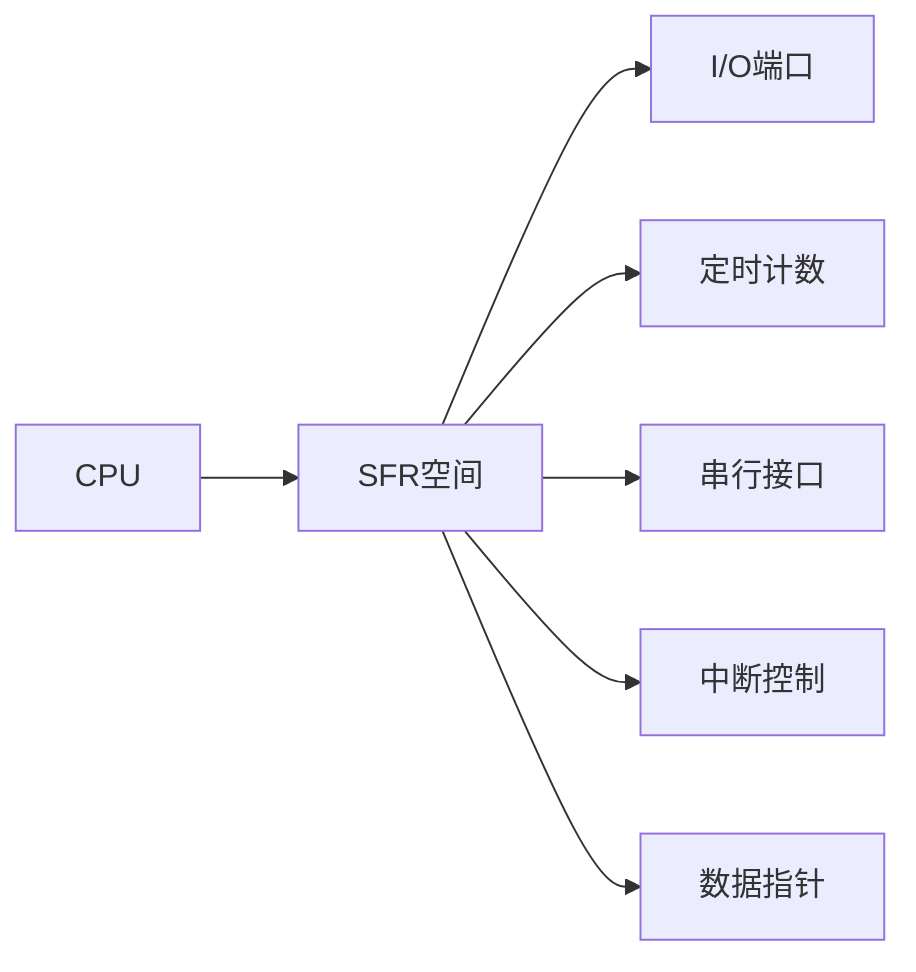

# 特殊功能寄存器（SFR）

## 它是什么

特殊功能寄存器（Special Function Register，SFR）是 MCS-51 单片机中用于==控制、监视和协调 CPU 及片上外设工作==的一组专用寄存器。I/O 端口数据锁存器、定时器/计数器、串行口数据缓冲器以及中断控制寄存器等，都以 SFR 的形式出现。

MCS-51/52 系列共有 25 个 SFR，离散分布在内部 RAM 高 128 字节的 $80\text{H}\sim0\text{FFH}$ 地址空间，通常采用==直接寻址==访问。程序既可对整个字节进行读写、算术或逻辑运算，也可对可位寻址 SFR 的指定位单独操作。

## 为什么需要

普通 RAM 主要保存程序运行中的数据，而 SFR 是软件操作硬件的接口。例如，向 `P1` 写数据可改变端口锁存器内容；设置 `TMOD` 可选择定时器工作方式；读写 `SBUF` 可完成串行数据收发。新增片上外设通常也通过增加 SFR 实现，因此使用具体芯片时应查阅其数据手册。

| SFR | 字节地址 | 主要作用 |
|---|---:|---|
| `ACC`、`B` | `0E0H`、`0F0H` | 累加运算及乘除等操作 |
| `PSW` | `0D0H` | 保存程序状态与标志 |
| `SP` | `81H` | 指向堆栈栈顶 |
| `DPH`、`DPL` | `83H`、`82H` | 组成 16 位数据指针 `DPTR` |
| `P0`～`P3` | `80H`、`90H`、`0A0H`、`0B0H` | 端口数据锁存 |
| `TMOD`、`TCON` | `89H`、`88H` | 定时方式选择与运行控制 |
| `SCON`、`SBUF` | `98H`、`99H` | 串行口控制与数据缓冲 |
| `IE`、`IP` | `0A8H`、`0B8H` | 中断允许与优先级控制 |

## 怎么用

以定时器/计数器为例，软件先通过 `TMOD` 选择工作方式，再由 `TCON` 控制启动、停止并保存溢出标志。`T0`、`T1` 分别由 `THx` 和 `TLx`（$x=0$ 或 $1$）组成，可构成 13 位、16 位或两个独立的 8 位计数器。

例如，将 `TMOD` 低四位设为 `0001B`，即选择 `T0` 的方式 1，此时 `TH0`、`TL0` 组成 16 位计数器。若晶振频率为 $12\,\text{MHz}$，机器周期为 $1\,\mu\text{s}$，要求定时 $1\,\text{ms}$，则计数次数为

$$N=\frac{1\,\text{ms}}{1\,\mu\text{s}}=1000$$

初值为

$$X=2^{16}-1000=64536=\text{FC18H}$$

因此装入 `TH0 = 0FCH`、`TL0 = 18H`，再置位 `TCON` 中的 `TR0` 启动计数；溢出后由 `TF0` 保存状态。

访问外部数据存储器时，`DPTR` 提供 16 位地址，可寻址 $64\,\text{KB}$；也可用 8 位地址访问低 256 字节，外部读写由 `nRD`、`nWR` 选通。

> [!WARNING]
> ==SFR 与普通 RAM 不能仅凭地址数值区分。==二者虽可能都出现 `80H～0FFH`，但普通高 128 字节 RAM 用间接寻址，SFR 用直接寻址；`PC` 不属于 SFR，52 系列的 `T2` 相关寄存器也不能当作 51 系列必有资源。

> [!TIP]
> 解题先判断“控制哪个外设”，再确定 SFR、相关位和寻址方式；涉及定时初值时，先算机器周期，再用 $X=2^n-N$。
