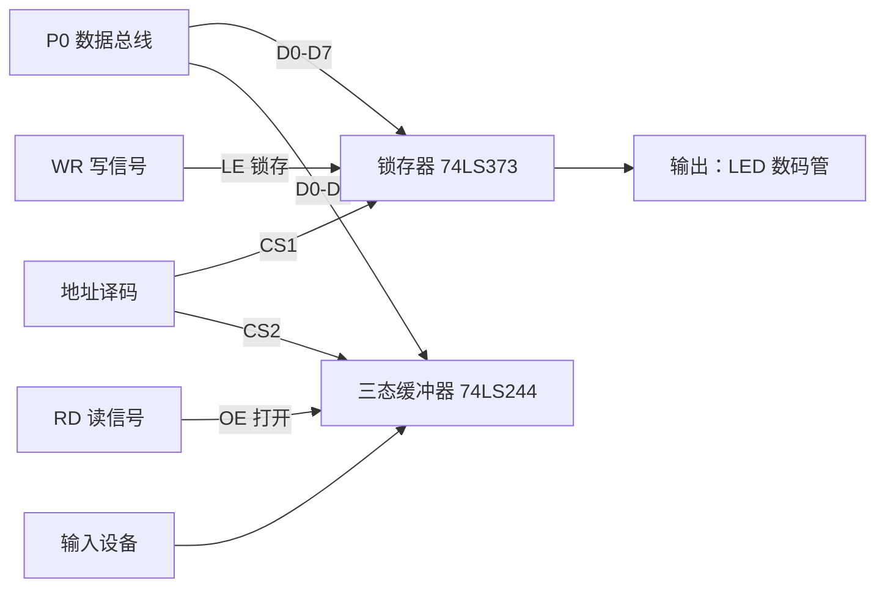
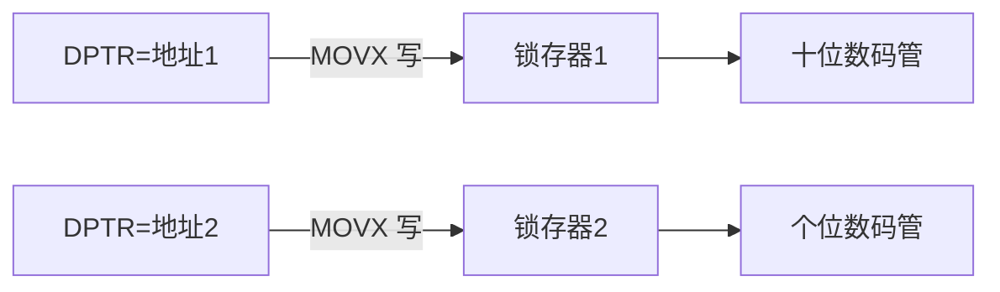

# 简单I/O扩展（锁存器、三态缓冲器扩展）

## 简单 I/O 扩展：锁存器与三态缓冲器

### 为什么需要扩展

MCS-51 的 P0～P3 口数量有限，且系统扩展外部程序存储器、数据存储器后，P0、P2 往往被占用作为地址/数据总线。当外设数量较多、需要并行驱动多位 LED 数码管或读取多路开关状态时，仅靠剩余的 I/O 引脚通常不够用。==简单 I/O 扩展的核心思路==：利用数据总线上挂接**锁存器**（输出）和**三态缓冲器**（输入），将它们当作外部 RAM 的单元来访问，用 `MOVX` 指令完成数据交换。

### 基本结构与工作方式

扩展的锁存器和缓冲器不占额外的并行口，而是直接连在 P0 数据总线（或局部数据总线）上，由译码得到的片选信号区分地址：



- **锁存器（输出扩展）**：如 74LS373/573。当 CPU 执行写外部 RAM 指令 `MOVX @DPTR, A` 时，`WR` 有效，锁存器的锁存使能端 LE 选通，P0 上的数据被锁存，之后即使总线数据变化，输出端仍保持刚写入的值。
- **三态缓冲器（输入扩展）**：如 74LS244/245。当 CPU 执行读外部 RAM 指令 `MOVX A, @DPTR` 时，`RD` 有效，缓冲器的输出使能端 OE 被打开，外部输入状态经数据总线送入累加器 A。平时 OE 无效，缓冲器输出呈高阻态，不干扰总线。

> [!IMPORTANT]
> 锁存器和缓冲器被“映像”为外部 RAM 单元：CPU 不关心它到底是存储芯片还是 I/O 芯片，只需要按外部 RAM 的地址和时序进行读写即可——这就是**存储器映象 I/O** 的统一处理方式。

### 静态显示：锁存器的典型应用

以两位共阴极数码管静态显示为例，每个数码管的 8 个段（a～g、dp）由一个锁存器持续驱动：



显示 `12` 的流程：

| 步骤 | 指令 | 说明 |
|---|---|---|
| 1 | `MOV DPTR, #0FE00H` | 指向锁存器 1 的映像地址 |
| 2 | `MOV A, #0F9H` | 共阴极数码管显示“1”的段码 |
| 3 | `MOVX @DPTR, A` | 锁存到十位数码管 |
| 4 | `MOV DPTR, #0FD00H` | 指向锁存器 2 的映像地址 |
| 5 | `MOV A, #0A4H` | 共阴极数码管显示“2”的段码 |
| 6 | `MOVX @DPTR, A` | 锁存到个位数码管 |

==静态显示的好处==：CPU 只需在显示内容变化时更新一次锁存器，之后数码管由锁存器输出持续驱动，无需反复刷新，软件简单且显示稳定。

### 与动态扫描显示的区别

| 对比项 | 静态显示（锁存器扩展） | 动态扫描显示 |
|---|---|---|
| 驱动方式 | 每个数码管独立锁存器持续驱动 | 多个数码管分时轮流导通 |
| CPU 负担 | 内容不变时不需刷新 | 需要定时扫描刷新 |
| 硬件成本 | 锁存器较多 | 驱动电路复杂但锁存器少 |
| 亮度 | 可做高 | 靠视觉暂留，亮度受限 |

### 常见易错点

> [!WARNING]
> 锁存器和缓冲器挂在同一数据总线上时，==地址译码不能重叠==。如果两个器件片选同时有效，写操作会同时写入多个锁存器，读操作则会发生总线冲突。

> [!CAUTION]
> 三态缓冲器输出端必须直接连数据总线，且==只有在读操作且对应片选有效时才打开==。若译码逻辑没把 `RD` 或 `CS` 作为使能条件编进去，缓冲器常开输出，会与总线上的其他数据源“打架”，轻则数据错误，重则损坏器件。

> [!TIP]
> 判断某外部端口地址时常结合 74LS138 译码器。例如 A15=1、A14=1、A13=0 时选中某片 138，再结合 A12～A8 的不同组合产生各锁存器的独立片选。计算地址时注意：`MOVX @DPTR` 用 16 位地址 `DPTR`，而非 8 位 `@Ri`。

### 一个算对了的例子

设系统扩展了两片 74LS373 锁存器和一片 74LS244 缓冲器。A15、A14 接 2-4 译码器使能端，要求 A15A14 = 10 时译码器工作。译码输出 Y0 接锁存器 1 片选，Y1 接锁存器 2 片选，Y2 接缓冲器片选。试写出各器件映像地址。

- 有效条件：A15 = 1，A14 = 0，A13、A12 由 Y0/Y1/Y2 对应的 2-4 译码输入决定（A13A12 = 00→Y0，01→Y1，10→Y2）。
- 锁存器 1：A15A14A13A12 = 1000，其余低 8 位取 0，得地址 `8000H`。
- 锁存器 2：A15A14A13A12 = 1001，得地址 `9000H`。
- 缓冲器：A15A14A13A12 = 1010，得地址 `A000H`。

显示数字 `5` 时，若段码为 `92H`，执行：

```asm
MOV  DPTR, #8000H
MOV  A, #92H
MOVX @DPTR, A
```

写完后总线上的数据可以任意变化，数码管仍保持显示 `5`，直到下一次写入新的段码。
