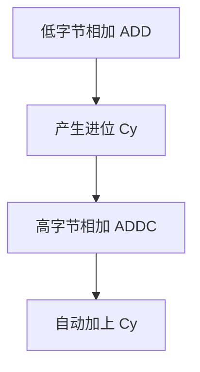

# 算术运算类指令（ADD、ADDC、SUBB、MUL、DIV、DA等）

## 算术运算类指令

算术运算类指令完成 8 位二进制数的加、减、乘、除以及 BCD 码调整，是 MCS-51 指令系统中使用最频繁的一类。它们都以累加器 A 为“主角”：==加、减运算的结果一律存入 A==，乘除运算则以 A、B 寄存器配对工作。

### 加法指令 ADD 与 ADDC

不带进位加法 `ADD A, 源操作数` 完成 $(A)\leftarrow(A)+源$。例如 `ADD A, #34H`，机器码 `24H 34H`，执行时把 A 中原来的内容与立即数 34H 一起送 ALU 相加，结果回写 A。

带进位加法 `ADDC A, 源操作数` 完成 $(A)\leftarrow(A)+(C)+源$，其中 $(C)$ 是 PSW 中的进位标志 Cy。它专门用于**多字节加法**：低字节相加产生的进位，要加到高字节上去。

> [!IMPORTANT]
> 加法指令影响 PSW 中的 Cy、Ac、OV、P 四个标志位。判断有符号溢出看 OV，判断无符号进位看 Cy。

### 减法指令 SUBB

`SUBB A, 源操作数` 完成 $(A)\leftarrow(A)-(C)-源$。注意：**MCS-51 没有不带借位的减法指令**，做普通减法前必须先清 Cy（`CLR C`），否则会把上一条指令留下的 Cy 当成借位一起减掉。

### 乘除指令 MUL 与 DIV

| 指令 | 操作 | 结果存放 | 周期 |
|------|------|----------|------|
| `MUL AB` | $(A)\times(B)$ | 高 8 位→B，低 8 位→A | 4 |
| `DIV AB` | $(A)\div(B)$ | 商→A，余数→B | 4 |

> [!WARNING]
> 乘除指令的源操作数**只能是 A 和 B**，不能写成 `MUL A, #10H`。`DIV AB` 中若 B=0，结果为不确定，且 OV=1。

### BCD 码调整 DA

`DA A` 紧跟在 ADD/ADDC 之后，把按二进制相加得到的“非法 BCD 码”修正为合法 BCD 码。修正规则：低 4 位大于 9 或 Ac=1，则低 4 位加 6；高 4 位大于 9 或 Cy=1，则高 4 位加 6。

### 一个算对了的例子

设 $(A)=78H$，$(B)=25H$，执行 `ADD A, B`：

$$
78H + 25H = 9DH
$$

结果 $(A)=9DH$，Cy=0，Ac=0，OV=1（有符号数 120+37=157 溢出）。

若做 BCD 加法，应再执行 `DA A`：因低 4 位 $D>9$，低 4 位加 6，得 $(A)=03H$，Cy=1，即 BCD 结果 103。

> [!TIP]
> 记口诀：加法两条（ADD/ADDC），减法必带借位（SUBB），乘除只用 AB，BCD 修正靠 DA。
