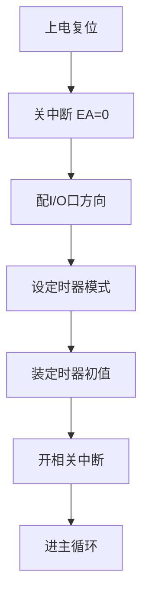

# 系统初始化与延时设置初始化

在市电定时开关这类实际应用中，单片机上电后并不会“自动”进入正确的工作状态。那么，程序执行的第一件事应该做什么？

## 它是什么与为什么需要

系统初始化是指单片机复位后、进入主循环前，对==特殊功能寄存器（SFR）、I/O端口、定时器/计数器及中断系统==进行统一配置的代码段。

市电定时开关需要在特定时刻控制继电器通断。若跳过初始化，P0口默认高阻态无法驱动外围电路，定时器未赋初值则计时混乱，系统将完全失控。

> [!IMPORTANT]
> 初始化的本质是==让硬件从不确定的复位态进入软件预期的确定态==。

## 怎么做：初始化流程



以MCS-51实现市电定时开关的延时为例，常选用定时器T0的方式1（16位定时），配合晶振 $f_{osc}=12\text{MHz}$ 产生精确延时。具体步骤如下：

1. **关总中断**：`EA = 0`，防止配置过程中被意外打断。
2. **配置I/O口**：将连接继电器的引脚置为输出状态。
3. **设置TMOD**：令T0工作在方式1，即 `TMOD = 0x01`。
4. **计算并装载初值**：根据所需延时反推TH0和TL0。
5. **开启中断并启动**：`ET0 = 1; EA = 1; TR0 = 1;`。

### 延时初值计算实例

假设要求T0定时 $50\text{ms}$。机器周期 $T_{cy} = \frac{12}{f_{osc}} = 1\mu s$。

计数次数：
$$N = \frac{50\text{ms}}{1\mu s} = 50000$$

方式1最大计数值为 $2^{16} = 65536$，故装入初值：
$$X = 65536 - 50000 = 15536 = \text{3CB0H}$$

对应代码：
```c
TH0 = 0x3C;  // 高8位
TL0 = 0xB0;  // 低8位
```

> [!TIP]
> 记忆口诀：==定方式、算初值、分高低、开中断==。

## 相近概念的区别

| 对比项 | 系统初始化 | 延时设置初始化 |
| :--- | :--- | :--- |
| **作用范围** | 全局（I/O、串口、中断等） | 局部（仅针对定时器/计数器） |
| **执行时机** | `main()`函数最开头 | 包含在系统初始化中或动态重配时 |
| **核心操作** | 配置各类SFR | 写TMOD、赋THx/TLx、置TRx |

## 常见的坑

> [!WARNING]
> 1. **忘记重装初值**：方式1（16位）溢出后不会自动重载！必须在==中断服务函数中重新给TH0、TL0赋值==，否则后续延时全错。若需自动重载应改用方式2（8位）。
> 2. **TMOD按位覆盖**：直接写 `TMOD = 0x01` 会破坏T1的配置。规范做法是 `TMOD = (TMOD & 0xF0) | 0x01`。
> 3. **先开中断后配定时器**：若先置 `EA=1` 再设初值，可能在中途触发错误中断。务必遵循==先配置、后使能==的顺序。

> [!CAUTION]
> 计算初值时，若 $N > 65536$，说明单次定时超出方式1极限，必须改用“定时器+软件计数变量”联合实现长延时。
