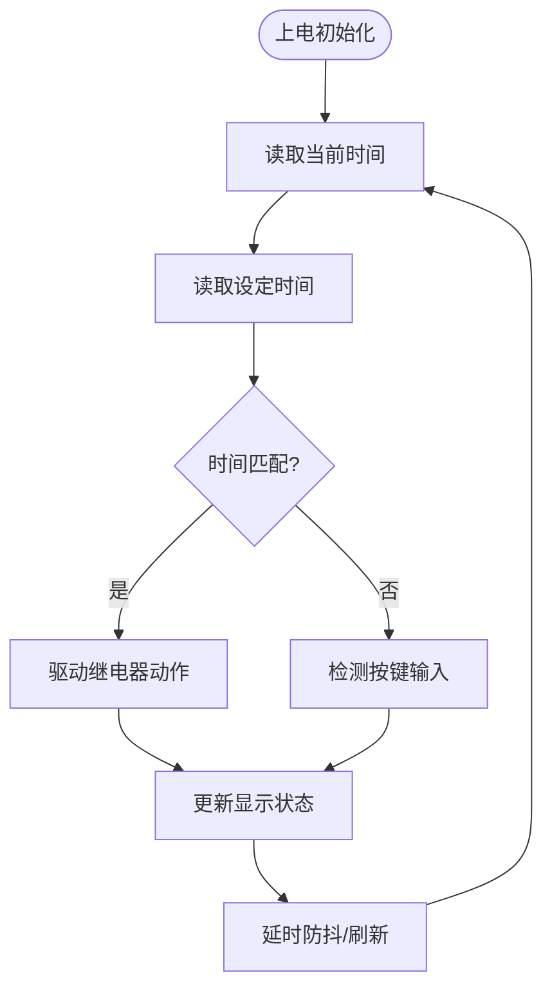

# 市电定时开关功能描述与系统需求分析

# 市电定时开关功能描述与系统需求分析

## 它是什么：从“手动”到“自动”的跨越

市电定时开关是一个典型的 MCS-51 单片机应用系统。其核心任务是==替代人工操作==，在预设的时间点自动接通或断开 220V 交流负载（如路灯、热水器）。

> [!IMPORTANT]
> 本质是**时间比较逻辑** + **继电器驱动控制**。
> 系统需实时获取当前时间，并与用户设定的“开/关时间”比对，一旦匹配即动作。

## 为什么需要：解决痛点与硬件隔离

若直接用机械定时器，精度低且无法灵活修改。单片机方案的优势在于：
1. **高精度**：利用内部定时器中断，误差极小。
2. **灵活性**：通过按键随时修改设定值。
3. **安全性**：单片机（5V）与市电（220V）必须==电气隔离==，防止高压击穿芯片或危及人身安全。

## 怎么做：系统架构与工作流程

系统主要由四部分组成：MCU（STC89C51/AT89C51）、时钟电路（DS1302 或内部定时器模拟）、人机交互（按键+LCD/LED）、执行机构（继电器+光耦）。

> [!TIP]
> **关键步骤**：
> 1. **初始化**：设置定时器模式，初始化 I/O 口。
> 2. **主循环**：不断扫描按键、读取时间、比较逻辑。
> 3. **输出控制**：通过 P1/P3 口输出高低电平，经光耦驱动继电器。

## 核心难点：强弱电隔离与去抖

| 模块 | 常见方案 | 注意事项 |
| :--- | :--- | :--- |
| **隔离驱动** | 光耦 (PC817) + 三极管 + 继电器 | ==严禁 MCU 引脚直连继电器线圈== |
| **按键处理** | 软件延时去抖 (10-20ms) | 避免一次按压多次计数 |
| **时间基准** | DS1302 芯片或 Timer0 中断 | 断电后需备用电池保持时钟 |

> [!WARNING]
> **高危误区**：忽略继电器的反向电动势。
> 必须在继电器线圈两端并联**续流二极管**，否则断开瞬间的高压会击穿驱动三极管。

## 算对了的例子：逻辑判定

假设当前时间为 `18:00`，设定开启时间为 `18:00`，关闭时间为 `23:00`。

1. **状态判断**：
   - 若 `Current_Time == Set_On_Time` $\rightarrow$ 置位 `Relay = ON`。
   - 若 `Current_Time == Set_Off_Time` $\rightarrow$ 置位 `Relay = OFF`。
2. **边界处理**：
   - 若设定跨天（如 22:00 开，次日 06:00 关），需增加日期判断或标志位，防止逻辑死锁。

> [!NOTE]
> **考试考点**：常考继电器驱动电路图的正确性（是否有光耦、续流二极管），以及主程序中时间比对的伪代码实现。记住：==先隔离，后驱动；先去抖，后响应==。
