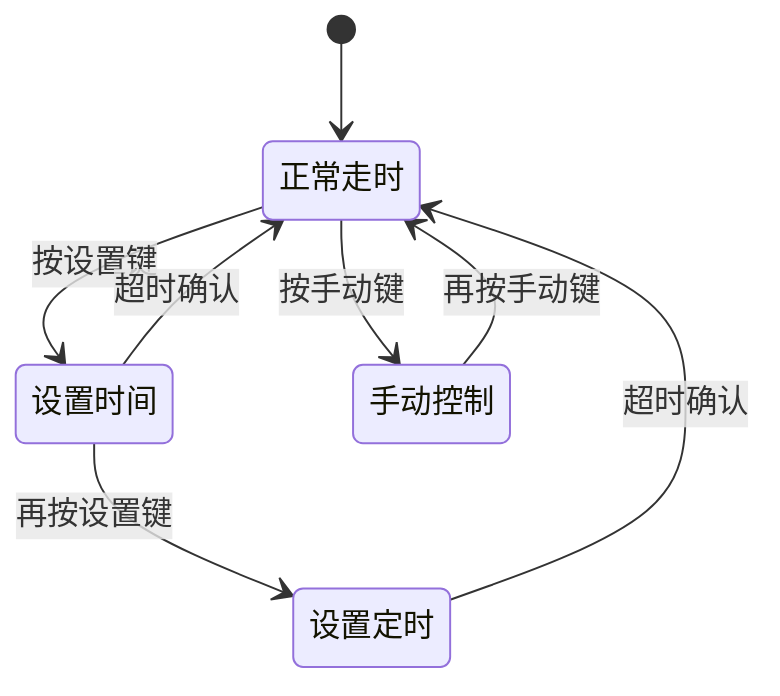

# 程序参数、系统状态及全局变量定义

## 为什么先定义状态与全局变量

市电定时开关的核心是"按时间自动通断"，程序要同时记住**当前几点几分**、**开关该通还是该断**、**当前处于什么工作阶段**。这些信息在定时中断、键盘扫描、显示刷新等多个模块间共享，如果散落在各函数里当局部变量，就会互相看不见、改不到。所以第一步就是把这些==程序参数、系统状态、全局变量==集中定义，作为整个程序的"公共账本"。

## 三类定义各管什么

| 类别 | 内容 | 特点 | 示例 |
|------|------|------|------|
| 程序参数 | 定时上下限、校准常数 | 运行中不变，可用 `code` 或宏 | `#define ON_HOUR 6` |
| 系统状态 | 当前工作模式、通断标志 | 决定程序走哪条分支 | `bit switch_state;` |
| 全局变量 | 当前时分秒、定时值 | 各模块共享，随时被中断改写 | `uchar hour, min, sec;` |

> [!IMPORTANT]
> ==系统状态变量回答"程序现在该干什么"，全局变量回答"现在是什么值"，程序参数回答"边界在哪里"。== 三者分开定义，程序结构才清晰。

## 状态划分与流转

以市电定时开关为例，系统状态通常划分为：正常走时、设置时间、设置定时、手动控制。它们之间靠按键事件切换：



每个状态对应主循环里一段处理代码，用 `switch(sys_state)` 分发即可。

> [!TIP]
> 状态变量用 `uchar` 或 `enum` 定义，并配合宏给状态起名字（如 `#define ST_RUN 0`），比直接写数字可读性强得多。

## 一个定义示例

```c
#define ON_HOUR   6      // 开时刻
#define OFF_HOUR 23      // 关时刻

uchar sys_state;         // 系统状态
bit   switch_state;      // 通断标志,1=通
uchar hour, min, sec;    // 当前时间
uchar on_hour, off_hour; // 定时值,可修改
```

定时中断每 1 s 把 `sec` 加 1，满 60 向 `min` 进位；主循环发现 `hour==on_hour && min==0` 就把 `switch_state` 置 1，驱动继电器吸合。这里 `hour/min/sec` 必须是全局变量，否则中断和主程序无法共享。

> [!WARNING]
> 全局变量被多个模块访问，==中断里修改的变量建议加 `volatile` 修饰==，防止编译器优化导致主循环读到旧值。另外 `bit` 型只能定义在可位寻址区，不要把它当普通 `char` 用。

> [!CAUTION]
> 常见错误：把定时值 `on_hour/off_hour` 也当成程序参数写死。参数是"出厂设定"，定时值是"用户可改"，前者用 `#define`，后者必须定义为变量，否则键盘设置功能无法实现。
