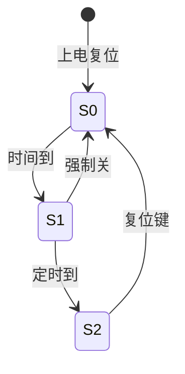
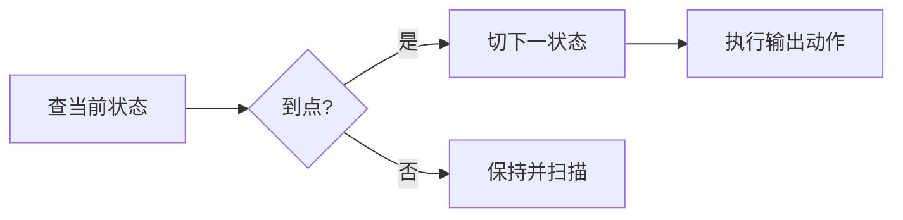

# 系统状态转移图设计

---
title: 系统状态转移图设计
requires: [单片机/中断系统, 单片机/定时器工作方式]
---

## 这是什么，为什么需要

市电定时开关要让单片机在"待机 → 到点合闸 → 定时到分闸 → 回到待机"之间自动切换，单靠一堆 if-else 很容易漏掉某个时刻该做的事。**==系统状态转移图==** 就是把整个系统抽象成若干**状态**，用**条件（转移）**描述状态之间何时跳转，从而把控制逻辑变成一张可读、可实现的图。

它的本质是有限状态机（FSM）：==一个状态在某一时刻只有一种行为模式==，下一状态由当前状态 + 输入事件共同决定。

## 怎么做：三步画出转移图

- **列状态**：把系统可能停留的"行为模式"一一命名，如 `S0 待机`、`S1 合闸运行`、`S2 报警`。
- **标转移条件**：每条箭头上写明触发跳转的输入事件（按键、定时器到、超时、外部中断等）。
- **标输出动作**：进入/离开某状态时要做的动作（置位 P1.0、启动 T0、关显示等），可在状态框旁注明。

## 与相近概念的区别

| 概念 | 侧重点 | 何时用 |
| --- | --- | --- |
| 程序流程图 | 描述执行步骤顺序 | 算法、计算过程 |
| 状态转移图 | 描述==状态与触发条件== | 长期循环的控制类系统 |
| 时序图 | 描述信号随时间变化 | 通信协议、总线 |

## 一个典型例子：市电定时开关

> [!IMPORTANT]
> 核心建模：==状态数 = 行为模式数==，不是"事件数"；条件写在箭头上，不是写在节点里。

设计要点：`S0` 待机只扫描按键并显示；`S1` 合闸时置 P1.0 高电平、启动 T0 计时；`S2` 到点断电，等待下一周期。转移条件来自定时器中断置位的标志位 `flag_sec`、`flag_end`，主循环只根据当前状态查表处理，不重复判断。

## 常见的坑

> [!WARNING]
> - 忘记给**初始状态**赋值，上电后状态变量随机 → 行为飘忽。
> - 把==事件==当成状态画进图，导致状态爆炸。
> - 转移条件既写在状态里又写在箭头上，语义重复、易错。
> - 中断中修改状态变量没用 `volatile` 或没考虑重入。

> [!TIP]
> 记忆口诀：**状态管"是什么"，条件管"何时变"，动作管"做什么"**。先画图后写代码，代码用 `switch(state)` 一一对应状态框，几乎不会写错。
