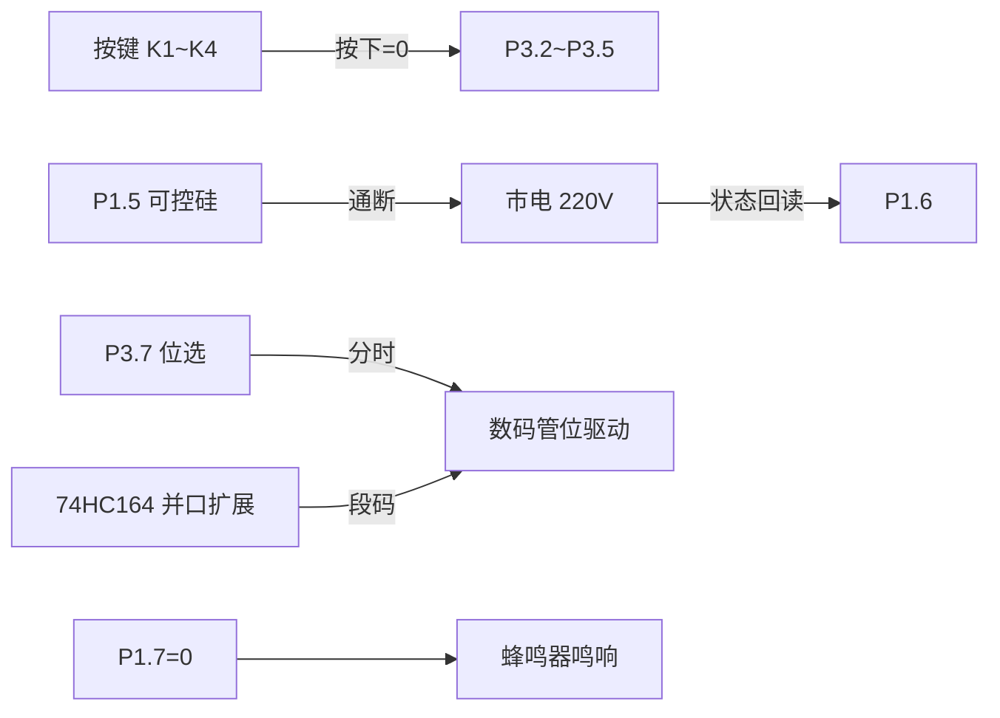

# 系统硬件电路设计（市电通断控制、按键、蜂鸣器、数码管、CPU及LED驱动）

## 它是什么、为什么需要

市电定时开关的本质，是让单片机在**强电（220V 市电）**与**弱电（5V 逻辑）**之间充当"定时大脑"：按用户设定的时间自动接通或断开市电。因此硬件设计围绕三条线展开——**人如何告诉单片机（按键）、单片机如何告诉人（数码管/LED/蜂鸣器）、单片机如何控制市电（可控硅/继电器驱动）**。

## 端口分配：15 个引脚怎么够用

51 单片机可用 I/O 仅 15 个（P1 全部 + P3 部分），却要驱动 2 只数码管（16 段线）、4 只按键、1 只蜂鸣器、可控硅及多只 LED，==必须借助串口扩展与分时复用==：

| 功能 | 引脚 | 实现方式 |
|---|---|---|
| 段码输出 | 串口方式0 + 74HC164 | 串行转并行，只占用 TXD/RXD |
| 位选 | P3.7 | 分时导通 PNP/NPN 三极管，轮流点亮两只数码管 |
| 按键扫描 | P3.2~P3.5 | 定时中断内读取，节省等待时间 |
| 可控硅驱动 | P1.5 | 输出触发信号控制市电通断 |
| 市电状态回读 | P1.6 | 检测当前市电是否接通 |
| 蜂鸣器 | P1.7 | 低电平有效（`BUZCTRL=0` 鸣响） |
| 状态 LED | P1.0~P1.3 | 小时/分钟/定时开/定时关指示 |

## 各模块电路要点

**按键**：一端经上拉电阻接 VCC 入端口，一端接地。未按下读高电平，按下读低电平，软件消抖后确认。

**蜂鸣器**：单片机引脚电流有限，经三极管放大后驱动。注意==低电平鸣响==，与直觉相反。

**数码管**：选用二联共阳 LG5022A。共阳结构决定了段码输出**低电平点亮对应段**，位选则需按三极管类型区分电平——PNP 需低电平导通、NPN 需高电平导通，P3.7 分时切换实现动态扫描。

**市电控制**：P1.5 驱动可控硅（或继电器）隔离控制 220V 回路；P1.6 回读市电实际状态，形成闭环确认。

## 常见的坑

> [!WARNING]
> 1. 蜂鸣器是**低电平**触发，写程序时若按高电平有效驱动会始终不响。
> 2. 共阳数码管段码与共阴**相反**，查表时务必确认型号（LG5022A 为共阳）。
> 3. 按键上拉意味着**按下为低**，扫描判据别写反。
> 4. 位选驱动 PNP 与 NPN 所需电平不同，不能简单共用同一驱动电平。

## 算对了的例子

晶振 11.0592 MHz，定时器实现 10 ms 时间片（100 Hz），数码管 2 位动态扫描，则每位刷新间隔为 20 ms，对应 50 Hz 刷新率，人眼无闪烁：

$$
f_{\text{位}} = \frac{1}{2 \times 10\text{ms}} = 50\text{Hz}
$$

按键扫描放在定时中断中，每 10 ms 读一次 P3.2~P3.5，连续 3 次（30 ms）均为低电平才确认按下，既消抖又不阻塞主程序。
