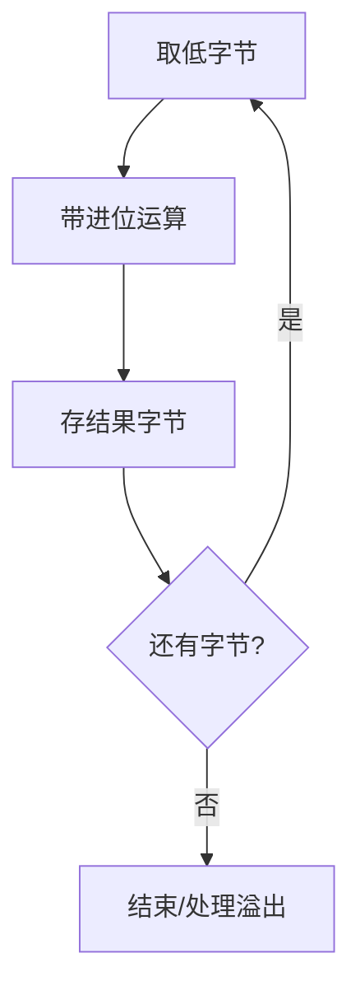
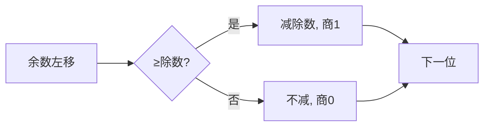

# 多字节运算程序设计（加减乘除）

## 它是什么

在 MCS-51 里，==多字节运算==指用若干字节拼成一个“长数据”后做加、减、乘、除程序。因为 8051 是 8 位机，累加器 A 一次只能处理 $8$ 位，所以 $n$ 字节数要按字节分组运算。

先想一个问题：若两个 $16$ 位数相加，低字节相加产生进位，下一步该怎么办？显然要把进位送到高字节，用 `ADDC` 而不是再用 `ADD`。

## 为什么需要

单字节只能表示 $0\sim255$。定时器初值、波特率除数、ADC 结果常超过 $8$ 位，必须用多字节表示。因此要掌握：

- 多字节加法：低位 `ADD`，高位 `ADDC`
- 多字节减法：先 `CLR C`，再用 `SUBB`
- 多字节乘法：拆成 $8$ 位乘 $8$ 位，再累加部分积
- 多字节除法：常用移位相减，类似手算长除

## 算法流程



## 怎么做：加法与减法

设 $32$ 位被加数在 `40H~43H`（低字节在前），加数在 `50H~53H`，和回存 `40H~43H`。核心是：

- 第一次用 `ADD A, 50H`
- 之后三次用 `ADDC A, 51H/52H/53H`

减法类似，但要先 `CLR C`，然后连续 `SUBB A, ...`，因为 MCS-51 的 `SUBB` 本身会减去进位标志 $CY$。

> [!WARNING]
> 减法前不 `CLR C`，最高字节会多减 $1$，这是南邮考题里最高频的坑。

## 加减法对比

| 运算 | 首字节指令 | 后续字节 | 进位/借位处理 |
|---|---|---|---|
| 多字节加 | `ADD` | `ADDC` | 加 $CY$ |
| 多字节减 | `SUBB` | `SUBB` | 先 `CLR C` |

## 乘除法怎么做

多字节乘法可用“竖式展开”：$(a_1\cdot 2^8+a_0)(b_1\cdot 2^8+b_0)$ 展开为四个 $8\times8$ 乘法，再用 `ADD/ADDC` 把部分积累加。双字节乘双字节常用 `MUL AB` 得到 $16$ 位积，再错位相加。

多字节除法常用“移位—比较—相减”：把余数寄存器左移，若余数 $\ge$ 除数则减去除数并商 $1$，否则商 $0$。其流程可记为：



## 一个算对了的例子

例：`40H~41H` 存 $16$ 位被加数 $12H,34H$（即 $3412H$），`50H~51H` 存加数 $56H,78H$（即 $7856H$），求和。

```asm
MOV A, 40H
ADD A, 50H      ; 12H+56H=68H
MOV 40H, A
MOV A, 41H
ADDC A, 51H     ; 34H+78H+CY=ACH
MOV 41H, A
```

结果：`40H=68H`，`41H=ACH`，即 $0AC68H$。检查：$3412H+7856H=0AC68H$，==低字节先算、进位逐级上传==，结果正确。

## 常见坑

- 多字节加法高位忘记用 `ADDC`
- 多字节减法前忘记 `CLR C`
- 乘除忘记“低字节在前”的存储约定
- 移位除法中余数或商寄存器长度取少了，导致高位丢失

> [!TIP]
> 解题口诀：==加从 ADD 起，减要 CLR C，字节低到高，进位跟着走==。
