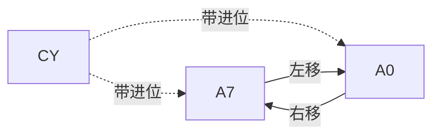

# 逻辑运算类指令（ANL、ORL、XRL、RL、RRC等）

> [!IMPORTANT]
> 逻辑运算类指令是对操作数按**位**进行布尔运算或移位操作的指令，结果通常送回累加器 A 或进位标志 C。

在单片机控制中，我们常需“屏蔽某几位”、“强制置位”或“翻转信号”，算术指令做不到逐位独立控制，而逻辑指令正是为此而生。

## 逻辑与、或、异或（ANL / ORL / XRL）

这三条指令分别对应按位与（`.AND.`）、按位或（`.OR.`）、按位异或（`.XOR.`）。它们支持寄存器寻址、直接寻址、寄存器间接寻址和立即数寻址。

想一想：如果想把 A 的高 4 位清零，低 4 位保持不变，该怎么做？答案是 `ANL A, #0FH`。

| 需求 | 选用指令 | 掩码技巧 |
| :--- | :--- | :--- |
| 清特定为 0，其余不变 | `ANL` | 要保留的位写 1，要清的位写 0 |
| 置特定为 1，其余不变 | `ORL` | 要置位的写 1，不变的写 0 |
| 翻转特定位，其余不变 | `XRL` | 要翻转的写 1，不变的写 0 |

以 `ANL` 为例，指令格式及执行周期如下：

- `ANL A, Rn` / `ANL A, direct` / `ANL A, @Ri` / `ANL A, #data`：$(A) \leftarrow (A) \text{ .AND. } \text{src}$，==执行周期均为 1==。
- `ANL direct, A` / `ANL direct, #data`：目标为直接地址，==执行周期为 2==。

`ORL` 与 `XRL` 的寻址方式、目的操作数分布和执行周期规律与 `ANL` **完全一致**。

## 移位与半字节交换（RL / RLC / RR / RRC / SWAP）

这类指令仅针对累加器 A 操作，==执行周期全为 1==。

- **`RL A`**：循环左移。$(A_{n+1}) \leftarrow (A_n),\; n=0\sim6;\; (A_0) \leftarrow (A_7)$。
- **`RLC A`**：带进位循环左移。$(A_{n+1}) \leftarrow (A_n),\; (A_0) \leftarrow (C),\; (C) \leftarrow (A_7)$。
- **`RR A`**：循环右移。$(A_n) \leftarrow (A_{n+1}),\; n=0\sim6;\; (A_7) \leftarrow (A_0)$。
- **`RRC A`**：带进位循环右移。$(A_n) \leftarrow (A_{n+1}),\; (A_7) \leftarrow (C),\; (C) \leftarrow (A_0)$。
- **`SWAP A`**：高低半字节互换。$(A_{3\sim0}) \leftrightarrow (A_{7\sim4})$。

> [!WARNING]
> `RL`/`RR` 是 A 内部 8 位首尾相接循环；而 `RLC`/`RRC` 是将进位标志 CY 作为第 9 位参与循环，==会改变 CY 的值==！

## 位变量的逻辑运算

MCS-51 具有布尔处理机，可直接对位地址（如特殊功能寄存器的位名称 P、ACC.0 等）进行逻辑运算，但**只能以 C（即 CY）为目的操作数**。

- `ANL C, bit`：$(C) \leftarrow (C) \text{ .AND. } (bit)$
- `ANL C, /bit`：$(C) \leftarrow (C) \text{ .AND. } (\overline{bit})$，注意 `/bit` 表示取反后参与运算，但不改变原 bit 的值。
- `ORL C, bit` 与 `ORL C, /bit` 同理。

以上位逻辑指令执行周期均为 2。

> [!TIP]
> 字节指令用 `.AND.` 掩码批量处理；位指令用 `ANL C, bit` 实现多条件串联判断。

## 算例验证

设 $(A) = 10101100B$，$(C) = 1$，执行 `RRC A`。

根据定义：$(A_n) \leftarrow (A_{n+1})$，最低位 $A_0$ 移入 C，原 C 移入最高位 $A_7$。
- 原 $A_0 = 0$，故新 $(C) = 0$。
- 原 $(C) = 1$，故新 $A_7 = 1$。
- 其余位右移一位。

结果：$(A) = 11010110B = D6H$，$(C) = 0$。

> [!CAUTION]
> 考试中极易混淆 `RL` 与 `RLC`。务必看清指令是否带字母 `C`，带 `C` 就必须把 CY 画进移位链条里一起算！
