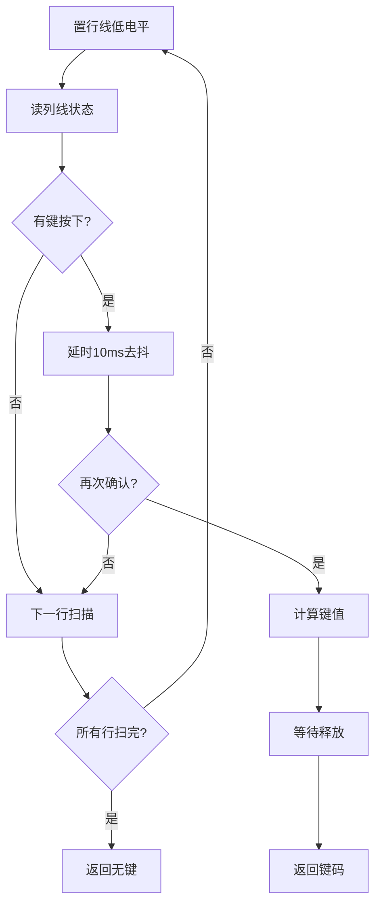

# 键盘接口设计与按键扫描

## 什么是行列式键盘

当按键数量超过8个时，若仍采用独立式接法会耗尽I/O口。==行列式键盘==通过矩阵排列，用 $M+N$ 根线即可识别 $M \times N$ 个按键，是单片机系统扩展输入设备的标准方案。其核心思想是“分时复用”：逐行输出低电平，同时读取列线状态，通过“行号+列号”唯一确定闭合键的位置。

## 扫描流程与动态显示协同

键盘扫描并非孤立操作，在南邮课程体系中常与数码管动态显示结合考察。两者共享CPU时间片，需在显示刷新间隙插入扫描逻辑。

> [!IMPORTANT]
> ==键值计算公式==：$\text{KeyVal} = \text{Row} \times N + \text{Col}$，其中 $N$ 为列数。例如4×4键盘中，第2行第3列（均从0起）键值为 $2 \times 4 + 3 = 11$。

## 与独立按键的核心区别

| 对比维度 | 独立式按键 | 行列式键盘 |
| :--- | :--- | :--- |
| I/O占用 | $n$ 键需 $n$ 口 | $M \times N$ 键仅需 $M+N$ 口 |
| 识别方式 | 直接读引脚电平 | 逐行扫描+列线检测 |
| 软件复杂度 | 简单查询或中断 | 需扫描循环+去抖+释放检测 |
| 适用场景 | ≤8键的简单系统 | ≥9键的人机交互面板 |

## 动态显示与扫描的结合要点

> [!TIP]
> 在“数码管动态显示驱动和按键扫描相结合”题型中，==扫描必须嵌入显示刷新周期==，通常安排在位选切换后的短暂空闲时段执行一次行扫描，避免显示闪烁。

实际编程时需注意三点协同：① 扫描耗时不能超出单只数码管的驻留时间（通常≤2ms）；② 去抖延时应拆分为多次短延时分散到多个显示周期内，而非集中阻塞；③ 键值处理结果可直接作为显示缓冲区索引，实现“按键即显”。

## 常见陷阱与正确示例

> [!WARNING]
> ==未检测按键释放==是最典型错误！若缺少“等待释放”环节，单次按压会被识别为连续多次触发，导致菜单跳转失控或计数翻倍。

**正确算例**：4×4键盘，P1高4位接行线、低4位接列线。扫描第1行时P1=0xEF，读回P1低4位为0x0B（即D2列被拉低）。则行号=1，列号=2，键值=$1\times4+2=6$。经10ms去抖后重读仍为0x0B，确认有效；随后循环等待P1低4位恢复0x0F才返回键码6。此过程完整包含“扫描→去抖→确认→等释放”四步，符合南邮实验与考试评分标准。

> [!CAUTION]
> 硬件上必须在列线加==上拉电阻==，否则开路状态下读取电平不确定，扫描结果完全随机。软件初始化时也需先将所有行线置高，防止上电瞬间误触发。
