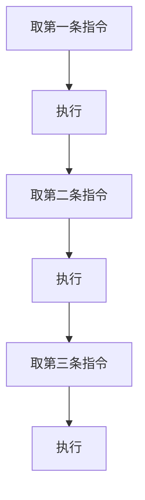

# 顺序结构程序设计

## 顺序结构程序设计

顺序结构是最基本、最简单的程序结构：程序按指令在存储器中的存放顺序**逐条执行**，执行完一条后自动指向下一条，中间没有任何分支、跳转或循环。



---

### 为什么需要它

任何程序的执行流都由三种基本结构组成：==顺序、分支、循环==。顺序结构是后两者的基础——分支和循环内部每一段被执行的代码，本身仍然是顺序执行的。汇编语言没有高级语言的代码块概念，程序走向完全由**指令指针（PC）**决定，因此理解顺序结构就是理解“PC 自动加 1”这一默认行为。

### 怎么实现

顺序结构在 MCS-51 汇编中不需要任何专门的控制指令。只需要**顺序书写指令**即可：

```asm
        ORG   0000H
        MOV   A, #30H      ; 将立即数 30H 送入累加器 A
        ADD   A, #12H      ; A = A + 12H，结果 42H
        MOV   R0, A        ; 将 A 的内容存入 R0
        MOV   40H, R0      ; 再存入内部 RAM 的 40H 单元
        SJMP  $            ; 程序暂停（原地踏步）
        END
```

执行过程：PC 从 `0000H` 开始，每取完一条指令，PC 自动加上该指令的字节数，指向下一条指令地址。整段程序没有使用 `LJMP`、`SJMP`、`JZ`、`DJNZ` 等跳转指令，流向完全直线前进。

> [!IMPORTANT]
> 顺序结构的本质：==PC 按指令长度自动递增==，不需要任何跳转指令介入。如果程序中所有指令都属于顺序结构，程序执行一次后就会“跑飞”到未知地址，所以实际工程中顺序程序段末尾通常接一条停机方式（如 `SJMP $`）或跳转指令。

### 与分支、循环的区别

| 结构 | 特征 | MCS-51 实现手段 |
|---|---|---|
| 顺序 | 逐条执行，PC 依次递增 | 无控制指令，顺序书写 |
| 分支 | 根据条件选择一条路径 | `JZ`、`JNZ`、`CJNE`、`DJNZ` + 标号 |
| 循环 | 重复执行某段代码 | `DJNZ` 或条件跳转 + 标号回跳 |

> [!WARNING]
> 常见的坑：在顺序结构的程序段末尾忘记加 `SJMP $` 或 `LJMP` 等停机/跳转指令，导致 PC 继续向下取指，执行到未定义区域，出现不可预知的结果。考试写完整程序时**必须先写 `ORG 0000H`，结尾必须有 `END`**。

### 一个算对了的例子

**题目**：已知内部 RAM 中 `30H` 单元存放 BCD 码 `58H`，编程将其转换成 ASCII 码，高 4 位存放在 `31H`，低 4 位存放在 `32H`。

**分析**：BCD 码 `58H` 拆成高 4 位 `05H` 和低 4 位 `08H`。ASCII 码 `'5' = 35H`，`'8' = 38H`，即在高/低 4 位基础上分别加上 `30H`。

```asm
        ORG   0000H
        MOV   A, 30H        ; A = 58H（BCD码）
        ANL   A, #0FH       ; 屏蔽高4位，A = 08H（取低4位）
        ORL   A, #30H       ; A = 38H（转换为ASCII码）
        MOV   32H, A        ; 低4位ASCII码存入32H

        MOV   A, 30H        ; 重新取原始数据
        SWAP  A             ; 高低4位互换，A = 85H
        ANL   A, #0FH       ; 取原高4位（现低4位），A = 05H
        ORL   A, #30H       ; A = 35H（转换为ASCII码）
        MOV   31H, A        ; 高4位ASCII码存入31H
        SJMP  $             ; 程序暂停
        END
```

**执行验证**：

- 第一步后 `A = 38H` → `(32H) = 38H`，对应字符 `'8'` ✓
- 第二步后 `A = 35H` → `(31H) = 35H`，对应字符 `'5'` ✓

整个过程没有任何分支跳转，数据按固定顺序依次流经各指令，是典型的顺序结构。

> [!TIP]
> 顺序结构看“数据流”：画一张表跟踪每条指令执行后 A、R0、对应内存单元的值，比逐行盯汇编代码更不容易算错。考试中顺序结构题目往往是“送分题”，关键是**把每一步的中间结果写清楚**。
