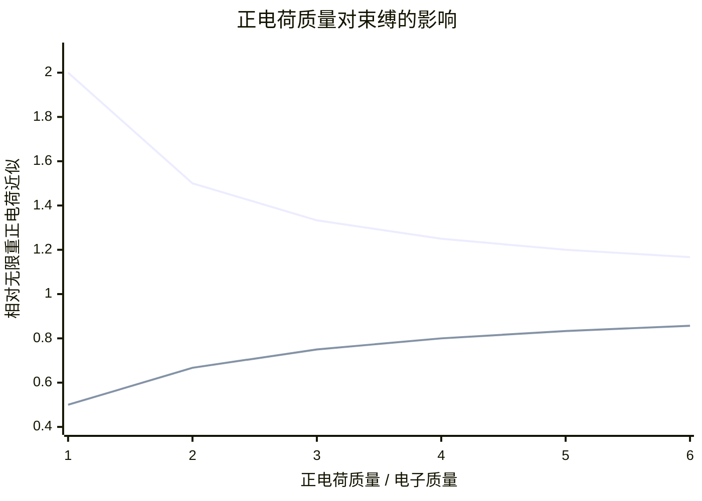

# 双体库仑束缚：为什么轨道尺度和束缚能受质量影响

在氢原子的初步模型中，质子远比电子重，常把它看成不动。若两粒子一样重，仍然固定其中一个，会怎样？即使两粒子受到的力没有变，==它们的距离是两者一起改变的==。库仑势取决于这个距离，因而真正要量子化的是相对运动，不是任选一个粒子绕质心的运动。

## 先把平移和内部运动拆开

两粒子质量为 $m_1,m_2$，令 $\mathbf r=\mathbf r_1-\mathbf r_2$，总质量为 $M=m_1+m_2$，以质量加权得到质心 $\mathbf R=(m_1\mathbf r_1+m_2\mathbf r_2)/M$。于是

$$
\mathbf r_1=\mathbf R+\frac{m_2}{M}\mathbf r,\qquad
\mathbf r_2=\mathbf R-\frac{m_1}{M}\mathbf r.
$$

把两式对时间求导后代回动能，质心速度和相对速度的交叉项正好抵消：

$$
T=\frac{M}{2}\left|\frac{\mathrm d\mathbf R}{\mathrm dt}\right|^2
+\frac{\mu}{2}\left|\frac{\mathrm d\mathbf r}{\mathrm dt}\right|^2,\qquad
\mu=\frac{m_1m_2}{M}.
$$

若两粒子电荷分别为 $-e$ 与 $+Ze$，势能 $-Ze^2/(4\pi\varepsilon_0|\mathbf r|)$ 只依赖内部坐标。质心可以整体平移，内部的相对坐标则像一个质量为 $\mu$ 的粒子，在同样的库仑势中运动。为什么这里不是总质量？总质量描述整个系统一起动的惯性；在质心系里，把间距缩小，两粒子反向移动，所需的动能由 $\mu$ 决定。

| 题面条件 | 内部使用的质量 | 核对 |
|---|---|---|
| 正电荷远重于负粒子 | $\mu\approx m_1$ | 固定重粒子是近似，不是普适步骤 |
| 两粒子等重 $m$ | $\mu=m/2$ | 两粒子反向移动，各走间距变化的一半 |
| 两粒子同时换到新的匀速参照系 | $\mu$ 不变 | 只改变质心项，不改变内部能级差 |

## 光谱能量变小，空间尺度为什么反而变大

定义 $k=Ze^2/(4\pi\varepsilon_0)$。在非相对论的点电荷库仑模型中，取长度 $\ell=\hbar^2/(\mu k)$ 后，内部动能算符和库仑势的能量尺度都正比于 $\mu k^2/\hbar^2$。无量纲方程与氢原子的相同，束缚态能量因此为

$$
E_n=-\frac{\mu k^2}{2\hbar^2n^2}
=-\frac{\mu}{m_e}\frac{Z^2}{n^2}hcR_\infty,\qquad
\ell=\frac{m_e}{\mu}\frac{a_0}{Z}.
$$

以两粒子分开且相对动能为零的阈值作能量零点。==固定电荷与主量子数时，约化质量越小，束缚越浅、间距尺度越大==。这是空间与能量的同一个变化，不是两个需要分别记忆的规则。

图中固定 $Z=1$ 和基态，以无限重正电荷的结果为基准。近似折线连接六个等距质量比的采样点：上方是尺度比 $\ell/a_0$，下方是电离能比 $E_{\mathrm{ion}}/(hcR_\infty)$。两者都趋向 1，但分别从上面和下面逼近。

> [!TIP]
> 例如将电子和单电荷正粒子配对，后者质量为 $3m_e$。先得 $\mu=3m_e/4$，再用氢样基态尺度核对：电离能约 $0.75\times13.606~\mathrm{eV}=10.20~\mathrm{eV}$，长度尺度为 $4a_0/3$。把正粒子进一步加重，这两个数应分别回到约 $13.606~\mathrm{eV}$ 和 $a_0$，而不能沿同一个方向改变。

> [!WARNING]
> 上述结果是相对运动的库仑模型，不保证束缚态永远稳定，也不含相对论、自旋及辐射修正。对正负电子组成的电子偶素，湮灭寿命是另一物理量，不能把产生湮灭光子的总能量叫作电离能。[相关电子偶素研究的模型说明](https://link.springer.com/article/10.1140/epjd/s10053-026-01191-2)也将这些修正与粗结构分开。
