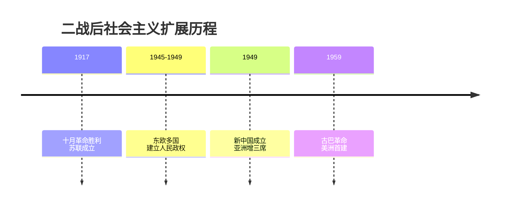

# 二战后社会主义从一国到多国的发展

## 社会主义从一国到多国的发展

二战结束后，世界政治格局发生了根本性变化。社会主义越出苏联一国的范围，在欧亚大陆和拉丁美洲相继建立，形成了与世界资本主义体系相抗衡的社会主义阵营。理解这段历史，可以从一个先例和一次浪潮两个维度来把握。

### 为什么能“从一到多”：十月革命提供的先例

社会主义在多国建立，其理论和实践起点都要回溯到 **1917 年的俄国十月革命**。

十月革命是俄国工人阶级在布尔什维克党领导下联合贫农完成的社会主义革命。它发生在 **1917 年 11 月 7 日**（俄历 10 月 25 日），核心领导人正是 **列宁**。这次革命建立了世界上第一个无产阶级专政的国家——苏维埃俄国。

> [!IMPORTANT]
> 列宁领导的十月革命，不仅开创了俄国历史的新纪元，更重要的是：==它为世界各国的无产阶级革命、以及殖民地半殖民地的民族解放运动开辟了胜利前进的道路。== 这正是社会主义能够从一国走向多国的根本前提。

### 一次浪潮：二战后社会主义阵营的形成

如果说十月革命是“星星之火”，那么第二次世界大战的胜利就是“燎原之风”。在苏联的影响和支持下，一系列国家在反法西斯战争胜利的基础上，由本国共产党领导人民完成了民族民主革命，并逐步走上社会主义道路。

从地域分布看，这一时期的社会主义国家主要集中于三块：

| 区域 | 主要国家 | 特点 |
| :--- | :--- | :--- |
| **东欧** | 波兰、捷克斯洛伐克、匈牙利、罗马尼亚、保加利亚、南斯拉夫、阿尔巴尼亚、民主德国 | 在苏联红军帮助下解放，受苏联影响最深 |
| **亚洲** | 中国、朝鲜、越南、老挝 | 共产党独立领导革命，走“农村包围城市”等本土化道路 |
| **拉丁美洲** | 古巴 | 1959 年革命胜利，首次在美洲建立社会主义制度 |

### 一张“地理考卷”：东欧与亚洲的辨析

这部分知识最常见的考点之一，是要求区分哪些国家属于哪个阵营或地域。比如这道题目：

> 下列二战后出现的社会主义国家中，属于东欧国家的有（）
> A. 古巴  B. 南斯拉夫  C. 波兰  D. 老挝
> 答案：**B、C**

解析这道题，要抓住一个关键：==二战后社会主义的扩展，本质上是反法西斯战争胜利的政治成果。==

- **古巴**（A）革命发生在 1959 年，不在欧亚大陆，属于拉丁美洲，且时间晚于战后初期。
- **老挝**（D）属于东南亚国家，亚洲阵营。
- **南斯拉夫**（B）和 **波兰**（C）都位于欧洲东部，是二战期间被法西斯德国占领、战后在共产党领导下获得解放的典型东欧国家，因此正确。

> [!TIP]
> 记忆口诀：“欧洲看苏联，亚洲看中越，美洲看古巴。” 凡是二战结束后（1945–1949年间）迅速建立社会主义制度的欧洲国家，基本都属于“东欧阵营”。

### 另一道题：“一国两制”的时间锚点

虽然“一国两制”的构想提出更早，但其成功实践发生在稍晚的改革开放新时期。关于时间点，常以选择题直接考查：

> （D）年 12 月 20 日，中国政府恢复对澳门行使主权。
> A. 1991  B. 1992  C. 1997  D. 1999
> 答案：**D**

> [!WARNING]
> 这道题最大的“坑”是把 **澳门回归（1999）** 和 **香港回归（1997）** 记混。老规矩：先看时间、再看地点。1997 是香港，1999 才是澳门。

把握这段“从一国到多国”的扩展，核心记住三步：**十月革命开了头，二战胜利推一把，全球分布分三块。** 再配上几个关键的时间点和地理坐标，就能把知识网准确建立起来。
