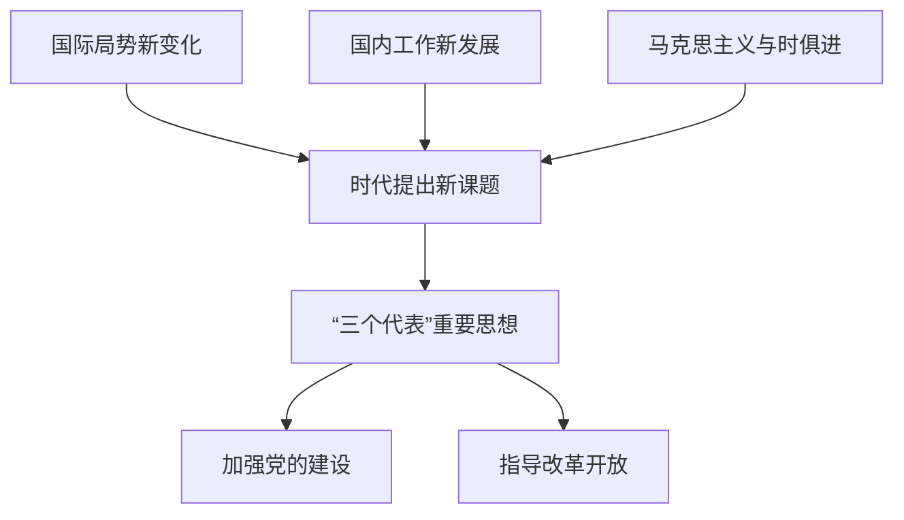

# “三个代表”重要思想的提出、内涵及实践

## 是什么

“三个代表”重要思想是中国共产党在==21世纪初形成的指导思想==，集中回答了“建设什么样的党、怎样建设党”这一根本问题。其完整表述是：

> [!IMPORTANT]
> 中国共产党必须始终代表中国先进生产力的发展要求，代表中国先进文化的前进方向，代表中国最广大人民的根本利益。

2000年2月，江泽民在广东考察时提出这一思想；2001年建党80周年时作系统阐述；2002年党的十六大把其写入党章；==2007年党的十七大==又写入党章，确立为党的指导思想。

## 为什么提出

20世纪末，国内外形势发生深刻变化：国际竞争更加激烈，科学技术迅速发展；国内改革开放进入新阶段，社会经济成分、组织形式和利益关系日益多样，党的建设也面临新课题。

这些变化说明，党如果不能始终保持先进性和纯洁性，就难以巩固执政地位。因此，“三个代表”不是对既有政策的简单重复，而是对==如何继续保持党的先进性==的回答。

## 三层内涵

| 方面 | 核心要求 | 实践指向 |
|---|---|---|
| 先进生产力 | 始终代表其发展要求 | 推进改革、科技创新和生产力发展 |
| 先进文化 | 始终代表其前进方向 | 坚持马克思主义，推动社会主义先进文化发展 |
| 最广大人民 | 始终代表其根本利益 | 维护人民利益，关心民生，联系群众 |

注意：这里的“代表”不是只说利益，而是指==发展方向和根本要求==。例如，发展先进生产力不能只看局部、短期数字，还要看是否符合人民长远利益。

## 怎样实践

贯彻这一思想，关键是把它落实到党的建设和改革发展的各项工作中，而不是停留在口号上。

- **发展先进生产力**：推进经济体制改革和科技创新，提高自主创新能力。
- **发展先进文化**：坚持党的指导思想，继承优秀传统文化，建设社会主义核心价值体系。
- **维护人民根本利益**：坚持群众路线，完善社会保障，关注教育、就业、医疗等民生问题。
- **加强党的建设**：保持党的先进性、纯洁性，提高党的执政能力。

## 与相近概念的区别

| 概念 | 提出或确立时间 | 核心内容 |
|---|---|---|
| 邓小平理论 | 1997年党的十五大写入党章 | 什么是社会主义、怎样建设社会主义 |
| “三个代表”重要思想 | 2002年党的十六大写入党章 | 建设什么样的党、怎样建设党 |
| 科学发展观 | 2003年党的十六届三中全会正式提出 | 实现什么样的发展、怎样发展 |

![NOTE]
“科学发展观”的正式提出时间是2003年；不要把党的十六大提出的新世纪新阶段奋斗目标与其混淆。

## 常见考法与易错点

> [!WARNING]
> “三个代表”的提出、正式阐述、写入党章和确立为指导思想，是不同时间节点，不能混为一谈。

尤其注意：==党的十六大确立“三个代表”重要思想为党的指导思想==。题目若问“何时确立为党的指导思想”，答案是2002年党的十六大。

“始终代表”也是高频点。其对象分别是：中国先进生产力的发展要求、中国先进文化的前进方向、中国最广大人民的根本利益，不能替换成“资产阶级利益”或“所有阶层的具体利益”。

## 例题解析

**多选题**：“三个代表”重要思想是指中国共产党必须始终（ ）。

- A. 代表特权阶级的利益  
- B. 代表中国先进生产力的发展要求  
- C. 代表中国先进文化的前进方向  
- D. 代表中国最广大人民的根本利益  

**答案：BCD。**

A项错误。“三个代表”强调党始终代表最广大人民的根本利益，排斥代表特权阶级利益。B、C、D分别对应先进生产力、先进文化和人民根本利益三个基本方面。

> [!TIP]
> 记忆口诀：**生产力、文化、人民的根本利益**。  
> 时间记忆：**2000提出，2001系统阐述，2002十六大写入党章并确立为指导思想。**
