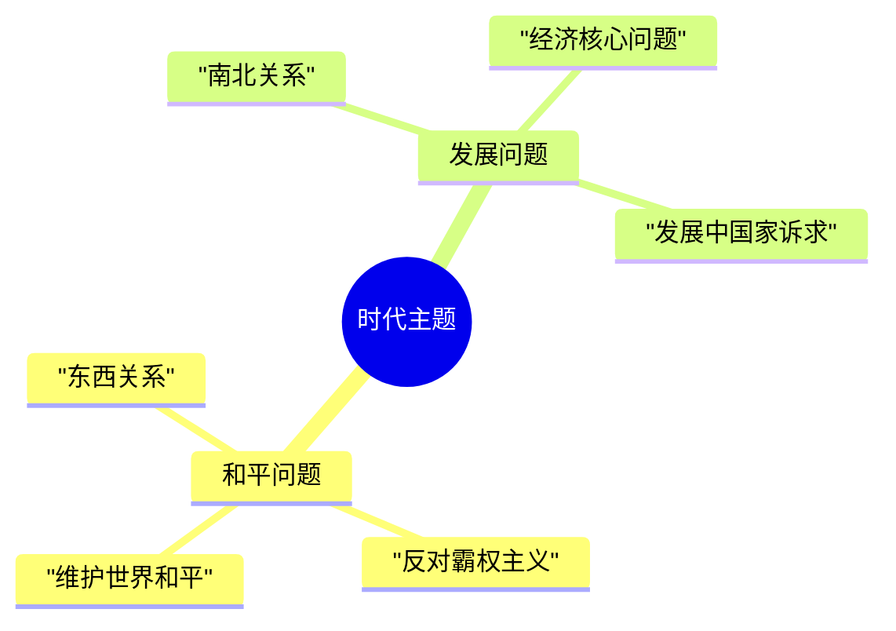

# 和平与发展时代主题的新判断与开启改革大幕

## 时代主题新判断的内涵与依据

为什么改革开放能在此时开启？这取决于对国际形势的根本性重新评估。过去我们长期认为“战争不可避免”，但邓小平同志敏锐指出，==和平与发展才是当代世界的两大主题==。这一判断并非否定矛盾存在，而是指在可预见的时期内，世界大战打不起来，各国竞争焦点已转向综合国力。

> [!IMPORTANT]
> 核心论断出自邓小平：“现在世界上真正大的问题，带全球性的战略问题，一个是和平问题，一个是发展问题。”其中，==发展问题是当代世界经济最核心的问题和集中体现==。

## 从理论判断到改革实践的逻辑链

有了“和平与发展”的判断，国内工作重心才能从“阶级斗争”转向“经济建设”。这一转变不是孤立的，而是通过一系列具体决策落地的。例如，恢复高考就是改革大幕开启在教育领域的先声。温元凯最初建议的十六字方针经邓小平调整，最终确立了“自愿报名、公平考试、择优录取”的原则（去掉了“领导批准”），这本身就是思想解放与制度改革的缩影。

| 维度 | 旧有认知/做法 | 新判断/新举措 | 关键意义 |
| :--- | :--- | :--- | :--- |
| 国际形势 | 战争迫在眉睫 | 和平与发展是主题 | 赢得建设时间窗口 |
| 工作重心 | 以阶级斗争为纲 | 以经济建设为中心 | 奠定现代化基础 |
| 人才选拔 | 推荐入学、领导批准 | 公平考试、择优录取 | 重启社会流动通道 |
| 思想束缚 | 姓社姓资争论 | 南方谈话破除迷障 | 确立市场经济方向 |

> [!TIP]
> 记忆口诀：==和平是前提，发展是核心==。做题时若问“最核心”“集中体现”，必选“发展”；若问“全球性战略问题”，则两者并列。

## 易混概念辨析与真题避坑

许多同学混淆“时代主题”与“时代潮流”。==时代主题是客观存在的战略性问题==（和平与发展），而==时代潮流是主观愿望与历史趋势的结合==（世界要和平、人民要合作、国家要发展、社会要进步）。前者是分析框架，后者是价值导向。

> [!WARNING]
> 常见误区：将“和平”误认为比“发展”更重要。实际上，在当代世界经济语境下，发展才是解决一切问题的基础和关键，也是南北矛盾的焦点。

以真题为例：题目问“当代世界经济最核心的问题”，选项含和平、贸易、金融、发展。根据邓小平理论，贸易与金融只是发展的具体领域，和平是外部条件，唯有“发展”本身才是==贯穿全球经济关系的根本主线==，故正确答案为 D。同样，1992年南方谈话视察地包括武昌、深圳、珠海、上海四地，其核心目的正是从理论上回答困扰人们的重大认识问题，进一步巩固了对时代主题的判断，推动改革向纵深发展。

> [!NOTE]
> “时代特征”是指与特定时代相适应的国际政治经济关系基本状态，由世界基本矛盾决定。理解这一点，有助于区分“主题”（问题导向）与“特征”（状态描述），避免在判断题中张冠李戴。
