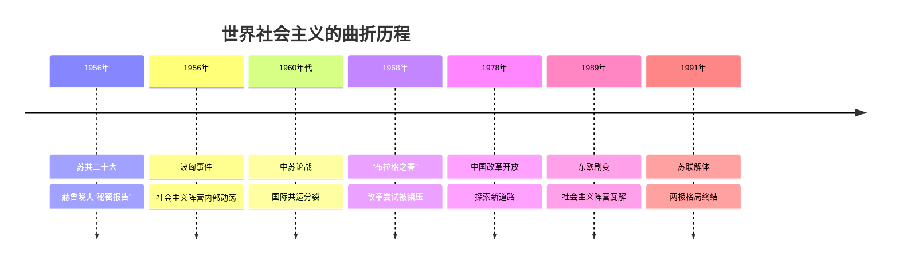
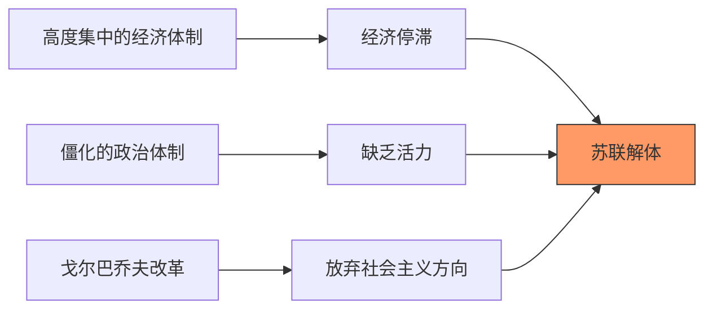

# 苏共二十大后世界社会主义经历的曲折与严峻考验

## 苏共二十大后的世界社会主义：成就与曲折并存

先问自己：苏共二十大（1956年）召开后，社会主义阵营一片大好，为什么短短几十年后却发生了苏联解体、东欧剧变？答案要从这条时间线的**内在矛盾**找起。

## 从“阵营”到“危机”的时间线

这条曲线揭示了一个核心问题：苏共二十大虽然揭开了**斯大林个人迷信**的盖子，但赫鲁晓夫全盘否定斯大林的做法，引发了国际共运内部的==思想混乱==，为后来的危机埋下了伏笔。

## 中国的探索：成就与挫折

在苏联模式暴露出弊端的同时，中国也经历了**独立探索**的曲折：

| 事件 | 性质 | 后果 |
|------|------|------|
| **“大跃进”和人民公社化运动** | 急于求成、脱离实际 | 国民经济比例严重失调 |
| **“文化大革命”** | 全局性、长时间“左”倾错误 | 新中国成立以来最严重的挫折和损失 |
| **改革开放**（1978后） | 拨乱反正、实事求是 | 中国特色社会主义道路的开辟 |

> [!IMPORTANT]
> 中国的教训表明：==必须坚持社会主义道路，但必须结合本国实际，不能照搬模式，更不能搞“左”的急于求成==。

## 苏联解体的深层原因

苏联解体是20世纪世界社会主义遭受的**最严重挫折**。其根源在于：

- **体制僵化**：高度集中的计划经济模式长期未能根本改革，导致经济效率低下。
- **改革失误**：戈尔巴乔夫的“新思维”改革偏离了社会主义方向，放弃了共产党的领导地位。
- **外部压力**：西方“和平演变”战略的长期渗透。

## 最大的启示

苏联解体给我们最大的启示是什么？是优先发展重工业，还是必须坚持计划经济？都不是。历史给出的答案是：

> [!TIP]
> **解题关键**：苏联解体的直接原因是放弃社会主义道路，因此==必须坚持社会主义道路==是最根本的启示。其他选项（优先发展重工业、高度集中体制、计划经济）恰恰是苏联模式的**弊端**或**已证明失败的做法**。

**例题解析**：  
题目：苏联解体给我们最大的启示是（D）。  
A. 必须优先发展重工业（×，片面发展重工业正是苏联模式弊端）  
B. 必须建立高度集中的政治体制（×，体制僵化是解体原因之一）  
C. 必须坚持计划经济（×，计划经济体制需改革）  
D. 必须坚持社会主义道路（√，苏联放弃了社会主义，导致解体）

## 总结：曲折中的前进

世界社会主义在苏共二十大后经历了**严峻考验**，但中国的改革开放证明了：==社会主义具有强大生命力，关键在于把马克思主义基本原理同本国具体实际相结合==，走符合国情的发展道路。
