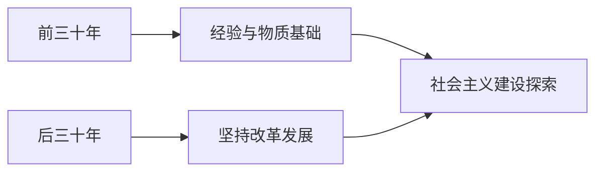

# 正确处理改革开放前后两个三十年的关系

## 它是什么

“两个三十年”指以党的十一届三中全会为界，改革开放前的社会主义革命和建设时期，以及改革开放后的社会主义现代化建设新时期。二者在思想指导、方针政策、实际工作上有很大差别，但本质上都是==党领导人民进行社会主义建设的实践探索==，不能相互否定。

## 为什么必须正确处理

改革开放前的探索提供了宝贵经验、理论准备和物质基础；改革开放后的探索坚持、改革并发展了前一段探索。若只讲曲折，会把前三十年说成“一片空白”；若只讲成就，又会把后三十年说成“另起炉灶”。正确态度是既分清阶段，又看到连续性，在总结历史经验中坚定中国特色社会主义道路。

## 怎么做：评价历史的三把尺子

- **看领导与方向**：两个时期都坚持党的领导和社会主义方向，不能把具体政策调整等同于改变根本制度。
- **看探索与接续**：前三十年不是后三十年的对立面，后三十年也不是对前三十年的简单延续，而是在新的历史条件下继承、纠正和创新。
- **看主流与曲折**：既承认探索中的严重曲折，也看到建立社会主义基本制度、推进工业化和积累建设经验等重大成就，避免以偏概全。

评价毛泽东和毛泽东思想，同样要放在历史进程中全面分析。党的十一届六中全会通过《关于建国以来党的若干历史问题的决议》，==肯定了毛泽东的历史地位，提出必须坚持和发展毛泽东思想==，体现了实事求是评价历史、统一全党思想的要求。

## 和相近说法的区别

| 说法 | 问题所在 | 正确认识 |
|---|---|---|
| 用前三十年否定后三十年 | 把改革看成背离社会主义 | 改革是社会主义制度的自我完善和发展 |
| 用后三十年否定前三十年 | 抹杀前期探索的奠基作用 | 前期探索为后续发展提供条件和经验 |
| 两个时期完全相同 | 忽视方针政策和发展阶段的差别 | 本质相连，但具体实践有区别 |
| 只记“互不否定” | 容易变成口号，忽略历史评价 | 还要理解继承、发展与纠正错误的关系 |

> [!WARNING]
> “不能相互否定”不等于两个时期没有区别，也不等于对历史错误不作总结。==改革是社会主义发展的内在要求==，但改革不是改旗易帜，更不是复古或简单沿袭。

## 例题

**题目：**（　）审议通过《关于建国以来党的若干历史问题的决议》，肯定了毛泽东的历史地位和毛泽东思想。  
A. 党的十一届三中全会　B. 党的十一届六中全会　C. 党的十二大　D. 党的十四大

**答案：B。** 解题时先抓“历史问题决议”这一标志，再对应党的十一届六中全会。十一届三中全会的核心考点是作出把党和国家工作中心转移到经济建设上来、实行改革开放的历史性决策，不能混淆。

> [!TIP]
> 记忆主线：**前期奠基、后期发展；分清差别、反对互否；评价历史、实事求是。**
