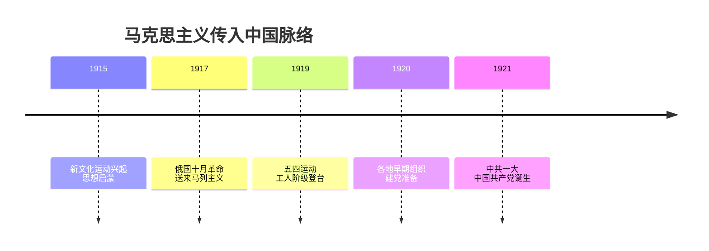

# 马克思主义传入中国与中国共产党应运而生

## 马克思主义传入中国与中国共产党应运而生

先想一个问题：十九世纪后期到二十世纪初，中国已经试过洋务运动、戊戌变法、辛亥革命，为什么这些路都没能真正改变国家命运？==关键不在于“要不要变”，而在于“依靠谁、用什么思想来变”。==

### 马克思主义是怎样来到中国的

马克思主义不是中国人自己“想出来”的，也不是直接从欧洲“飞过来”的。它的传入有一个关键转折点——==俄国十月革命==。

> [!IMPORTANT]
> 二十世纪初期，给中国送来马克思列宁主义的是 **俄国十月革命**，不是新文化运动，也不是五四运动本身。新文化运动为接受新思想做了思想准备，五四运动推动了马克思主义广泛传播，但“送”来马列主义的是十月革命的炮声。

十月革命让中国先进分子第一次看到：一个经济文化落后的国家，可以依靠==工人阶级==和==马克思列宁主义==取得革命胜利。这对当时苦寻出路的中国知识分子冲击极大。

### 五四运动：从“学生运动”到“工人登台”

五四运动最初由学生发起，但真正让它从请愿抗议变成全国性政治力量的是==工人阶级的参与==。

> [!WARNING]
> 五四运动的主要参与群体是 **学生、工人、商界人士**。农民不是五四运动的主要参与群体，这道多选题容易把“农民”也选进去。

当时传播马克思主义的重要阵地是报刊。毛泽东在湖南主编的==《湘江评论》==是其中代表，他本人也在这一过程中完成了思想转变。

> [!NOTE]
> 《新青年》是新文化运动和马克思主义传播的核心刊物，《湘江评论》是毛泽东在湖南主编的刊物。题目问“1919 年毛泽东在湖南主编推动马克思主义传播”的刊物，答案是 **《湘江评论》**，不是《新青年》。

### 从思想传播到组织建党

先进青年们在救亡图存运动中清醒认识到：==必须以工人阶级为基础、以马克思列宁主义武装自己==，才能解救民族危亡。

1921 年，中国共产党第一次全国代表大会在上海召开。会议期间因租界巡捕搜查，==最后一天转移到浙江嘉兴南湖的游船上==继续举行。

> [!TIP]
> 记忆口诀：“上海开幕，嘉兴收尾”。南湖红船由此成为党的诞生地象征。

一大通过了《中国共产党第一个纲领》。这个纲领明确了革命的方向：==推翻资本家阶级的政权，承认无产阶级专政，援助工人阶级==。注意——它承认的是 **无产阶级专政**，不是“农民阶级专政”。

> [!CAUTION]
> 选项中出现“承认农民阶级专政”是错误描述。无产阶级专政是根本原则，农民是同盟军，不是专政主体。

### 一个“算对了”的典型题

**例题（多选）**：先进青年们在救亡图存的运动中清醒认识到，什么才是解救民族危亡的良方？

- **正确思路**：中国革命要成功，必须依靠新生的==工人阶级==，用==马克思列宁主义==武装自己。所以选 **B（以工人阶级为基础）** 和 **C（以马克思列宁主义武装自己）**。
- **错误选项辨析**：农民阶级固然重要，但不是无产阶级政党的阶级基础；“对人民无私奉献”是道德要求，不是阶级路线和历史规律层面的救国方案。

### 常见坑汇总

| 易混点 | 正确结论 | 常见错误 |
|---|---|---|
| 谁来“送”马列主义 | 俄国十月革命 | 误选五四运动或新文化运动 |
| 五四参与群体 | 学生、工人、商界人士 | 多选“农民” |
| 毛泽东主编刊物 | 《湘江评论》 | 误选《新青年》 |
| 一大纲领承认什么 | 无产阶级专政 | 误选“农民阶级专政” |
| 一大转移地点 | 嘉兴南湖 | 误选宁波、苏州 |

### 一句话总结

==十月革命送来马克思列宁主义，五四运动让工人阶级登上历史舞台，中国先进分子以工人阶级为基础、以马列主义为武器，建立了中国共产党。==
