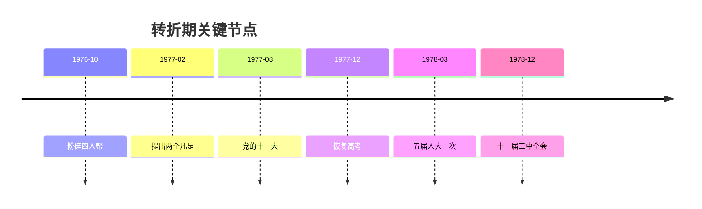

# 粉碎“四人帮”后“中国向何处去”的争论与邓小平复出

粉碎“四人帮”后，中国面临着向何处去的重大历史抉择。这一时期并非直接进入改革开放，而是经历了一段==在徘徊中前进==的特殊过渡期。理解这段历史，关键在于厘清“宣告结束”与“真正转折”的区别，以及邓小平复出过程中教育领域率先突破的标志性意义。

## 历史转折的“两步走”

为什么1976年10月粉碎“四人帮”后，党和国家的工作没有立即走上正轨？因为当时中央主要领导人提出了“两个凡是”的错误方针，导致思想僵化。真正的拨乱反正经历了从“形式宣告”到“实质转折”的过程。

> [!IMPORTANT]
> ==党的十一大宣告“文革”结束，但十一届三中全会才实现伟大转折。==前者总结了同“四人帮”的斗争，却未能纠正“左”倾错误；后者才重新确立了实事求是的思想路线。

考试中极易混淆这两次会议的定位。例如真题问及“着重总结同‘四人帮’斗争并宣告文革结束”的会议，正确答案是**党的十一大**，而非十一届三中全会。同样，题为《团结起来，为建设社会主义的现代化强国而奋斗》的政府工作报告出自**五届全国人大一次会议**（1978年），这是新时期首次明确提出现代化建设目标的国家级会议。

## 邓小平复出与教育破冰

邓小平的复出不是简单的职务恢复，而是伴随着对“两个凡是”的实践突破。他选择科教领域作为突破口，其中恢复高考是最具象征意义的“算对了的例子”。

1977年，温元凯建议恢复高考并提出十六字方针。经邓小平亲自调整，最终确定的招生方针为：

| 原提议内容 | 最终确定方针 | 核心变化 |
| :--- | :--- | :--- |
| 自愿报名 | 自愿报名 | 保留 |
| 领导批准 | **公平考试** | ==废除推荐制== |
| 单位同意 | （取消） | 打破出身限制 |
| 择优录取 | 择优录取 | 强调能力导向 |

> [!TIP]
> 记忆口诀：“==自公择==”（自愿报名、公平考试、择优录取）。多选题中若出现“领导批准”或“单位同意”均为干扰项，这是新旧体制更替的核心考点。

## 常见误区警示

> [!WARNING]
> 切勿将“粉碎四人帮”等同于“改革开放开端”。1976年10月至1978年12月是==两年徘徊期==，虽有局部整顿（如恢复高考），但指导思想尚未根本转变。

> [!CAUTION]
> “两个凡是”社论发表于**1977年2月7日**，由《人民日报》《红旗》《解放军报》联合刊发。判断题中若将时间写为1976年或1978年均属错误，该时间节点是理解思想解放运动起因的关键锚点。

这段历史的本质，是从教条主义回归实事求是。无论是十一大的局限性，还是高考方针中删去“领导批准”，都印证了同一个逻辑：只有打破思想枷锁，中国才能找到正确的出路。掌握这些细节，不仅能应对选择题和判断题，更能深刻理解改革开放史中“破”与“立”的辩证关系。
