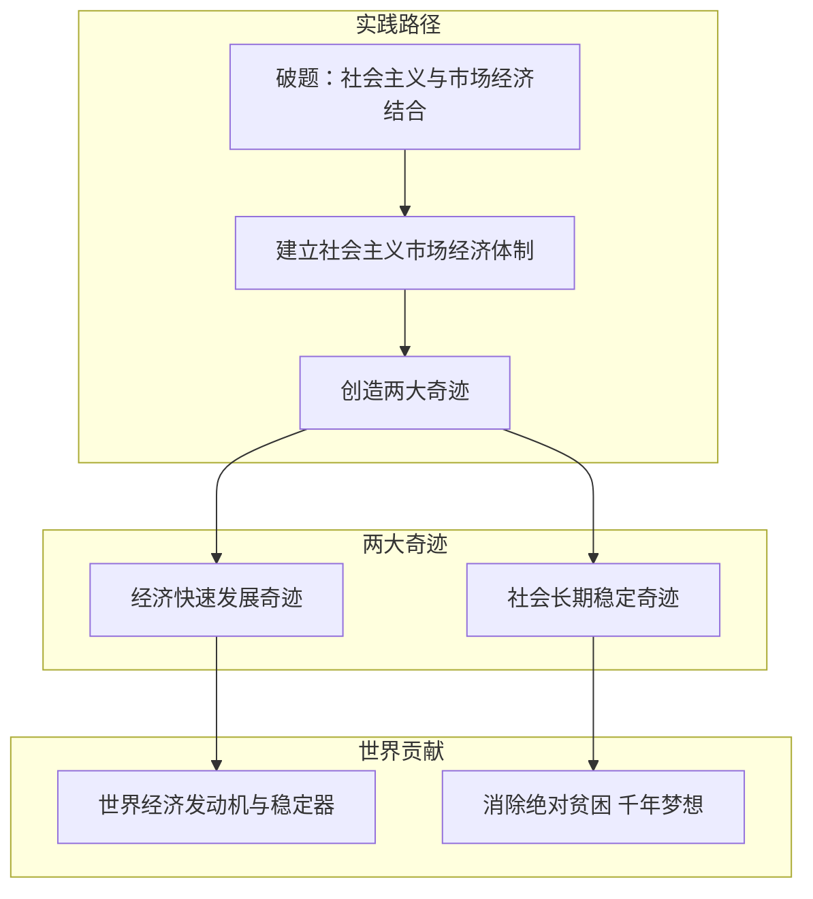

# 中国式现代化实践证明中国没有辜负社会主义
如果说“社会主义没有辜负中国”回答的是**历史选择**的问题，那么“中国没有辜负社会主义”回答的则是**实践创新**的问题。它不仅是一句政治宣言，更是一套可以用历史事实和发展数据验证的逻辑闭环。

### 为什么需要回答“没有辜负”？

社会主义从空想到科学、从理论到实践，曾长期面临一个核心质疑：**社会主义是否只能拘泥于单一模式？** 苏联解体、东欧剧变后，“历史终结论”一度甚嚣尘上。中国用中国式现代化的成功实践，给出了响亮的回答：==社会主义的生命力在于扎根本土，在于不断自我革新。==

### 中国式现代化的“社会主义答卷”

中国式现代化不是西方化的翻版，而是坚持科学社会主义基本原则，并结合中国国情进行的伟大创造。我们可以通过一个对比来看清楚“没有辜负”在哪：

| 比较维度 | 西方传统现代化 | 中国式现代化 |
| :--- | :--- | :--- |
| **核心逻辑** | 资本为中心，追求利润最大化 | ==人民为中心==，追求共同富裕 |
| **文明形态** | 伴随殖民掠夺、零和博弈 | ==人类文明新形态==，和平发展 |
| **发展维度** | 物质文明单兵突进，生态代价巨大 | 物质、政治、精神、社会、生态“五位一体”协调 |
| **世界难题** | 认为社会主义与市场经济不可兼容 | 成功把社会主义制度和市场经济结合起来 |

> [!IMPORTANT]
> 核心结论：中国式现代化**科学社会主义基本原则不能丢（如党的领导、公有制主体、共同富裕）**，又在资源配置方式上大胆创新，实现了“有效市场”和“有为政府”的辩证统一。

### 怎么证明？——以改革开放成就为例

以往的多选考点中常常混淆“已经做到的”和“还没做到的”。要证明中国没有辜负社会主义，需要拿捏分寸精准的实证。

> [!TIP]
> 解题时抓住两个“不是”：①中国不是GDP总量世界第一（仍居第二），不是什么都第一才是证明社会主义优越性；②解决了“绝对贫困”≠消除了“贫困”（相对贫困仍存在）。

### 一个算对了的例子：多选题的正解逻辑

以“多选 20”为例，问“以下属于改革开放的成效是（BCD）”。我们可以逐个推演：

- **A. 我国已成为国内生产总值世界排名第一的大国** → 排除。现状是**第二**。这是典型的事实夸大，答错往往是记混了“经济体量”和“增长速度”。
- **B. 解决了中国千百年来存在的绝对贫困问题** → 正确。2021年全面建成小康社会，这是社会主义“共同富裕”本质要求的直接体现。
- **C. 中国经济成为世界经济的发动机和稳定器** → 正确。在多次金融与经济危机中，中国贡献了全球增长的最大份额，体现了社会主义大国对世界的担当。
- **D. 解决了社会主义与市场经济结合的世界性难题** → 正确。从“计划经济为主”到“让市场在资源配置中起决定性作用”，中国在实践中创造性地破解了这一困境，让社会主义制度焕发出新的活力。

### 常见的“坑”与辨析

- **把“没有辜负”等同于“已经完美”**：中国仍处于社会主义初级阶段，发展不平衡不充分问题仍突出。中国式现代化的成功在于**提供了新道路、新形态**，不代表一劳永逸。
- **把“社会主义模式”等同于“中国模式输出”**：中国没有辜负社会主义，恰恰证明了社会主义不可能定于一尊，各国应走符合本国国情的道路。
- **混淆革命与建设机构**：如“选择 3”中特地把“中国科学院”（成立于1949年11月）混入陕甘宁边区的教育科研机构中。==新中国建立前的陕北高等教育实践，本身是社会主义理想在局部地区的播种==，延安自然科学院的“科学与抗战结合”、陕北公学的“革命救国”精神，都是“没有辜负”的精神源头，但时间节点不能记混。
