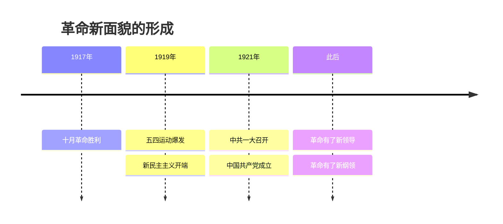

# 进入新民主主义革命崭新阶段与中国革命展现新面貌

## 进入新民主主义革命崭新阶段

中国旧民主主义革命屡遭失败，说明农民阶级和资产阶级都不能领导中国革命取得彻底胜利。五四运动中，中国工人阶级开始以独立的政治力量登上历史舞台，促进了马克思主义同中国工人运动相结合，为中国共产党的成立作了思想上、干部上的准备。

> [!IMPORTANT]
> ==五四运动是中国新民主主义革命的伟大开端==。判断革命性质，关键看领导阶级、指导思想和革命前途，不能只看它是否反对帝国主义和封建主义。

| 比较角度 | 旧民主主义革命 | 新民主主义革命 |
|---|---|---|
| 领导力量 | 主要是资产阶级 | 无产阶级及其政党 |
| 指导思想 | 资产阶级民主主义等 | 马克思列宁主义 |
| 革命前途 | 建立资产阶级共和国 | 经新民主主义走向社会主义 |
| 所属范畴 | 世界资产阶级革命的一部分 | 世界无产阶级社会主义革命的一部分 |

新民主主义革命仍然属于资产阶级民主革命，因为它担负反帝反封建的任务；其“新”不等于已经进入社会主义革命。

## 中国共产党成立与革命新面貌

1921年7月，中共一大在上海开幕，后转移到==浙江嘉兴南湖的一艘游船==上继续举行。大会通过《中国共产党第一个纲领》，确定党的名称为“中国共产党”，提出革命军队必须与无产阶级一起推翻资本家阶级的政权，承认无产阶级专政，援助工人阶级。

中国共产党的成立，使中国革命有了坚强领导力量、科学指导思想、新的奋斗目标和新的革命方法。党把马克思主义基本原理同中国具体实际相结合，深入工农群众，组织群众开展革命斗争。中国革命之所以能走上胜利发展道路，==最根本的原因是中国共产党的领导==。

> [!WARNING]
> 纲领规定的是“无产阶级专政”，不是“农民阶级专政”；会议转移地点是“嘉兴”，不是宁波、苏州。上海是最初开会地点，不能混为转移后的地点。

## 例题

**题目：** 五四运动标志着中国（　）的伟大开端。  
A. 新民主主义　B. 三民主义　C. 社会主义　D. 共产主义

**答案：A。** 解题时抓住“五四运动—工人阶级登上政治舞台—新民主主义革命开端”这条线索。五四运动并不等于社会主义制度建立，也不等于共产主义实现。
