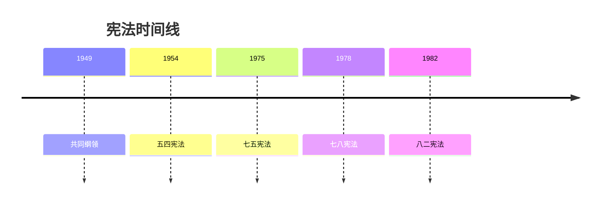
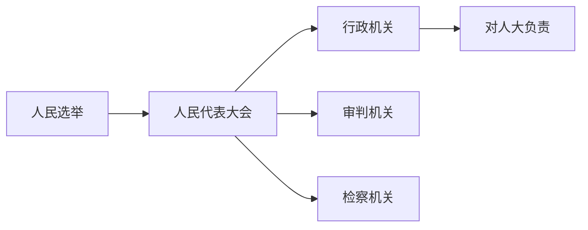

# 1954年《中华人民共和国宪法》的制定与一切权力归人民

## 它是什么

1954 年 9 月，第一届全国人民代表大会召开，通过《中华人民共和国宪法》，这就是“==五四宪法==”。它是新中国第一部正式宪法，规定国家 ==一切权力属于人民==，人民行使权力的机关是人民代表大会，确立根本政治制度为 ==人民代表大会制度==。

## 为什么需要

建国初期的《共同纲领》起临时宪法作用，但它不是正式宪法。随着政权巩固，需要一部正式宪法把人民主权制度化，为社会主义改造和建设提供根本法律依据。

## 怎么做：制度落地

人民选出人大代表 → 组成人民代表大会 → 产生政府、法院、检察院 → 这些机关对人大负责。

## 和相近概念的区别

| 概念 | 性质 | 是否正式宪法 |
|---|---|---|
| 共同纲领 | 临时宪法作用 | 否 |
| 五四宪法 | 首部正式宪法 | 是 |
| 八二宪法 | 现行宪法 | 是 |
| 根本制度 | 社会主义制度 | — |
| 根本政治制度 | 人民代表大会制度 | — |

> [!WARNING]
> 易错坑：不要把“社会主义制度”（根本制度）当成“根本政治制度”；根本政治制度是人民代表大会制度。

> [!WARNING]
> 易错坑：五星红旗是在政协一届全会上确定的，不是在第一届全国人民代表大会上。

## 常见坑与例题

> [!IMPORTANT]
> 首个国家宪法日是 ==2014 年 12 月 4 日==，不是 2013 年。

> [!NOTE]
> 若复习题给出“2013 年 12 月 4 日”，要注意区分“决定设立”与“正式首个”：首个宪法日应为 2014 年 12 月 4 日。

看看这道题：

> “五四宪法”确立的我国根本政治制度是（ ）。
> A. 人民代表大会制度 B. 社会主义制度 C. 政治协商制度 D. 民族区域自治制度

答案应为 ==A==。人民代表大会制度是政体；社会主义制度是根本制度；政治协商制度是基本政治制度；民族区域自治制度也是基本政治制度。这样分析，下次遇到同类选项就能分辨清楚。
