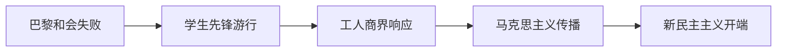

# 五四运动中青年的历史作用与创中国实践

## 五四运动：青年担当与新民主主义开端

当巴黎和会外交失败的消息传回国内，是谁最先走上街头？又是哪股力量将一场学生抗议转化为席卷全国的社会革命？理解五四运动，不能仅停留在“爱国”的情感层面，更要看清它如何重塑了中国革命的==领导阶级与指导思想==。

> [!IMPORTANT]
> 五四运动标志着中国==新民主主义革命的伟大开端==，其核心精神是爱国主义。

### 历史定位与青年实践

为什么五四运动被定义为“新”的起点？关键在于参与主体与思想武器的质变。不同于旧民主主义革命，五四运动中青年学生发挥了先锋作用，并推动了马克思主义与中国工人运动的结合。

在天津，影响最广泛、作用最突出的青年团体是==觉悟社==；而在湖南，毛泽东主编的《湘江评论》成为推动马克思主义传播的重要阵地。这些实践表明，先进青年已从单纯的反帝爱国走向了对社会根本改造的探索。

### 参与群体与易混辨析

复习时需精准区分运动的参与阶层与性质界定，这是选择题的高频陷阱。

| 对比维度 | 五四运动（1919） | 辛亥革命（1911） |
| :--- | :--- | :--- |
| 革命性质 | 新民主主义革命开端 | 旧民主主义革命 |
| 主力构成 | 学生、工人、商界人士 | 资产阶级、新军 |
| 指导思想 | 马克思主义开始传播 | 三民主义 |
| 群众基础 | 广泛的群众性反帝反封建 | 缺乏广泛群众动员 |

> [!WARNING]
> 农民==未直接参与==五四运动的主要斗争；英、法、美三国秘密出卖山东权益，中国作为战胜国却被排除在决策之外。

### 真题逻辑拆解

以“五四运动标志着什么伟大开端”为例，解题需抓住“新旧分界”这一题眼。既然选项中同时出现新民主主义、社会主义、共产主义，就要回溯时间线：1919年尚未建党（排除D），也未建立社会主义制度（排除C）；三民主义是旧民主主义旗帜（排除B）。因此，唯有==新民主主义==准确对应了无产阶级登上历史舞台这一质变节点。

> [!TIP]
> 记忆口诀：五四精神爱为核，新民开端工学商；天津觉悟湘评论，农未参与莫乱选。

掌握本节内容，不仅要记住“爱国、进步、民主、科学”的精神内涵，更要理解青年一代如何通过组织社团、创办刊物、深入工农，完成了从思想启蒙到社会实践的历史跨越，这正是《四史》学习中南邮学子应当汲取的奋进力量。
