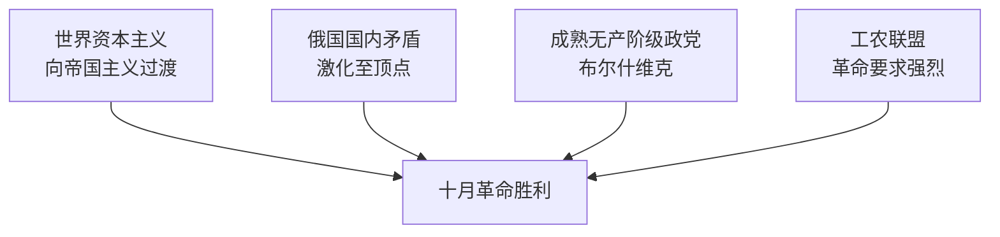

# 十月革命开辟人类历史新纪元的深刻启示

## 它是什么与为什么需要

十月革命是列宁和布尔什维克党领导的、人类历史上==第一次胜利的社会主义革命==。它不仅推翻了资产阶级临时政府，更实现了科学社会主义从理论到现实的伟大飞跃。

为什么俄国能率先跨越？这并非偶然，而是世界历史趋势与俄国特殊国情共振的结果。复习时不能只背“意义”，更要理解其作为“新纪元”起点的底层逻辑：它标志着世界现代史的主题正式转变为==社会主义与资本主义两种制度的斗争==。

> [!IMPORTANT]
> 核心定性：十月革命开辟了人类探索社会主义道路的新时代，使马克思列宁主义传遍世界，为殖民地半殖民地民族解放运动开辟了新曙光。

## 怎么做：革命胜利的双重条件

十月革命的成功，是外部时代背景与内部成熟条件共同作用的产物。我们可以通过以下结构把握这一因果链条：

从外部看，革命发生在资本主义固有矛盾激烈爆发、向世界社会主义过渡的大趋势下；从内部看，必须具备==成熟的无产阶级政党==以及受双重压迫、革命性最强的工人阶级及其同盟军农民。缺少任何一个环节，革命都无从谈起。

## 与相近概念的区别

考试中常将“十月革命”与“巴黎公社”或“二月革命”混淆，需精准区分：

| 比较维度 | 巴黎公社（1871） | 俄国二月革命（1917.3） | 十月革命（1917.11） |
| :--- | :--- | :--- | :--- |
| 性质 | 无产阶级专政首次尝试 | 资产阶级民主革命 | ==社会主义革命== |
| 结果 | 失败 | 推翻沙皇，建立临时政府 | 推翻临时政府，建苏维埃 |
| 理论实践 | 尚未有成熟政党领导 | 未解决土地与和平问题 | ==理论变为现实== |

> [!NOTE]
> 辨析关键：二月革命解决的是“反封建”问题，十月革命解决的才是“反资本主义、建立社会主义制度”的问题。只有十月革命才真正消灭了剥削制度。

## 常见的坑与真题解析

> [!WARNING]
> 易错点：误认为马克思主义诞生即等于实践成功，或混淆恩格斯、伯恩施坦等人的历史角色。马克思主义经典作家中，==最先将革命理论付诸实践并取得胜利的是列宁==。

**【真题示例】**
最先将马克思主义经典作家革命理论付诸实践的是（）。
A. 恩格斯  B. 列宁  C. 毛泽东  D. 伯恩施坦

**解析**：恩格斯是理论奠基人但未领导夺权；伯恩施坦是修正主义者；毛泽东领导中国革命晚于俄国。列宁领导十月革命，首次将科学社会主义从理论变为现实政权，故选 ==B==。此题直接对应“开辟新纪元”的核心内涵——==理论与实践的统一==。

> [!TIP]
> 记忆口诀：十月革命开新元，列宁实践谱新篇；两种制度争天下，马列光芒照人间。答题时紧扣“第一次胜利”“理论变现实”“鼓舞被压迫民族”三个得分点。
