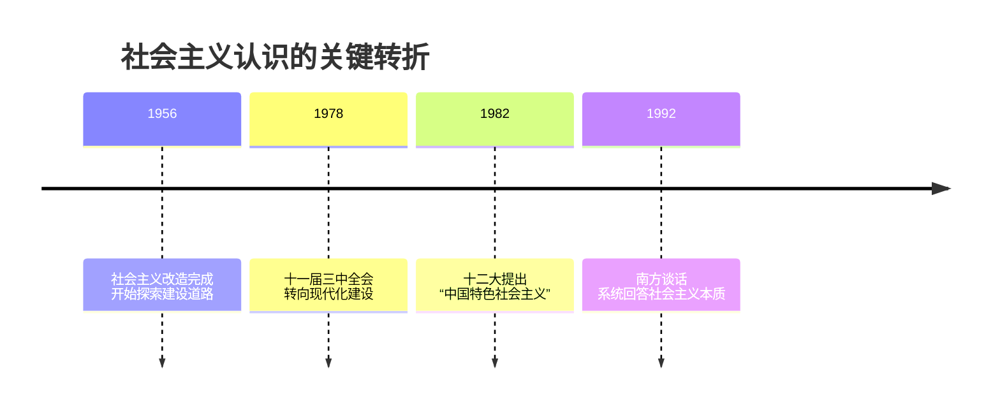
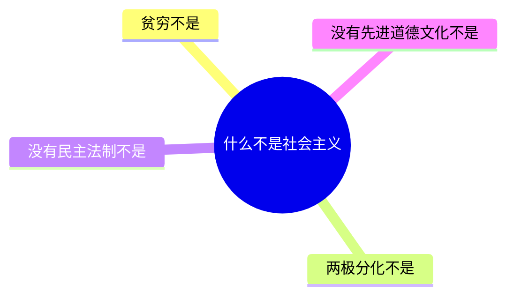
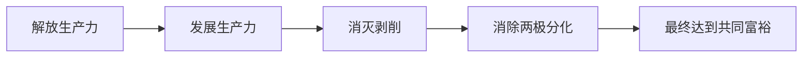

# “什么是社会主义、怎样建设社会主义”根本问题的提出

## 从“走自己的路”到“什么是社会主义”

1982年9月，邓小平在党的十二大开幕词中明确提出：

> “把马克思主义的普遍真理同我国的具体实际结合起来，走自己的道路，建设有中国特色的社会主义，这就是我们总结长期历史经验得出的基本结论。”

这句话看似朴素，实则回答了社会主义建设史上一个长期悬而未决的根本问题：==社会主义没有统一公式，必须从本国实际出发去探索“什么是社会主义、怎样建设社会主义”==。

### 为什么这个问题如此关键

在改革开放之前，社会主义建设曾长期受困于一个认识误区：将苏联模式当作社会主义的唯一标准，把计划经济、单一公有制等同于社会主义本身。由此带来两个方面的偏差：

| 错误倾向 | 表现 | 后果 |
|---------|------|------|
| 超越阶段 | 追求“一大二公”、跑步进入共产主义 | 脱离生产力实际，挫伤积极性 |
| 僵化教条 | 照搬苏联模式，排斥市场机制 | 经济缺乏活力，发展缓慢 |

> [!IMPORTANT]
> “什么是社会主义”问的是**本质**，“怎样建设社会主义”问的是**道路**。前者需要理论澄清，后者需要实践探索。邓小平的贡献在于：先破除“苏联模式=社会主义”的等式，再从中国实际出发重新作答。

### 回答的展开：从否定到肯定

对“什么是社会主义”的认识，经历了一个从“说不是什么”到“说清是什么”的过程。考题中常见的判断题——“贫穷不是社会主义”“两极分化不是社会主义”“没有民主与法制不是社会主义”“没有先进的道德文化不是社会主义”——正是这一否定式澄清的经典表述：

但仅仅说“不是什么”还不够。1992年南方谈话给出了正面回答：

> [!IMPORTANT]
> ==社会主义的本质，是解放生产力，发展生产力，消灭剥削，消除两极分化，最终达到共同富裕。==

这句话将**生产力**（解放和发展）与**生产关系**（消灭剥削、消除两极分化）统一起来，最终落脚于**共同富裕**这一价值目标。它既超越了“唯生产力论”，也超越了“唯生产关系论”。

### 与相近概念的区别

| 概念 | 内涵 | 易混点 |
|------|------|--------|
| 社会主义本质 | 解放和发展生产力 + 共同富裕 | 是**深层规定**，不直接等同于某项具体制度 |
| 社会主义特征 | 公有制为主体、按劳分配等 | 是本质在制度层面的**体现**，随阶段调整 |
| 社会主义模式 | 苏联模式、中国模式等 | 是**具体实现形式**，可借鉴但不可照搬 |

> [!WARNING]
> 高频易错判断题：“中国特色社会主义可以与科学社会主义基本原则相分离。”答案是**错误**。中国特色社会主义恰恰是==科学社会主义基本原则与中国实际相结合的产物==，分离了就不再是社会主义；但坚持基本原则不等于照搬某种具体模式。

### 一个判断小例题

**题目**：判断正误——“社会主义的本质是解放生产力，发展生产力，消灭剥削，消除两极分化，最终达到共同富裕。”

**解析**：这句话完整对应邓小平南方谈话的“五句概括”。五个分句环环相扣：

其中“消灭剥削”和“消除两极分化”是**生产关系的调整**，“最终达到共同富裕”是**根本目的**。因此表述正确。常见丢分点是漏看“最终”二字——共同富裕是一个动态渐进过程，不是同步富裕，也不是平均主义。
