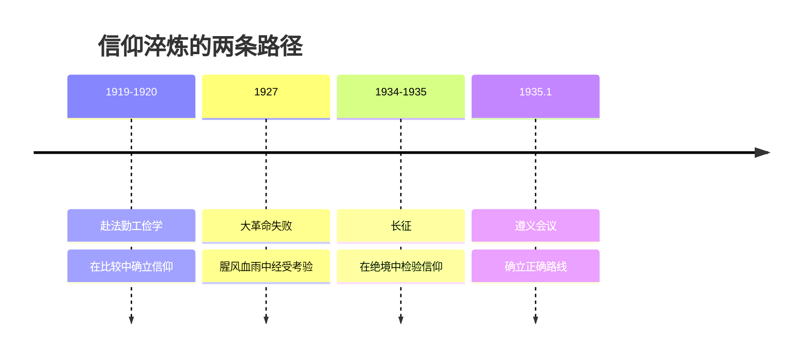

# 腥风血雨中共产党人对信仰的坚守

## 腥风血雨中，他们怎样守信仰？

1927 年大革命失败后，中国共产党陷入前所未有的白色恐怖之中。据不完全统计，仅 1927 年到 1928 年上半年，就有三万多共产党员和革命群众被杀害。在这样的腥风血雨中，是选择叛变求生，还是坚守信仰慷慨赴死？这种极端考验，将信仰从一种口头表态，逼成了一种需要用生命来回答的终极选择。

### 信仰不是顺境里的口号

大革命时期，国共合作看似一片繁荣，许多人口中的“信仰”未经生死检验。真正的分水岭出现在“四一二”“七一五”反革命政变之后。电影《大浪淘沙》生动再现了这一幕：同是怀着救国理想的四位青年，在革命低潮时做出了不同抉择——有的叛变，有的消沉，而靳恭绶和顾达明则==在革命最危险的时刻选择加入中国共产党==。这种“逆向选择”，恰恰是信仰成色的试金石。

> [!IMPORTANT]
> 信仰的坚守往往不在高歌猛进的顺境，而在流血牺牲的逆境。判断一个人是否真有信仰，要看他在没有利益回报、甚至要付出生命代价时，还信不信、做不做。

### 两条信仰的锻造之路

20 世纪初，中国先进分子主要通过两条路径完成信仰的淬炼：

**赴法勤工俭学：在比较中确立信仰**
1919 年至 1920 年，近 2000 名中国青年赴法勤工俭学。他们白天在工厂做工，夜晚学习研究，亲身体验资本主义社会的劳资矛盾，同时大量阅读马克思主义著作。蔡和森“猛看猛译”《共产党宣言》，周恩来在旅欧期间写下大量通讯向国内介绍马克思主义。他们的收获是立体的：

> [!NOTE]
> **赴法勤工俭学的主要收获（考点）**
> - ==确立了马克思主义信仰==——通过实地比较，在各种主义中认定了马克思主义
> - ==积蓄了革命力量==——培养了一大批后来党的核心骨干（周恩来、邓小平、蔡和森等）
> - ==实践了革命运动==——在法国组织华工斗争、反对中法秘密借款等
> - ==储存了革命资金==——勤工所得部分用于支持革命活动

**长征：在绝境中检验信仰**
1934 年第五次反“围剿”失败，中央红军被迫长征。湘江战役后，八万余红军锐减至三万余人。正是在这生死存亡关头，==遵义会议确立了毛泽东同志为代表的马克思主义正确路线==，挽救了党、挽救了红军、挽救了革命。

### 长征精神的信仰底色

长征不只是一次军事转移，更是一场信仰的远征。红军平均每天行军 37 公里，翻越 18 座大山、渡过 24 条大河，平均每 300 米就有一名战士牺牲。是什么支撑他们走完两万五千里？

> [!TIP]
> **长征精神的四个维度（记忆口诀：理独顾，理想不退）**
> - ==崇高理想、坚定信念==——没有信念就不会出发，没有信仰就走不到底
> - ==独立自主、实事求是==——从盲从共产国际到立足中国实际，遵义会议是关键转折
> - ==不怕艰难险阻、不怕流血牺牲==——血染湘江、飞夺泸定桥、翻雪山过草地
> - ==顾全大局、紧密团结==——张国焘分裂图谋的失败，证明了团结就是生命

### 雨花台：信仰者的精神地标

矗立在==南京==城南的雨花台，自 1927 年至 1949 年，约有近十万革命烈士在此殉难。他们中许多人出身富裕家庭、受过良好教育，完全可以过优渥的生活，却选择了一条“死路”。恽代英在狱中写下“已摈忧患寻常事，留得豪情作楚囚”，邓中夏就义前说“就是把骨头烧成灰，我邓中夏还是共产党员”。

### 错题避坑指南

> [!WARNING]
> **常见错误辨析**
> 1. 赴法勤工俭学的收获中，“储存了革命资金”容易被误认为不选——但它是正确答案之一，勤工所得确实有部分用于革命活动。
> 2. 确立毛泽东正确路线的会议是==遵义会议==，不是黎平会议（通道转兵）、两河口会议（确定北上方针）或泸定会议。
> 3. 青年学习“最重要”的是学好书本知识？这是典型的干扰项——学知识重要，但==树立远大理想、坚定信仰、学习“四史”才是根本方向==，切忌本末倒置。

> [!CAUTION]
> 不要误以为信仰坚守只是革命年代的命题。和平时期的选择题不再“流血”，但依然在考：当集体利益与个人利益冲突时怎么选？当“躺平”成为潮流时信不信理想？==每一个时代都有属于它的“腥风血雨”，考验的形式变了，信仰的成色不变。==
