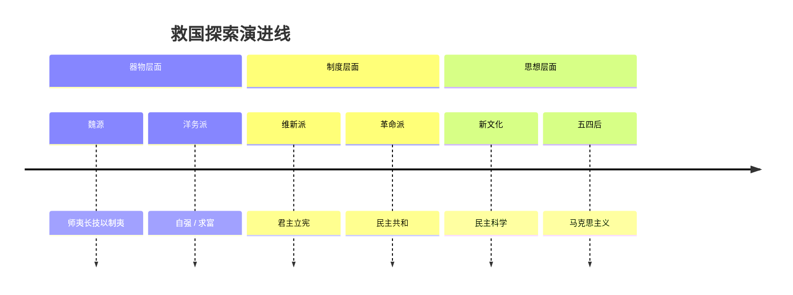

# 近代中国先进分子艰难探索救国救民之路

近代中国先进分子为何在屡战屡败后仍不停止探索？当器物、制度层面的学习接连碰壁，救国之路究竟该向何处去？这不仅是历史之问，更是理解社会主义为何成为中国最终选择的关键逻辑起点。

## 探索历程与核心主张

> [!IMPORTANT]
> 近代救国探索呈现==由表及里、层层深入==的演进规律，从技术模仿走向制度变革，最终转向思想与社会革命。

“师夷长技以制夷”由魏源在《海国图志》中提出，强调学习西方军事技术以抵御侵略，“师夷”是手段，“制夷”是目的。洋务运动在此思想指导下展开，但甲午战败宣告其破产。此后“西学东渐”加速，康梁维新、辛亥革命相继登场，却未能改变中国半殖民地半封建的社会性质。直到十月革命爆发，李大钊等先进分子看到“人类觉醒的新纪元”，马克思主义才开始在中国广泛传播，为救国提供了全新方案。

## 易混概念辨析

> [!WARNING]
> 洋务运动口号前后有别，且与魏源思想不可混淆，这是高频错题点。

| 概念 | 提出者/时期 | 核心内容 | 常见误区 |
| :--- | :--- | :--- | :--- |
| 师夷长技以制夷 | 魏源（鸦片战争后） | 学西方军事技术以御侮 | 误认为是洋务运动后期口号 |
| 自强 | 洋务运动前期 | 兴办军事工业 | 与“制夷”直接等同 |
| 求富 | 洋务运动后期 | 兴办民用工业 | 误记为“师夷长技以制夷” |

## 真题避坑示例

> [!TIP]
> 做多选题时，注意区分“参与国”与“受害国”，题干问的是决策方而非相关方。

以1919年巴黎和会山东问题为例：题目问“哪三国秘密决定将德国在山东权利让给日本”，正确选项是==英、法、美==（ABC）。中国虽是战胜国且为当事方，但被排除在决策之外，属于受害国而非决策国。若误选D，即混淆了帝国主义分赃会议的本质与中国的外交地位。此题印证了“西方道路在中国行不通”的历史判断，也解释了为何先进分子最终转向社会主义探索。

> [!NOTE]
> 本知识点归属“社会主义发展史”，重点不在罗列史实，而在理解==资本主义方案失败如何倒逼社会主义成为历史必然==。复习时应紧扣“探索—失败—转向”的逻辑链，避免陷入纯事件记忆。
