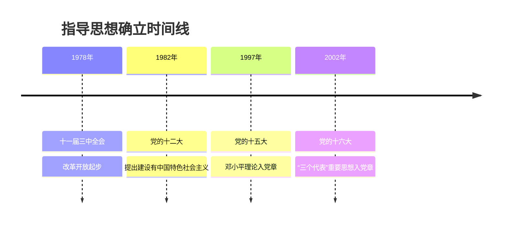

# 党的十五大召开与邓小平理论确立为指导思想

## 会议概况与历史方位

==1997年9月，党的十五大在北京召开==。会议处在改革开放和现代化建设承前启后的重要节点：既要回答邓小平逝世后“举什么旗、走什么路”的问题，也要把改革开放以来形成的理论成果确立为全党行动指南。十五大通过的党章修正案，把==邓小平理论同马克思列宁主义、毛泽东思想一道确立为党的指导思想==。

## 为什么确立邓小平理论

邓小平理论围绕“什么是社会主义、怎样建设社会主义”，系统回答了社会主义发展道路、发展阶段、根本任务、发展动力、外部条件、政治保证、战略步骤、领导力量和依靠力量等问题。它把全党对社会主义的认识提高到新的科学水平，为坚持党的基本路线、推进改革开放提供了理论依据。

> [!IMPORTANT]
> 十五大的核心考点是：==邓小平理论被确立为党的指导思想并写入党章==，不是“三个代表”重要思想，也不是科学发展观。

## 与相近考点的区别

| 会议 | 时间 | 与本知识点相关的结论 |
|---|---:|---|
| 党的十二大 | 1982年 | 提出“建设有中国特色的社会主义” |
| 党的十四大 | 1992年 | 明确建立社会主义市场经济体制的改革目标 |
| 党的十五大 | 1997年 | 邓小平理论确立为党的指导思想并写入党章 |
| 党的十六大 | 2002年 | “三个代表”重要思想确立为党的指导思想并写入党章 |

> [!WARNING]
> “提出理论”“系统阐述”“确立为指导思想”是不同表述，不能混用。看到“邓小平理论＋指导思想＋写入党章”，应锁定==党的十五大==；看到“‘三个代表’重要思想＋指导思想”，应锁定==党的十六大==。

## 十五大的其他重要内容

十五大还提出党在社会主义初级阶段的基本纲领，明确建设有中国特色社会主义的经济、政治、文化的基本目标和基本政策；强调公有制为主体、多种所有制经济共同发展，是社会主义初级阶段的一项基本经济制度；提出依法治国，建设社会主义法治国家。这些内容共同说明，十五大不仅完成了理论旗帜的确立，也对跨世纪发展作出部署。

> [!TIP]
> 记忆可抓“十五邓、十六三”：十五大对应邓小平理论，十六大对应“三个代表”重要思想。选择题再核对“写入党章”“指导思想”等关键词。

## 例题辨析

**题目：**（　）把“三个代表”重要思想和马克思列宁主义、毛泽东思想、邓小平理论一道确立为中国共产党的指导思想。  
A. 党的十二大　B. 党的十四大　C. 党的十六大　D. 党的十八大

**正确解答：**选 **C**。题干问的是“三个代表”重要思想，对应2002年党的十六大；若把题干换成“邓小平理论确立为党的指导思想并写入党章”，才选党的十五大。解题时先识别理论名称，再匹配会议，不能因选项中出现“邓小平理论”而误选十五大。
