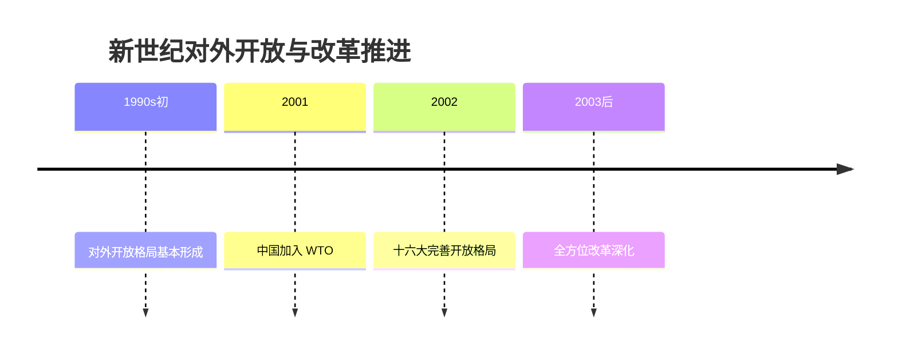

# 新世纪新阶段全方位改革开放的深入推进

## 从“打开国门”到“全面融入”

为什么要专门把新世纪的头十年单列出来？因为中国在 1992 年确立社会主义市场经济改革目标后，经过了九十年代的“闯关”，到 2001 年前后站上了一个关键节点：对内，改革需要从“放权让利”转向“制度定型”；对外，是否融入全球多边贸易体系，决定了中国能否真正成为世界经济循环中的一环。

2001 年 11 月，中国正式加入世界贸易组织（WTO）。这不是一次普通的关税调整，而是一套规则体系的接入。WTO 的宗旨可以概括为三个方向：扩大货物与服务的生产和贸易、建立一体化的==多边贸易体制==、保证发展中国家贸易与经济的发展。注意：WTO 的目标是**降低**而非提高贸易壁垒，这是选择题反复考的点。入世本身，表明中国主动融入世界经济体系、承担更多国际义务的基本态度——判断题中这个说法是成立的。

## 入世前后的经济地位变化

入世前后，中国经济总量在世界上的位置常被拿来命题：==2001 年，我国国内生产总值排世界第六位==。这个数字本身并不“漂亮”，但它说明的是起点：一个总量第六、人均远低于平均水平的大国，选择用开放倒逼改革。此后十多年的增长曲线，正是入世红利逐步释放的过程。

## 全方位改革：不只是“开放”

入世是“对外开放”，但考纲里更强调“对内改革”的系统性。新世纪围绕==建立社会主义市场经济体制==的目标，改革涵盖了四大领域：

| 改革领域 | 核心任务 |
|---|---|
| 金融体制 | 国有银行股份制改造、汇率形成机制改革 |
| 分配制度 | 按劳分配与按生产要素分配结合 |
| 国有资产管理体制 | 国资委设立，政企分开、政资分开 |
| 国家税收制度 | 分税制优化、出口退税机制调整 |
| 国家宏观调控机制 | 从直接行政调控转向经济、法律手段为主 |

这四到五项改革，多选题的正确选项是**全选**。记忆时可以用“金、分、资、税、宏”五字串联。

## 一个容易被忽视的“坑”

判断题中有一个高频陷阱：**“2002 年党的十六大提出要构建全方位、多层次、宽领域的对外开放格局”**——答案是**错误**。原因在于：这一格局在 ==20 世纪 90 年代初已经基本形成==，十六大是提出“完善”而非“构建”。“形成”与“完善”一字之差，决定了对错。

> [!WARNING]
> 时间线极易混淆：1990s 初“基本形成”，2001 年“加入 WTO”，2002 年十六大“完善格局”。命题人最喜欢把“完善”偷换成“提出”或“构建”。

> [!TIP]
> 记忆口诀：“九零成形，零一入世，零二完善”。WTO 宗旨记“降壁垒”；改革五方面记“金分资税宏”。

## 用一个例子收束

以多选 16 为例：如果题干问“新世纪围绕建立社会主义市场经济体制目标的全方位改革包括哪些”，你应迅速反应——金融体制、分配制度、国有资产管理体制、国家税收制度、国家宏观调控机制，选项中出现其中任何四个，直接全选即可。这类题考的不是深度，而是“体系感”：改革不是单点突破，而是一组制度相互咬合。
