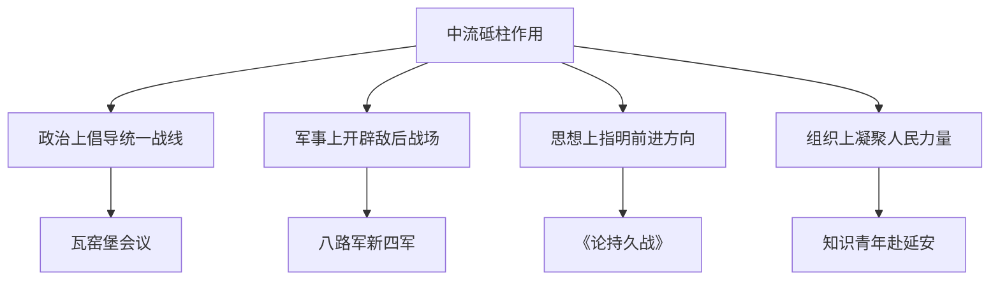

# 全民抗战时期中国共产党发挥中流砥柱作用的依据

## 它是什么

"全民抗战时期中国共产党发挥中流砥柱作用"是《四史》党史部分的核心论断之一。"中流砥柱"本指黄河急流中的砥柱山，比喻在艰难环境中能起到支撑全局作用的力量。这一知识点要求理解：在 1937—1945 年全民族抗战中，中国共产党为什么是团结抗战的==核心领导力量==，而不只是"参与者之一"。

## 为什么需要

考题常从"会议""统一战线""知识青年奔赴延安""抗战歌曲"等具体场景切入，检验你是否能把史实串成"中流砥柱"的完整论证链。光背结论不行，得会用史实做依据。

## 怎么做：四条主要依据

- **政治上**：率先提出并推动建立 ==抗日民族统一战线==。1935 年 12 月的==瓦窑堡会议==确立了这一政策（注意：不是洛川会议，洛川会议是 1937 年制定全面抗战路线）。
- **军事上**：八路军、新四军深入敌后，开辟广大的敌后战场，与正面战场相互配合，长期抗击大量日军和几乎全部伪军。
- **思想上**：发表《论持久战》，驳斥"亡国论""速胜论"，为全民族抗战指明方向。
- **组织上**：以延安为中心吸引大批知识青年（华侨、官僚家庭、农民地主、知识分子家庭出身都有），通过八路军办事处、中共邀请、报刊招生简章、社会名人介绍等途径汇聚，形成抗战骨干。

## 与相近概念的区别

| 概念 | 时间 | 要点 | 易混处 |
|---|---|---|---|
| 瓦窑堡会议 | 1935.12 | 确立抗日民族统一战线政策 | ≠ 洛川会议 |
| 洛川会议 | 1937.8 | 制定全面抗战路线 | ≠ 瓦窑堡 |
| 遵义会议 | 1935.1 | 挽救党、挽救红军的转折 | 与抗战无直接关系 |
| 八七会议 | 1927.8 | 土地革命、武装反抗国民党 | 时期不同 |

## 常见的坑

> [!WARNING]
> - 抗战歌曲"均为当时的电影插曲"是错误说法，很多来自街头、剧团、歌曲集，并非都是电影插曲。
> - "中流砥柱"≠"唯一力量"，国民党正面战场也有作用，党是团结抗战的**中坚**，不能写成"唯一"。
> - 知识青年赴的是==延安==，不是北平、南京、西安（西安只是中转）。

> [!TIP]
> 记忆口诀：**瓦窑堡定统战，洛川定路线，持久战定方向，青年赴延安定人心。**

## 例子：用史实答一道判断题

**题**：共产主义不仅是中国共产党人的信仰，更是中国人民共同奋斗的力量之源。（ ）

**分析**：判断其表述是否符合"中流砥柱"的逻辑。中国共产党以共产主义为信仰，同时以抗日民族统一战线团结全国人民，使信仰成为共同奋斗的凝聚力，故表述成立。

**答案**：√。共产主义信仰通过党的组织与政策，转化为全民族抗战的精神动力，这正是中流砥柱作用在思想层面的体现。
