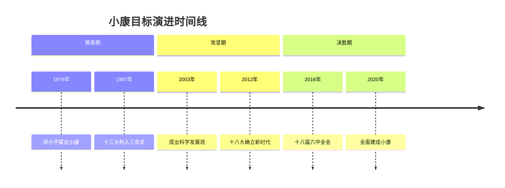

# 全面建设/建成小康社会目标的确定与演进

## 概念溯源与战略定位

提到“小康”，你是否只想到2020年的脱贫成就？其实它经历了从文化理想到国家战略的漫长演进。“小康”一词最早见于《诗经》，意指百姓劳作不休、期盼安居乐业。但真正将其引入现代化建设目标的，是==邓小平同志==。

> [!IMPORTANT]
> 核心考点：第一个把“小康”引入奋斗目标的是邓小平；党的十三大正式将其列为“三步走”战略的第二步目标。

这一概念解决了改革开放初期“现代化标准如何中国化”的问题。它将抽象的经济指标转化为人民群众可感可知的生活愿景，成为凝聚共识的战略抓手。

## 从“总体”到“全面”的质变

进入新世纪，我们实现了“总体小康”，但这是否意味着目标已经达成？答案是否定的。总体小康具有==低水平、不全面、发展很不平衡==的特征。为此，党提出了科学发展观（十六届三中全会），推动目标向“全面建成小康社会”升级。

党的十八大标志着中国特色社会主义进入新时代，其鲜明特征就是==决胜全面建成小康社会==。2016年十八届六中全会明确习近平总书记的核心地位，为这一目标的实现提供了根本政治保证。

## 易混概念辨析与避坑指南

复习时最容易混淆的是“总体小康”与“全面小康”的区别，以及关键会议对应的历史贡献。

| 维度 | 总体小康 | 全面小康 |
| :--- | :--- | :--- |
| 水平 | 低水平 | 高水平 |
| 覆盖面 | 不全面 | 惠及十几亿人口 |
| 均衡度 | 发展不平衡 | 城乡区域协调发展 |
| 对应阶段 | 20世纪末 | 2020年节点 |

> [!WARNING]
> 判断题高频陷阱：“总体小康是高水平的、全面的、更均衡的小康”是==错误==的。务必记住总体小康的三大负面特征。

> [!TIP]
> 选择题解题锚点：看到“首次引入”选邓小平；看到“三步走第二步”选十三大；看到“科学发展观提出”选十六届三中全会；看到“新时代/决胜小康”选十八大。

## 真题逻辑验证

以课件中的判断27题为例：“小康社会一词最早见于《诗经》”。这道题考查的是词源而非现代政治概念。虽然现代小康目标是邓小平提出的，但词汇本身确实源于古籍，因此答案为正确。这提醒我们：==区分“词语出处”与“战略目标提出者”==是避免张冠李戴的关键。

从2020年到2035年，我国将在全面建成小康社会基础上，基本实现社会主义现代化。理解这一演进脉络，不仅是应对考试的需要，更是读懂中国式现代化逻辑的起点。
