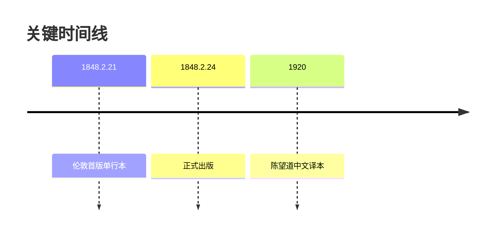

# 《共产党宣言》的发表标志着科学社会主义的诞生

> [!IMPORTANT]
> 1848年2月，马克思和恩格斯共同起草的《共产党宣言》正式出版，==标志着科学社会主义的诞生==。

## 它是什么

要理解这个知识点，我们先问自己两个问题：空想社会主义为什么“空”？无产阶级的斗争怎样才能从自发走向自觉？

答案在于**科学理论**的指导。《共产党宣言》是马克思、恩格斯为世界上第一个共产党组织——共产主义者同盟起草的纲领，也是国际共产主义运动的第一个纲领性文献。它将社会主义从空想变成了科学，系统阐述了无产阶级解放运动的发展规律。

> [!NOTE]
> 1920年由陈望道从日文译成的中文版在上海出版。至今，《共产党宣言》已成为传播最广、影响最大的马克思主义文献。

## 为什么需要它

在《共产党宣言》发表前，工人运动缺乏科学指南。科学社会主义理论的创立，回答了社会主义的本质、性质、特征和发展规律，是人类关于社会发展理论的最新成果。一百多年来，正是在这一理论指导下，世界无产阶级和劳动人民进行了人类历史上最伟大的社会主义革命和建设实践。

## 核心人物与怎么做

这份纲领由两位伟大导师共同缔造：

| 人物 | 身份定位 |
| :--- | :--- |
| **卡尔·马克思** | 马克思主义创始人之一，第一国际的组织者和领导者，全世界无产阶级和劳动人民的革命导师 |
| **弗里德里希·恩格斯** | 德国思想家、哲学家、革命家，马克思主义创始人之一，全世界无产阶级和劳动人民的伟大导师 |

他们通过剖析资本主义基本矛盾，论证了“资产阶级的灭亡和无产阶级的胜利是同样不可避免的”，从而为共产主义者同盟确立了科学的行动纲领。

## 相近概念的区别与常见坑

考试中极易混淆“标志”类考点以及具体思想的首次提出位置。

> [!WARNING]
> 易错坑：《共产党宣言》的发表既标志着==科学社会主义的诞生==，也标志着==马克思主义的诞生==。两者在此处指向同一历史事件，但“科学社会主义”侧重理论体系，“马克思主义”侧重整体学说。

> [!CAUTION]
> 高危误区：“无产阶级专政”的思想是在哪里提出的？很多同学习惯性选《共产党宣言》，这是错的！

我们来看一道真题：

**【例题】** 马克思在下列哪份资料中提出无产阶级专政的思想？（）
A. 《共产党宣言》
B. 《马克思恩格斯文集》（第三卷）
C. 《苦难辉煌》
D. 致魏德迈的信

**解析：**
- A项：《共产党宣言》是科学社会主义诞生的标志，阐述了阶级斗争等基本原理，但并非首次明确提出“无产阶级专政”概念的地方。
- B项、C项：均为干扰项。
- D项：马克思在1852年《致魏德迈的信》中，明确概括了自己对阶级斗争学说的新贡献，其中就包括证明了“阶级斗争必然导致无产阶级专政”。

**答案：D**

> [!TIP]
> 记忆口诀：==“宣言”定科社（科学社会主义），“信件”提专政（致魏德迈的信）==。遇到“无产阶级专政”找“致魏德迈的信”，遇到“科学社会主义/马克思主义诞生”找“《共产党宣言》”。
