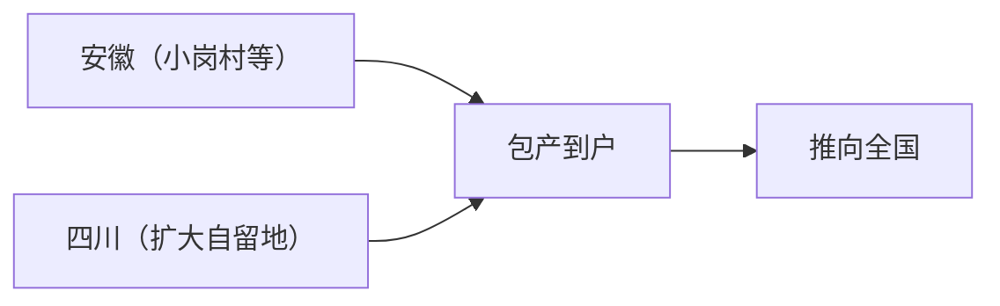
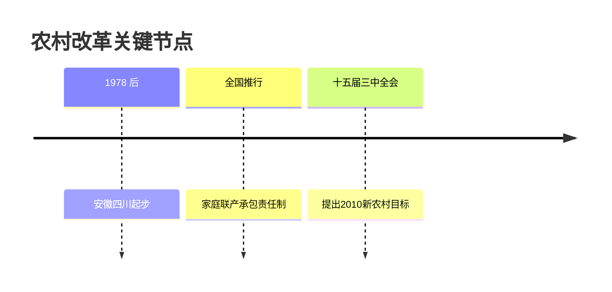

# 家庭联产承包责任制与农村改革率先取得突破

## 它是什么

先看一道判断题：农村改革的突破口是建立以==包产到户、包干到户==为主要形式的家庭联产承包责任制——答案是√。所以你要先记住：**突破口就是它，形式是包产到户、包干到户**。

那它到底是什么？简单说：土地仍归集体所有，但把土地承包给农户家庭经营，“交够国家的、留足集体的、剩下都是自己的”。它不是把地分掉私有化，而是==经营权变了、所有权没变==。

> [!IMPORTANT]
> 家庭联产承包责任制 = 集体所有 + 家庭承包经营；==不是土地私有==。

## 为什么需要

改革初期农村面临两个突出问题（见多选）：A“政社合一”人民公社体制亟待改革；B 两亿多农民温饱还没解决。也就是：

- 人民公社“政社合一”，干活大呼隆、分配平均主义，农民没积极性；
- 很多人吃不饱饭，必须先把农业搞上去。

> [!NOTE]
> 多选 7 里 C“土地流转纠纷”、D“青少年弃学打工”都不是改革初期突出问题，别被现代农村现象带偏。

## 怎么做：从哪里突破

多选 6 考“首先在农村取得突破”，选项里答案是 **A 安徽、D 四川**。你可以这样记地图：

安徽、四川等地率先开启农村改革，大潮随后席卷全国。

## 和相近概念的区别

用一张表把易混点钉死：

| 概念 | 土地所有权 | 经营主体 | 分配方式 |
|---|---|---|---|
| 人民公社旧体制 | 集体 | 集体统一劳动 | 平均主义工分 |
| 家庭联产承包责任制 | 集体 | 农户家庭 | 交够/留足/剩下自己 |

> [!WARNING]
> 常见坑：以为“包产到户=分田到户=私有制”。错！只是==承包到户==，所有权仍集体。

## 一个算对了的例子

回到多选 6：题干“以（ ）等地率先开启的农村改革大潮席卷全国”，你先问自己：改革先从哪两个省点火？——安徽、四川。于是选 **AD**。福建、甘肃不是起步代表。

> [!TIP]
> 记忆口诀：**“安四起，包到户；所有权，仍集体”**。

## 时间线与后续目标

十五届三中全会通过的决定，第一次提出到 2010 年建设有中国特色社会主义新农村的奋斗目标（判断题 41 为√）。它说明：农村改革不是一步到位，而是从==解决温饱==走向==新农村建设==的长过程。
